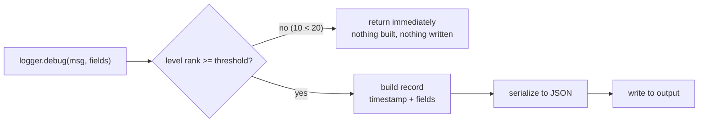
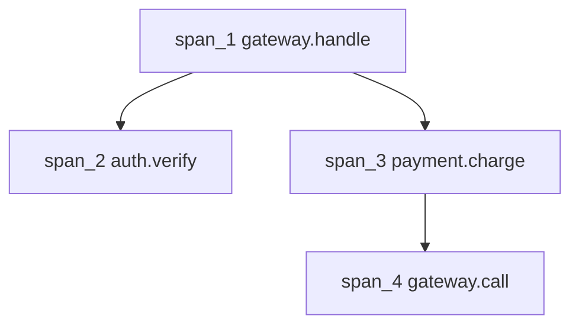
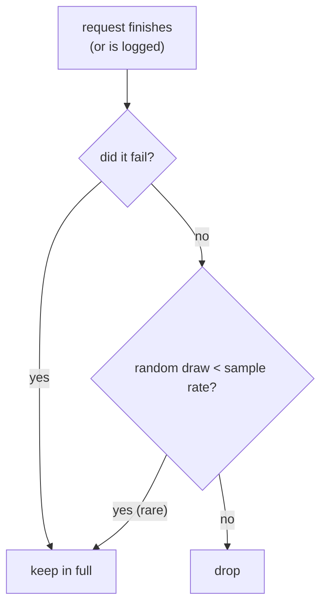

import Scenario from "../../../components/Scenario.astro";
import LevelIntro from "../../../components/LevelIntro.astro";
import Checkpoint from "../../../components/Checkpoint.astro";
import PracticeCheck from "../../../components/PracticeCheck.astro";

export const unit = {
  track: "systems",
  unitSlug: "logging",
};

<Scenario label="Even with structured logs and trace IDs, one payment endpoint is drowning the log storage bill.">
  <Fragment slot="facts">
    <div class="not-prose flex flex-col gap-2 text-sm text-slate-700 dark:text-slate-300">
      <div class="flex items-center gap-1.5"><span>📈</span> <strong>Volume</strong> — payment-service alone logs 40M lines/day once structured logging + tracing shipped</div>
      <div class="flex items-center gap-1.5"><span>💸</span> <strong>Cost</strong> — log storage bill triples in a month, mostly from routine successful requests</div>
      <div class="flex items-center gap-1.5"><span>🎯</span> <strong>Actual need</strong> — every failed request in full detail, but only a small, representative slice of the successful ones</div>
    </div>
  </Fragment>

Structured logging and trace propagation solve the Scenario from L1
and L2 — an engineer can now find one request's full story instantly.
But logging _everything_, for _every_ request, at full detail turns
into its own problem once volume is real: payment-service alone
produces 40 million structured log lines a day, and the storage bill
triples in a month, mostly from routine successful requests nobody
ever queries. **The team still needs every failing request captured
in full. What has to change so 40M lines/day doesn't mean 40M lines
stored?**

</Scenario>

<LevelIntro
  items={[
    "Why level filtering happens before formatting",
    "How a span tree is reconstructed from parent references",
    "Sampling that keeps every failure but thins out the rest",
  ]}
/>

## Level filtering: drop it before you pay to format it

**Why does a logger check the level first, before building the log
record?** Because building the record (timestamp, merging fields,
serializing to JSON) is the expensive part, and a `debug` line that is
about to be discarded shouldn't cost any of it:



| Level | Rank | Written when threshold is `info` (20)? |
| ----- | ---- | -------------------------------------- |
| debug | 10   | No, dropped at the first check         |
| info  | 20   | Yes                                    |
| warn  | 30   | Yes                                    |
| error | 40   | Yes                                    |
| fatal | 50   | Yes                                    |

The whole mechanism is one comparison placed in front of all the work:

```js
if (LEVELS[level] < threshold) return; // before any formatting
```

At millions of `debug` calls per minute, serializing then discarding is
real CPU overhead; the early return is why leaving debug calls in the
code is cheap while the threshold is `info`.

<Checkpoint question="A team leaves `logger.debug(JSON.stringify(bigObject))` in a hot path with the threshold at `info`. The line never appears in the output. Is it free?">

No. The logger's early return only protects work the logger does. The
caller already ran `JSON.stringify(bigObject)` to build the argument,
before the logger could look at the level. The filter saves the
formatting inside the logger; it can't save work the caller did first.
That is why hot paths pass raw fields (or a lazy callback) and let the
logger decide whether to serialize.

</Checkpoint>

<PracticeCheck
  track={unit.track}
  unitSlug={unit.unitSlug}
  topicId="level-filtering"
/>

## Span trees: parent references are the whole mechanism

**How does a trace viewer draw nested bars when each service only
reports its own span?** Every span is a small record, and the nesting is
rebuilt purely from the parent reference each one carries:

| spanId | parentSpanId | name           | traceId    |
| ------ | ------------ | -------------- | ---------- |
| span_1 | _(none)_     | gateway.handle | trace_8841 |
| span_2 | span_1       | auth.verify    | trace_8841 |
| span_3 | span_1       | payment.charge | trace_8841 |
| span_4 | span_3       | gateway.call   | trace_8841 |



Nothing is implicit: some mechanism must carry the current span's ID
across every call boundary, whether an explicit argument, an HTTP header
between services, or a runtime facility like Node's `AsyncLocalStorage`
inside one process. It is the same relationship a call stack has, made
durable instead of vanishing when the function returns.

<Checkpoint question="Two services, A and B, both call a shared database helper for the same request, each producing their own span. If both spans are given the same parentSpanId by mistake, what does the resulting trace look like, and is it wrong in a way that would mislead someone debugging?">

It looks like both database calls happened as direct children of the
same parent, siblings of each other, when in reality one happened
inside service A's own span and the other inside service B's. The
timeline would still show two database calls and roughly correct
durations, so it's not obviously broken, but it would misrepresent
_which service_ made which call, which matters exactly when the
debugging question is "which service is slow" or "which service made
a redundant duplicate call." A span tree is only as trustworthy as
its parent references are accurate; a wrong parent doesn't crash
anything, it just quietly tells the wrong story.

</Checkpoint>

<PracticeCheck
  track={unit.track}
  unitSlug={unit.unitSlug}
  topicId="span-tree"
/>

## Sampling: keeping every failure, thinning the rest

**How do you cut 40M lines/day without losing the failures that
actually matter?** Keep everything that's interesting, thin out
everything that's routine:



This is a **hybrid**: routine requests are sampled at a fixed rate, but
a failure is always kept, because by the time it's logged its outcome is
already known and nothing has to be buffered to find out.

**Head sampling** decides at the start of a request, before its outcome
exists, by fixed rate. **Tail sampling** waits until the request
finishes and then decides from the real outcome (slow? errored?), which
is more accurate but needs every in-flight trace held in memory until it
completes.

| Strategy      | Decides when                       | Keeps failures? | Cost                                              |
| ------------- | ---------------------------------- | --------------- | ------------------------------------------------- |
| No sampling   | n/a, logs everything               | Always          | Highest storage, simplest setup                   |
| Head sampling | At request start, by fixed rate    | Only by luck    | Cheap, but a rate too low can lose real failures  |
| Tail sampling | After request finishes, by outcome | Always          | Accurate, but must buffer every in-flight request |

A subtlety with traces: if one service samples a request in and another
samples it out independently, the trace has holes. The sampling decision
is made once and propagated with the trace ID, so every service keeps or
drops the same request together.

<Checkpoint question="With a 1% head-sampling rate and no special handling for errors, roughly how likely is it that one specific failed request has its logs kept?">

About 1%. Head sampling doesn't know the request will fail, so the
failure is thinned out exactly like a success. That is why the hybrid
always keeps errors: the failures are the entire reason logs exist, and
a fixed rate would throw away 99 out of every 100 of them.

</Checkpoint>

<PracticeCheck
  track={unit.track}
  unitSlug={unit.unitSlug}
  topicId="sampling-strategies"
/>

## The worked example is a case, not the whole territory

Everything above used one checkout, one payment service, one 2.1% error
rate. Try changing the facts. What if the failures were 30% of traffic
during an outage: does "always keep errors" still save money, or does the
bill spike exactly when you can least afford it? What if the bad requests
are not errors at all but just slow (a 5-second success)? A fixed error
check would miss them, and that is the case tail sampling by latency
exists for. Work out which sampling rule you'd pick for each.
