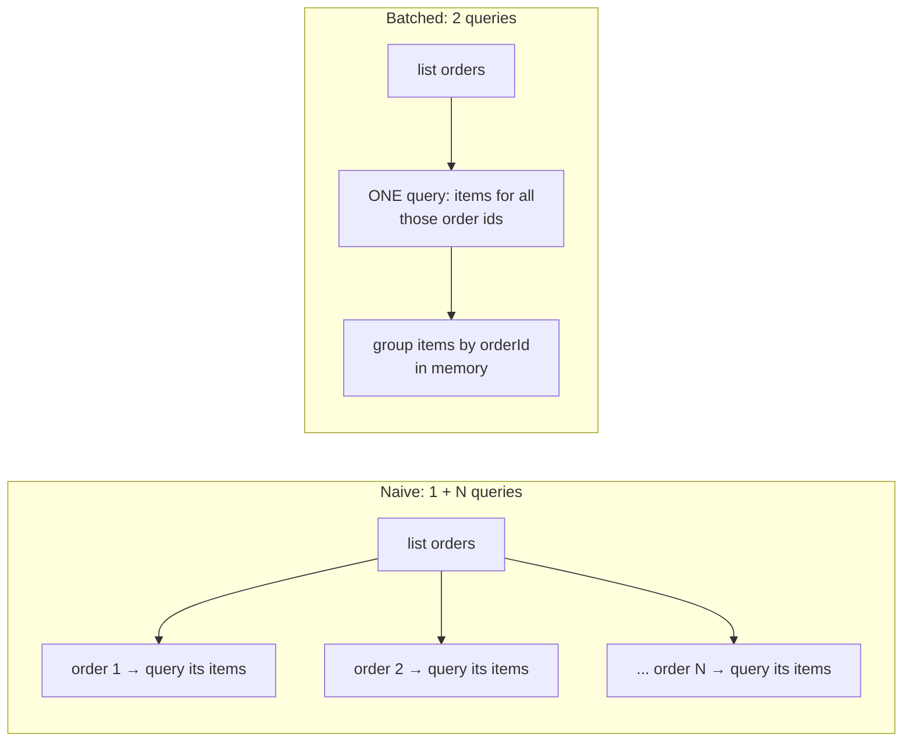
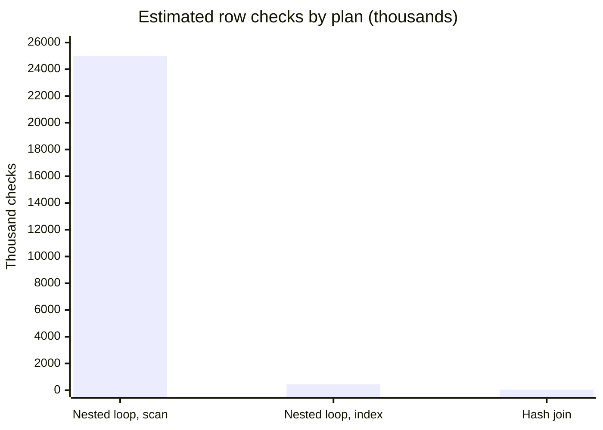
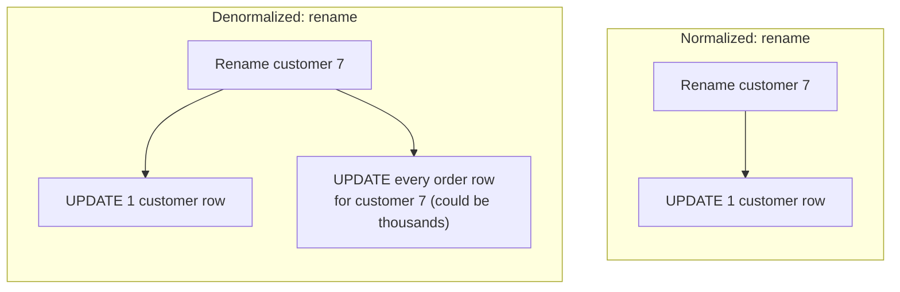

import LevelIntro from "../../../components/LevelIntro.astro";
import Checkpoint from "../../../components/Checkpoint.astro";
import PracticeCheck from "../../../components/PracticeCheck.astro";

export const unit = { track: "systems", unitSlug: "query-planning" };

L2 explained why query count, not raw database speed, drives the Scenario's
slowdown, and what normalization and denormalization each trade off. L3
makes that measurable: how many queries each version issues, the one small
piece of code that implements the fix, how a planner would rank candidate
routes, and what denormalizing really costs on the write side.

<LevelIntro
  items={[
    "Counting queries as the data grows",
    "Fixing N+1 with a lookup-map join, and the one-to-many case",
    "Comparing plans by cost, and the write cost of denormalizing",
  ]}
/>

## Counting the Scenario's queries

**Take the endpoint from the Scenario, 500 customers and 50,000 orders. How many database round-trips does each version make, and what happens when orders quadruple?** Instead of timing anything, just count:

| Version                                    | Queries at 20 orders | At 50,000 orders | At 200,000 orders | Grows with orders? |
| ------------------------------------------ | -------------------- | ---------------- | ----------------- | ------------------ |
| Naive: list, then one customer lookup each | 21                   | 50,001           | 200,001           | Yes, one-for-one   |
| Joined / batched                           | 1                    | 1                | 1                 | No, constant       |

The naive row is the N+1 pattern itself, not a symptom of it: the number
of queries equals `orders.length + 1` because the loop body issues one
lookup per iteration. That is why the endpoint that felt instant at 20
orders takes nearly a minute at 50,000 and would take about four times as
long again at 200,000.

<Checkpoint question="If the order list grew from 50,000 to 200,000 and each query still took the same time, how would the naive endpoint's latency change, and would a joined version change at all?">

The naive version's latency would roughly quadruple, because its query
count is tied directly to the number of orders. The joined version still
issues one query; it does more work inside that query (more rows to
combine), but it pays the per-query overhead once instead of 200,001
times. The pattern, not the speed of any single query, sets how the cost
scales.

</Checkpoint>

<PracticeCheck
  track={unit.track}
  unitSlug={unit.unitSlug}
  topicId="query-counting"
/>

## The fix: fetch related data in one pass

**What changes if the customers are fetched once, up front, instead of once per order?** This is one of the few places in the unit where a few lines of code are the clearest vehicle, because the idea is a small mechanism: build a lookup from id to record, then attach by lookup.

```js
function listOrdersWithCustomer(orders, customers) {
  const customerById = new Map(customers.map((c) => [c.id, c]));
  return orders.map((order) => ({
    ...order,
    customerName: customerById.get(order.customerId).name,
  }));
}
```

Fetching `customers` is one query. Building the `Map` and looking up each
order's customer is in-memory work with no extra round-trips, however many
orders there are. A SQL database does the same thing with a `JOIN`: "return
each order with the customer row whose `id` equals `orders.customerId`",
planned and executed inside one operation.

<PracticeCheck
  track={unit.track}
  unitSlug={unit.unitSlug}
  topicId="lookup-map-join"
/>

**Try extending it yourself.** The customer lookup is one-to-one: each order has exactly one customer. What if each order also needed its list of line items, a one-to-many relationship?



The single-`Map` idea still works, with one change: the map's value is a
_list_ of items per order id (group, don't overwrite), and the fetch is one
query for all the relevant order ids. The principle is unchanged: fetch
together, then assemble in memory. Query count is now a small constant (2),
not a function of N.

<Checkpoint question="Why can't you reuse the one-to-one customer map as-is for line items?">

Because many items share the same `orderId`. A map from id to a single record
would keep only one item per order and silently drop the rest. The map has to
hold a list per key, which is why one-to-many needs grouping, while the
one-to-one customer lookup doesn't.

</Checkpoint>

<PracticeCheck
  track={unit.track}
  unitSlug={unit.unitSlug}
  topicId="batching-shapes"
/>

## Comparing candidate plans by estimated cost

**One query is not automatically a fast query. If the planner could run the joined query three different ways, how would it choose?** It estimates work for each. With 50,000 orders and 500 customers:

| Plan                                           | Rough work                          | Estimated row checks |
| ---------------------------------------------- | ----------------------------------- | -------------------- |
| Nested loop, scan all customers per order      | 50,000 orders x 500 customers       | about 25,000,000     |
| Nested loop, index lookup on `customers.id`    | 50,000 orders x about 9 index steps | about 450,000        |
| Hash join: hash 500 customers, probe per order | 500 to build + 50,000 probes        | about 50,500         |



The same query text spans a 500x range of cost depending on the route. The
planner picks by _estimates_, which come from table statistics, so a stale
row count or a missing index can steer it onto the expensive route even
though a cheap one exists. This is the wider lesson behind the unit: N+1 is
a bug in how _you_ ask; a bad plan is a bug in how the database _answers_,
and fixing one does not fix the other.

<Checkpoint question="A developer fixed the N+1 pattern with a single join, yet the query is still slow. Name one reason it can still be slow.">

A single query can still get an expensive plan: it may scan too much, sort
too many rows, join in a costly order, or lack the index that would narrow
the work, perhaps because statistics are stale. Query count and plan cost
are separate axes. Reducing round-trips solved the first; the second needs
its own look at the plan.

</Checkpoint>

<PracticeCheck
  track={unit.track}
  unitSlug={unit.unitSlug}
  topicId="plan-choice"
/>

## The write cost of denormalizing

**Customers almost never rename themselves and the endpoint runs on every page load. Should the customer name be copied onto each order?** Copying removes even the join from the read path. The price is paid at write time:



Two costs appear. The rename touches many rows, and every code path that
creates or edits an order or a customer must keep the copies in step, or
stale names appear silently. If renames are rare and reads constant, this
trade is a clear win; if renames were frequent, the same change would turn
the rename into the new bottleneck.

<PracticeCheck
  track={unit.track}
  unitSlug={unit.unitSlug}
  topicId="denorm-write-cost"
/>

## What generalizes and what doesn't

The core lesson (a query pattern's cost scales with what it does _per item
in a list_) applies to any list-then-fetch-related-data shape: SQL, NoSQL,
or even code calling a remote API per item in a loop. What is specific here:
the exact fix (a lookup map or a `JOIN`) fits a one-list-one-related-table
shape; three or four related tables need the same principle applied to a
more complex join or batch fetch. Which routes are cheap also depends on
data size and statistics, not on the query text alone. The worked example is
one case, not the whole territory: what changes if customers were 50 million
rows and orders only 1,000? The cheapest plan could flip, which is exactly
why the planner estimates rather than following a fixed recipe.

## Failure modes

| Failure mode                                                                | What it gets wrong                                                                                                                        |
| --------------------------------------------------------------------------- | ----------------------------------------------------------------------------------------------------------------------------------------- |
| Assuming a slow endpoint means the database server needs an upgrade         | A faster server lowers the cost per query but not a query count that scales with list size                                                |
| Denormalizing without updating every write path that can touch the original | A duplicated field is only safe if every path that changes the original also updates the copies; missing one silently produces stale data |
| Load-testing only at development data volumes                               | N+1 is invisible at small scale and severe at production scale; this unit's Scenario is exactly that gap                                  |
| Fixing the query count without checking it actually dropped                 | A rewrite that still hides a loop of lookups behind different-looking code has not fixed the pattern                                      |
| Treating "one query" as "fast query"                                        | A single query can still get a plan that scans, sorts, or joins far more rows than needed                                                 |
