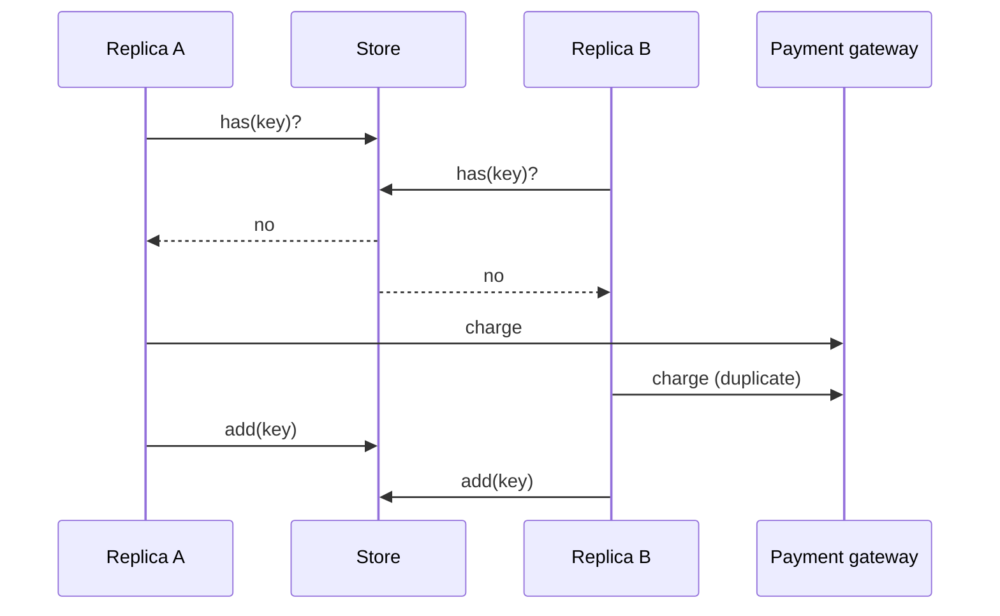
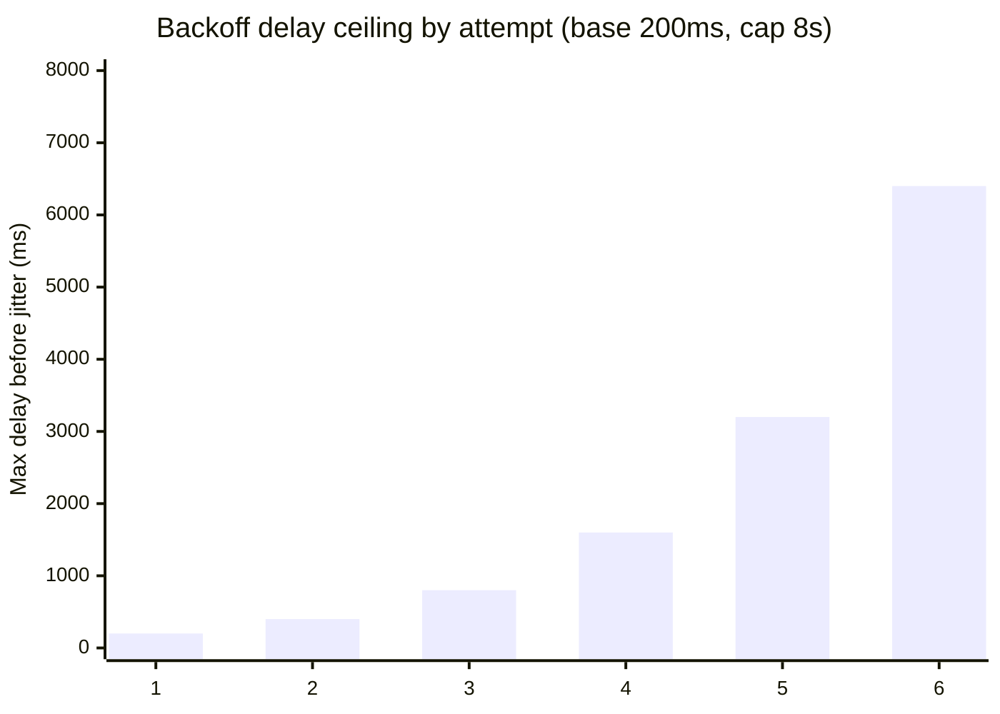

import Scenario from "../../../components/Scenario.astro";
import LevelIntro from "../../../components/LevelIntro.astro";
import Checkpoint from "../../../components/Checkpoint.astro";
import PracticeCheck from "../../../components/PracticeCheck.astro";

export const unit = {
  track: "systems",
  unitSlug: "queues",
};

<Scenario label="Code review: this consumer 'handles duplicates' — does it, really?">
  <Fragment slot="facts">
    <div class="not-prose flex flex-col gap-2 text-sm text-slate-700 dark:text-slate-300">
      <div class="flex items-center gap-1.5"><span>📝</span> <strong>The PR's claim</strong> — "added a Set to track processed order IDs, so duplicates are now handled"</div>
      <div class="flex items-center gap-1.5"><span>⚠️</span> <strong>What the reviewer notices</strong> — the Set is a plain in-memory JS <code>Set</code>, local to one worker process</div>
      <div class="flex items-center gap-1.5"><span>🔀</span> <strong>What isn't tested</strong> — two workers processing the same redelivered message at nearly the same instant</div>
    </div>
  </Fragment>

A pull request adds duplicate protection to the payment worker: a
`processedOrderIds` `Set`, checked before charging a card and updated
right after. The author's test — send the same message twice through
one worker, in sequence — passes, and the PR is titled "fix: handle
duplicate messages." A reviewer points out two problems before
approving it: first, this worker runs as three replicas behind the
same queue, so a message redelivered to a _different_ replica sees an
empty `Set` and charges the card anyway; second, even on a single
replica, nothing stops two near-simultaneous deliveries from both
passing the "have I seen this?" check before either one finishes
recording that it has. **What does an idempotency check actually need
to be safe against concurrent, distributed workers — not just
sequential calls on one process?**

</Scenario>

<LevelIntro
  items={[
    "Why the dedupe store must be shared and atomic",
    "How long the dedupe key has to live",
    "Producer backoff with jitter, and retry versus dead-letter",
  ]}
/>

## Why must the dedupe store be shared and atomic?

**The reviewer found two bugs in one `Set`. Are they the same bug?** No,
and each needs its own property from the store.

- **Shared.** Three replicas each hold their own in-memory `Set`, so a
  redelivery to a different replica sees an empty one and charges again.
  The record has to live somewhere every replica can see.
- **Atomic.** "Check whether I have seen this, then record it" is two
  steps. Two near-simultaneous deliveries can both pass the check before
  either records anything:



The fix is a single operation that checks and records together, returning
whether this caller was the one that recorded it. Redis `SET key value NX`
and a SQL `INSERT ... ON CONFLICT DO NOTHING` both work this way: when two
replicas race, exactly one is told "you were first."

<PracticeCheck
  track={unit.track}
  unitSlug={unit.unitSlug}
  topicId="atomic-dedupe"
/>

The consumer built on that primitive is small enough to read at a
glance, and this is the one place in the unit where code beats a diagram,
because the order of the three lines is the whole point:

```js
async function handle(message, store, gateway) {
  const first = await store.markIfNew(message.messageId, DEDUPE_TTL_MS);
  if (!first) return { charged: false }; // skip the effect, still ack
  await gateway.charge(message.orderId, message.amountCents);
  return { charged: true };
}
```

The record is claimed before the effect. That choice has a cost the next
section's exercises will probe: if the charge then throws, the key is
already marked, so the retry would be skipped and the charge lost. A
production version either releases the claim on failure or records the
outcome in the same transaction as the effect.

<PracticeCheck
  track={unit.track}
  unitSlug={unit.unitSlug}
  topicId="idempotent-consumer"
/>

## How long must the dedupe key live?

**The key is recorded, but a record is only useful while a duplicate can
still arrive. When can the last duplicate arrive?** Not later than the
queue's longest redelivery window, which is the visibility timeout times
the allowed attempts, plus any manual replays from a dead-letter queue:

| Dedupe TTL versus redelivery window | Result                                                     |
| ----------------------------------- | ---------------------------------------------------------- |
| Shorter                             | Late redelivery looks brand new, so it is processed twice  |
| Equal, no margin                    | Clock skew and slow acks can still slip a duplicate past   |
| Comfortably longer                  | Every plausible duplicate is caught; storage cost is small |

<Checkpoint question="The dedupe TTL is 60 seconds but the queue's visibility timeout is 5 minutes. What slips through?">

A message can be redelivered after its key has already expired and been
evicted: the queue's window (5 minutes) outlasts the consumer's memory
(60 seconds). The consumer sees what looks like a new message and charges
again. The TTL has to exceed every plausible redelivery window, not just the
common case, because the rare slow redelivery is exactly the one that
causes the incident.

</Checkpoint>

<PracticeCheck
  track={unit.track}
  unitSlug={unit.unitSlug}
  topicId="dedupe-ttl-window"
/>

## How should a producer retry a failed write?

**Retrying instantly in a loop is the worst option, so what is better?**
It adds load to a queue that is already struggling, and many producers
retrying in lockstep create a thundering herd the moment it recovers.
**Exponential backoff with jitter** fixes both: each retry waits longer
than the last, and a random component spreads producers apart. With full
jitter the actual wait is a random point between zero and the ceiling:



This protects the write into the queue. It is a different mechanism from
the queue's redelivery to consumers in L2, and a system can need both,
working independently at different boundaries. A retried write can itself
create a duplicate message, which is one more reason the consumer
dedupes.

<PracticeCheck
  track={unit.track}
  unitSlug={unit.unitSlug}
  topicId="producer-backoff-jitter"
/>

## Retry again, or send it to the dead-letter queue?

**After a failure, what does the consumer need to know before deciding?**
Whether the failure is a fact about the message or a fact about the moment.

| Failure                               | Nature    | Right call                               |
| ------------------------------------- | --------- | ---------------------------------------- |
| Payload fails validation              | Permanent | Dead-letter at once; retries cannot help |
| Downstream timed out during a deploy  | Transient | Retry with backoff                       |
| Transient failure, attempts exhausted | Unclear   | Dead-letter so a human looks             |

<Checkpoint question="A developer marks a transient database outage as a permanent error. A different developer lets a genuinely permanent error look transient. Which mistake is worse, and why?">

Treating a transient failure as permanent dead-letters a recoverable
message after one attempt. That is an availability cost: the order is late
until someone replays it, but nothing is wrong with the data, so a replay
after the outage fixes it. Treating a permanent failure as transient is
worse: the message retries to the attempt limit and fails every time,
burning worker capacity and delaying the human attention it needs by the
whole retry schedule. Both are misclassifications, but one escalates
wrongly early and recoverably, the other escalates correctly but late.

</Checkpoint>

<PracticeCheck
  track={unit.track}
  unitSlug={unit.unitSlug}
  topicId="retry-vs-dead-letter"
/>

## This is one case, not the whole territory

The worked example here is one message type, one payment gateway, one
dedupe store. Change the setting and the answers change. What if the
message must update two independent systems, such as charging a card **and**
decrementing inventory, and only one of them might fail? Idempotency alone
no longer covers it, because a duplicate-safe step can still be half done.
That leads to the outbox pattern and distributed-transaction trade-offs.
Try extending the case yourself: what happens to the dedupe TTL if an
operator replays the dead-letter queue three weeks later? What changes if
two different producers can enqueue the same business event with different
message IDs?
