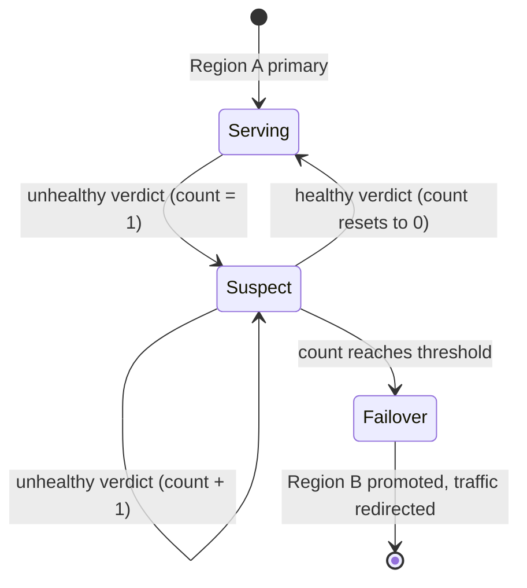
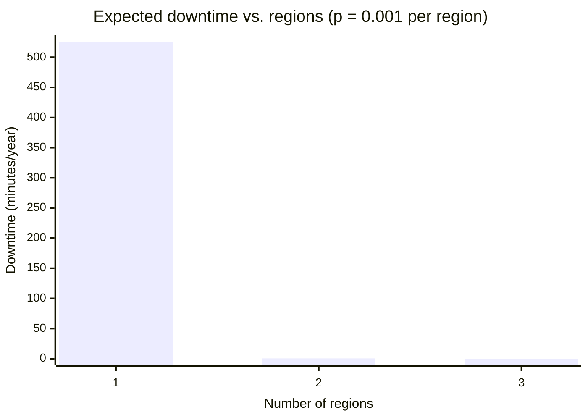

import LevelIntro from "../../../components/LevelIntro.astro";
import Checkpoint from "../../../components/Checkpoint.astro";
import PracticeCheck from "../../../components/PracticeCheck.astro";

export const unit = {
  track: "systems",
  unitSlug: "redundancy",
};

L2 covered the detect-decide-redirect mechanics of failover and why
replication mode, not the router, sets the RPO. This level takes the
three numbers a design review will actually argue about and works each
one through by hand: what a group of health-check voters is allowed to
conclude, how much data a failure can really cost, and how much a
second region really buys. No code is needed; every one of these is
a small table or a few lines of arithmetic.

<LevelIntro
  items={[
    "What a group of voters may conclude, and why one outcome is 'do nothing'",
    "Sizing RPO from the worst replication lag, not the average",
    "Availability arithmetic: why independent regions multiply, and where it breaks",
  ]}
/>

## What may a group of voters conclude?

**Three monitoring nodes disagree about Region A. One says reachable,
two say unreachable. Do we fail over?** The answer depends on a rule
decided in advance, not on a judgment call during the incident. With a
quorum of `floor(total / 2) + 1` voters, every possible tally lands in
exactly one of three outcomes:

| Voters | Quorum | Tally (reachable / unreachable) | Verdict                             |
| ------ | ------ | ------------------------------- | ----------------------------------- |
| 3      | 2      | 3 / 0                           | healthy                             |
| 3      | 2      | 1 / 2                           | unhealthy (2 unreachable is quorum) |
| 4      | 3      | 2 / 2                           | no-quorum: neither side reaches 3   |
| 5      | 3      | 2 / 3                           | unhealthy                           |
| 5      | 3      | 3 / 2                           | healthy                             |

The row to dwell on is 2 / 2 with four voters. Treating it as
"unhealthy" would promote a standby against a primary that may be
perfectly fine and merely cut off from those two voters, which is the
split-brain setup. **`no-quorum` is a deliberate third outcome: it
means "no reliable signal, take no action."** An odd voter count makes
a tie impossible, which is why quorums are sized odd in practice.

<Checkpoint question="With 5 voters, how many must report the region unreachable before the verdict is 'unhealthy', and why does that make split-brain harder to trigger than with 3?">

Quorum with 5 voters is `floor(5/2) + 1 = 3`. For a partition to fool
the group, it would have to isolate at least 3 of the 5 voters from
Region A specifically, a much narrower and less likely failure than a
single voter losing connectivity. More independent voters, spread
across separate failure domains, shrink the set of partitions that can
produce a wrong verdict.

</Checkpoint>

<PracticeCheck
  track={unit.track}
  unitSlug={unit.unitSlug}
  topicId="quorum-verdicts"
/>

## From verdicts to a failover: the threshold and the clock

**A verdict of "unhealthy" arrives once. Should the router fail over
immediately?** No: one bad verdict could be a transient blip, so the
router counts consecutive unhealthy verdicts and only acts when the
count reaches a threshold. A healthy verdict resets the count, and a
`no-quorum` verdict is ignored entirely, since it carries no signal in
either direction.

The threshold is not free. It is paid for directly in RTO. Worked
through with illustrative numbers:

| Step     | Setting                            | Time added      |
| -------- | ---------------------------------- | --------------- |
| Detect   | 3 consecutive verdicts, 10 s apart | about 30 s      |
| Decide   | Promote the standby database       | about 45 s      |
| Redirect | DNS TTL of 60 s                    | up to 60 s      |
| **RTO**  | Sum of the three                   | **about 135 s** |

Dropping the threshold from 3 to 1 would cut detection from 30 s to
10 s, but every transient blip would now trigger a real failover,
which is itself an outage. That is the trade the threshold encodes:
detection speed against false alarms.

## Sizing RPO from lag: average versus worst case

**A team says "our average replication lag is 20 ms, so our RPO is
basically zero." What number should they have used?** Failure can land
at any moment, including during a lag spike, so the exposure is set by
the worst lag the system has demonstrated, not the typical one.

Worked arithmetic with five sampled lags (50, 120, 80, 340, 90 ms) and a
write rate of 200 writes per second:

| Basis for RPO | Lag used   | Seconds of exposure | Writes at risk |
| ------------- | ---------- | ------------------- | -------------- |
| Average lag   | 136 ms     | 0.136               | about 27       |
| **Worst lag** | **340 ms** | **0.34**            | **68**         |

The average understates the exposure by a factor of 2.5 on this very
sample. Translating seconds into a count of writes (lag in seconds
times write rate) turns an abstract duration into a number a design
conversation can hold: "we could lose 68 orders" lands differently than
"340 ms".

<Checkpoint question="Replication lag is usually 20 ms but occasionally spikes to 2 seconds during bulk imports. At 500 writes per second, what is the honest worst-case exposure?">

The spike is the number that matters: 2 s times 500 writes per second is
1,000 writes at risk, versus 10 writes if you trusted the typical
20 ms. A failure that coincides with a bulk import is rare but entirely
possible, and the whole point of an RPO is to describe what the system
can lose when things go wrong, not when they go as usual. A defensible
claim is built from the tail of the lag distribution, not its center.

</Checkpoint>

<PracticeCheck
  track={unit.track}
  unitSlug={unit.unitSlug}
  topicId="worst-case-lag"
/>

## How availability compounds across independent regions

**If one region is down 0.1% of the time, how much does a second one
actually help?** If the regions fail independently and the system is
down only when every region is down at once, the failure probabilities
multiply, so the probability of total outage is `p^n`. A year has
525,600 minutes:

| Regions (n) | Probability all are down | Expected downtime per year    |
| ----------- | ------------------------ | ----------------------------- |
| 1           | 0.001                    | 525.6 minutes                 |
| 2           | 0.000001                 | 0.53 minutes (about 32 s)     |
| 3           | 0.000000001              | 0.0005 minutes (about 0.03 s) |

Going from one region to two does not halve downtime; it cuts it by
three orders of magnitude, because both would have to fail in the same
overlapping window. That is why a second region is a disproportionately
large win compared with doubling capacity inside one region. Serial
dependencies behave the opposite way: if a request needs A and B to
both work, availabilities multiply (two 99.9% components give about
99.8%), so every extra hard dependency lowers the total.

**"Independent" is doing all the work in that table.** Suppose 10% of
each region's failures are actually caused by a shared dependency (one
DNS provider, one identity service) that takes every region down at the
same time. Then the shared part, 10% of 0.001, equals 0.0001, and it
does not multiply away: it alone costs about 52.6 minutes per year no
matter how many regions exist. The independent remainder (0.0009
squared, about 0.4 minutes) is almost irrelevant next to it. Two
regions with a 10% shared dependency are barely better than "about 53
minutes", not "about half a minute".

<Checkpoint question="A team adds a fourth and fifth region to push downtime lower, but all five depend on one DNS provider. Why is the extra spending mostly wasted?">

Once the independent part is already tiny, the shared dependency is the
floor. Its failures hit all five regions at once, so adding regions
only shrinks a term that was already negligible. The money is better
spent removing the correlation (a second DNS provider, a regional
fallback for identity) than adding another copy that fails for the same
reason as the others.

</Checkpoint>

<PracticeCheck
  track={unit.track}
  unitSlug={unit.unitSlug}
  topicId="availability-math"
/>

## Back to the Scenario, and what is only a case

Apply the three ideas to the checkout service that went down for six
hours. A second region with independent health voters would have
turned that outage into a failover of about two minutes. Sizing RPO
from worst lag would have told the team in advance how many orders the
async-replicated database could lose in that window. And auditing the
shared dependencies (one DNS provider, one identity service) would have
shown the real floor on downtime.

**This is a worked case, not the whole territory.** The thresholds,
the 10 s check interval, the 0.001 failure probability, and the 10%
shared fraction are all illustrative. Try extending it yourself:

- What changes if only 1% of failures are shared, and there are three
  regions instead of two? (The shared term alone is about 5 minutes per
  year; does a third region still matter?)
- What changes if the business can tolerate losing 30 seconds of
  writes but not 2 minutes of downtime? Which of the two numbers does
  your next unit of engineering effort go to?
- What changes if the data is not transactional orders but analytics
  events, where losing a few seconds is harmless?

A real per-region failure probability should come from the provider's
own history, and a stricter RTO means a lower threshold at the cost of
more false failovers.

## Failure modes

| Failure mode                                                          | What it gets wrong                                                                                                                       |
| --------------------------------------------------------------------- | ---------------------------------------------------------------------------------------------------------------------------------------- |
| Acting on a single health checker's verdict                           | The split-brain setup from L2: a network partition looks identical to a real outage from one checker's vantage point                     |
| Sizing RPO from average replication lag instead of worst-case         | Understates real exposure, since failure can land during a lag spike                                                                     |
| Assuming regions are independent without checking shared dependencies | Correlated failures (shared DNS, shared identity provider) break the multiplication and make actual downtime far worse than the estimate |
| Treating "no-quorum" the same as "unhealthy"                          | Turns an ambiguous, no-signal moment into a false failover, which is itself a source of unnecessary outages                              |
