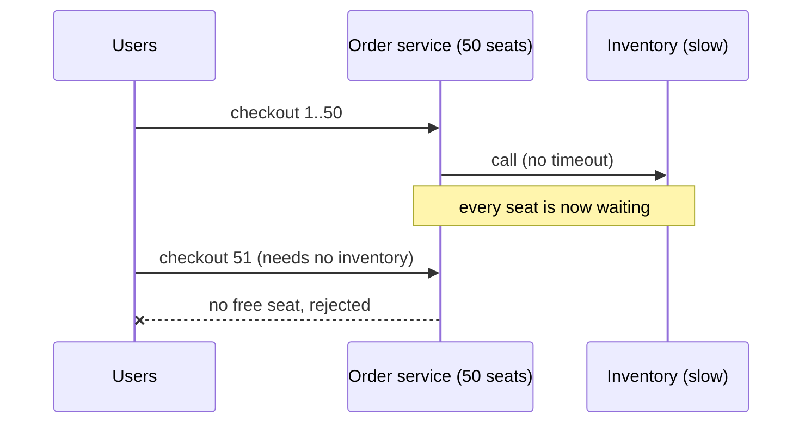

import Scenario from "../../../components/Scenario.astro";
import LevelIntro from "../../../components/LevelIntro.astro";
import PracticeCheck from "../../../components/PracticeCheck.astro";

export const unit = {
  track: "systems",
  unitSlug: "timeouts",
};

<Scenario label="The order service's own code never changed. It went down anyway, because a dependency it called started responding slowly.">
  <Fragment slot="facts">
    

      
🐌 <strong>What degraded</strong> — the inventory service, called by the order service on every checkout

      
⏳ <strong>What the order service did</strong> — called it with no timeout, so every request just waited

      
💥 <strong>The result</strong> — the order service's own connection pool filled up with stuck requests, making it unavailable too

    

  </Fragment>

The order service calls the inventory service on every checkout, with
no timeout on that call. One day the inventory service starts
responding slowly — not down entirely, just slow. Every checkout
request to the order service now sits waiting on a slow inventory
call that never fails and never succeeds quickly. Within minutes, the
order service's own limited pool of connections fills up entirely
with stuck requests, and it stops being able to serve _any_ checkout
at all — and the same exhausted service also struggles with other
routes that are not directly about inventory. **The order
service's own code has no bug. So how did one slow dependency take
down an entirely different, otherwise-healthy service?**

</Scenario>

<LevelIntro
  items={[
    "Why a slow dependency exhausts a service's own resources",
    "Timeouts, retries, circuit breakers, backpressure — what each one is",
    "How the four techniques cover four different parts of the problem",
  ]}
/>

## Before the technical names

A service has limited "seats" for work: worker threads, database
connections, HTTP connections, memory, and queue space. When one
request sits waiting, it keeps a seat occupied. If enough requests sit
waiting, there are no seats left for new work, even if the new work
would have been quick.

That is why a slow dependency is dangerous. The first problem is not
only "inventory is slow." The second problem is "the order service
keeps lending its limited seats to calls that may never come back."

<PracticeCheck
  track={unit.track}
  unitSlug={unit.unitSlug}
  topicId="slow-dependency-cascade"
/>

## The four techniques at a glance

**Four separate questions, four techniques — which question does each one answer?**

| Question                                         | Technique       | One-line answer                                                    |
| ------------------------------------------------ | --------------- | ------------------------------------------------------------------ |
| How long am I willing to wait?                   | Timeout         | Cap how long one call can hold a seat                              |
| When is it worth trying again?                   | Retry + backoff | A few spaced-out second chances for transient failures             |
| When should I stop calling something broken?     | Circuit breaker | After repeated failures, refuse calls instantly for a while        |
| How do I tell callers to slow down before I jam? | Backpressure    | Reject, shed, or bound work instead of silently queuing it forever |

## Key terms

- **Timeout** — a maximum duration a call is allowed to take before it
  is treated as failed, whether or not the dependency would eventually
  have answered.
- **Retry (with backoff)** — re-attempting a failed call after a
  growing delay, to survive brief blips without hammering a struggling
  dependency.
- **Circuit breaker** — a gate that stops sending calls to a
  dependency after repeated failures, then periodically probes whether
  it has recovered.
- **Backpressure** — a signal (such as `429`/`503`, a bounded queue, a
  paused producer) telling upstream to send less, instead of the
  receiver silently queuing until it collapses.

<PracticeCheck
  track={unit.track}
  unitSlug={unit.unitSlug}
  topicId="four-techniques-roles"
/>

## What this unit covers

L2 works through why a timeout alone is not enough, the three states a
circuit breaker moves through, how retries go wrong, and what real
backpressure looks like. L3 builds a backoff calculation and a circuit
breaker state machine and applies the combination to the Scenario's
cascading outage.
