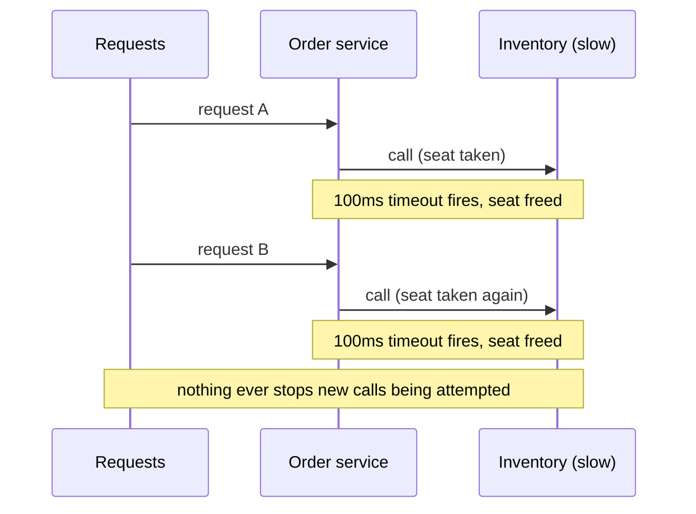
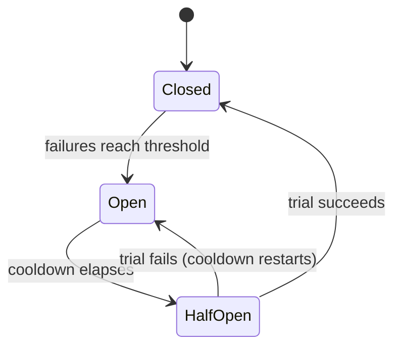
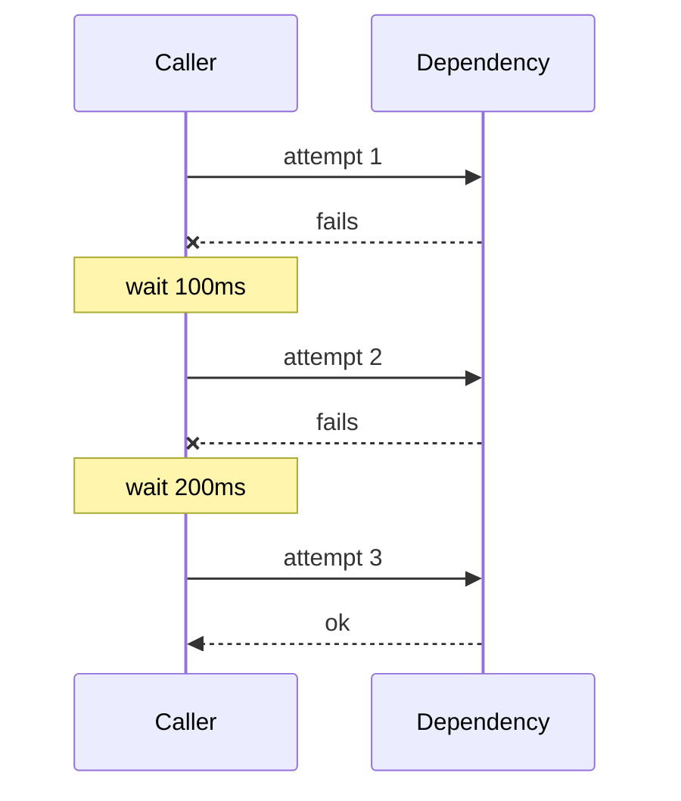

import LevelIntro from "../../../components/LevelIntro.astro";
import Checkpoint from "../../../components/Checkpoint.astro";
import PracticeCheck from "../../../components/PracticeCheck.astro";

export const unit = {
  track: "systems",
  unitSlug: "timeouts",
};

L1 named four techniques and the seat-exhaustion problem they all
respond to. This level works through what each one solves on its own,
why a timeout alone is not enough, how retries go wrong, and the
states a circuit breaker moves through.

<LevelIntro
  items={[
    "Why a timeout alone doesn't prevent the outage",
    "The three states of a circuit breaker",
    "Retry discipline and real backpressure",
  ]}
/>

## Why a timeout alone doesn't finish the job

**If a timeout already stops a call from hanging forever, why are
retries and circuit breakers needed too?** Because a timeout shortens
each wait; it does not reduce the number of waits. Picture the pool
over time with a 100ms timeout and inventory staying slow:

| Technique          | What it actually solves                                                                                   |
| ------------------ | --------------------------------------------------------------------------------------------------------- |
| Timeout            | Caps how long any single call holds a seat                                                                |
| Retry with backoff | Recovers from a brief, transient failure without giving up on the first attempt                           |
| Circuit breaker    | Stops calling a dependency that is clearly failing, protecting both the caller's seats and the dependency |
| Backpressure       | Lets an overloaded system push back on upstream instead of silently queuing until it collapses            |

<Checkpoint question="A teammate says: 'we already added a 100ms timeout on the call to inventory, so we're covered.' Are they right?">

Not fully. A timeout caps how long any single call can hold a seat,
so it does stop requests from waiting forever — real progress over the
Scenario's original setup. But it does not reduce how many calls are
made. If inventory stays slow, every new request still spends up to
100ms of a seat on a doomed call, and if requests arrive faster than
they time out, the pool can still fill — just more slowly, and bounded
instead of unbounded. Being covered against unbounded hangs is not the
same as being covered against exhaustion under sustained load; that
second part is what a circuit breaker adds.

</Checkpoint>

<PracticeCheck
  track={unit.track}
  unitSlug={unit.unitSlug}
  topicId="timeout-alone-not-enough"
/>

## The states a circuit breaker moves through

**Does a circuit breaker permanently stop calling a failing dependency
once it trips?** No — it periodically checks whether the dependency
has recovered, moving through three states:

| State     | Calls                                 | Seats spent on the dependency |
| --------- | ------------------------------------- | ----------------------------- |
| Closed    | Flow normally, failures are counted   | Normal                        |
| Open      | Refused instantly, no network attempt | None                          |
| Half-Open | Exactly one trial call is let through | One, until the trial resolves |

**Why not just retry forever until the dependency comes back?**
Because retrying forever against a dependency that is still down
spends the caller's own seats on calls very likely to fail — the
Scenario's problem again, just caused by the caller's own retry logic.

<Checkpoint question="Once a circuit breaker has moved to Open, does the next incoming request to the dependency still consume a connection or wait on the timeout?">

No — and that is the whole point of the Open state. While Open, the
breaker refuses the call before any network attempt is made, so the
request fails immediately instead of occupying a seat for up to the
timeout. A timeout bounds how long one wasted call takes; Open skips
the call entirely. Only after the cooldown does the breaker move to
Half-Open and let a single trial through.

</Checkpoint>

<PracticeCheck
  track={unit.track}
  unitSlug={unit.unitSlug}
  topicId="breaker-states"
/>

## Retries: a second chance, not a multiplier

**If one retry is good, why not retry immediately and many times?**
Because a struggling dependency needs less load, not more. A healthy
retry policy has three parts: a **cap** on attempts, a **growing
delay** (backoff) between them, and **jitter** (a random shuffle of
the delay) so thousands of callers do not all retry at the same
instant.

Retries also multiply across layers. If each layer in a call chain
retries independently, the load on the bottom dependency is the
product, not the sum:

| Layers that each retry 3 times | Calls reaching the bottom dependency |
| ------------------------------ | ------------------------------------ |
| 1                              | 3                                    |
| 2                              | 9                                    |
| 3                              | 27                                   |

Retry only operations that are safe to repeat (idempotent), and only
failures that can plausibly be transient — a timeout or `503`, not a
`400` that will fail identically every time.

<PracticeCheck
  track={unit.track}
  unitSlug={unit.unitSlug}
  topicId="retry-discipline"
/>

## Backpressure: saying "slow down" out loud

**Logging "we are overloaded" is not backpressure — what is?** A
signal or behavior that causes less work to arrive, or less work to be
accepted. The unsafe default is an unbounded queue: it accepts
everything, latency grows without limit, and the service eventually
runs out of memory with every queued request already doomed.

| Mechanism                      | What the overloaded service does                     |
| ------------------------------ | ---------------------------------------------------- |
| Reject with `429` / `503`      | Tells callers now, so they can back off or fail over |
| Bounded queue                  | Refuses new work once the queue is full              |
| Load shedding                  | Drops low-priority work to protect critical work     |
| Pausing the producer (streams) | Stops reading until the consumer catches up          |

<PracticeCheck
  track={unit.track}
  unitSlug={unit.unitSlug}
  topicId="backpressure-signal"
/>

## Failure modes at this level

- **A timeout so long it does not prevent exhaustion.** A 30-second
  timeout on a service expected to answer in milliseconds still lets a
  flood of slow requests fill the pool.
- **Retries without backoff, cap, or jitter.** They add load exactly
  when the dependency can least afford it.
- **Treating the circuit breaker as optional polish.** Without one the
  caller keeps spending seats on a dependency that is obviously down.
- **Naming overload without changing behavior.** If nothing causes
  less work to arrive, it is not backpressure.
