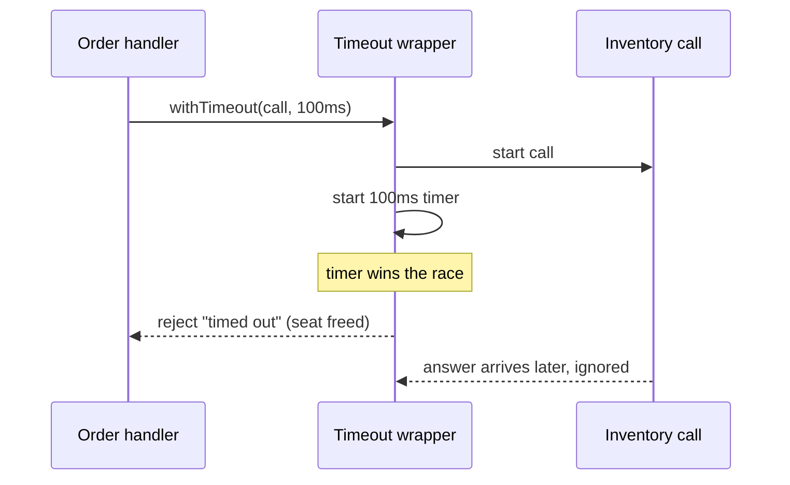
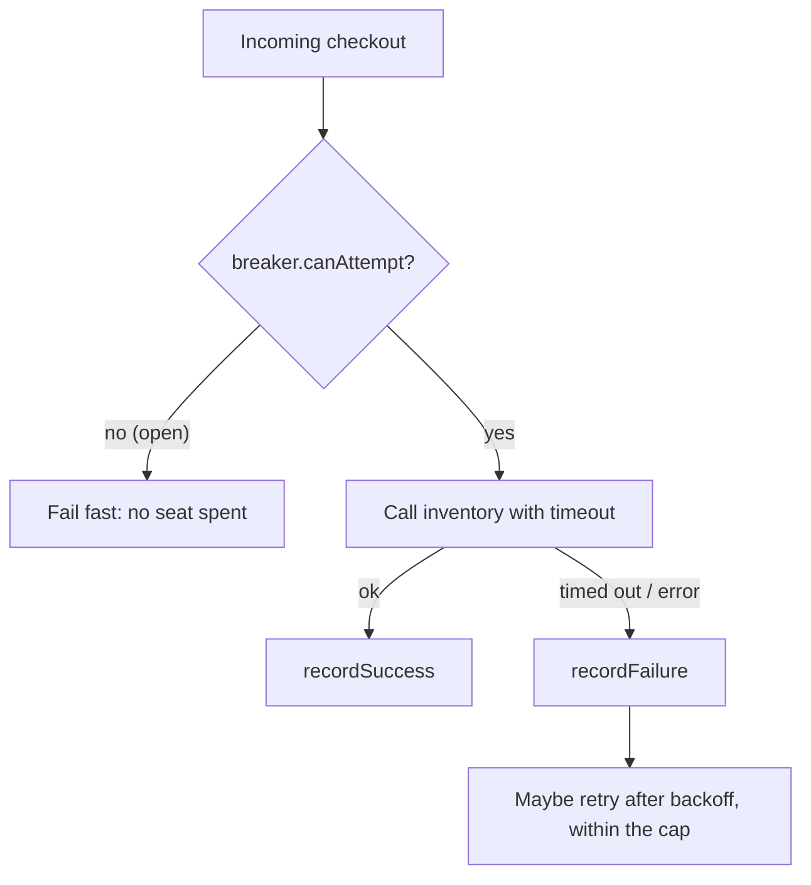

import LevelIntro from "../../../components/LevelIntro.astro";
import Checkpoint from "../../../components/Checkpoint.astro";
import PracticeCheck from "../../../components/PracticeCheck.astro";

export const unit = {
  track: "systems",
  unitSlug: "timeouts",
};

L2 covered what each technique solves and the states a circuit
breaker moves through. This level shows the two mechanisms that are
genuinely clearer as code — the backoff calculation and the breaker's
state machine — and then replays the Scenario with everything in
place.

<LevelIntro
  items={[
    "How a timeout wrapper frees the seat early",
    "A backoff calculation and a circuit breaker state machine",
    "Gating the call, and the full Scenario replayed",
  ]}
/>

## Capping how long a call can hold a seat

**What does a timeout wrapper actually do, mechanically?** It starts
the real call and a timer together and returns whichever finishes
first (in JavaScript, `Promise.race([call, timer])`).



One subtlety worth keeping: the wrapper returns control to the
caller, but it does not cancel the underlying work. Real HTTP clients
usually need an abort mechanism too. The timeout is still valuable
because the caller stops lending its own seat to an unbounded wait.

**Does this alone stop the pool from filling?** Only partially. Each
call is now bounded at 100ms, but if inventory stays slow and
requests keep arriving, every one still burns a seat for up to 100ms.

## The backoff calculation

**How long should the caller wait before attempt N+1?** Doubling the
delay each time, up to a ceiling, is the standard shape — this is the
one piece of the retry story where the arithmetic itself is the
lesson.

```js
function backoffDelay(attempt, { baseMs, capMs }) {
  return Math.min(capMs, baseMs * 2 ** (attempt - 1));
}
// base 100, cap 1000:  attempt 1 -> 100, 2 -> 200, 3 -> 400, 4 -> 800, 5 -> 1000
```

| Attempt | Delay (base 100ms, cap 1000ms) |
| ------- | ------------------------------ |
| 1       | 100ms                          |
| 2       | 200ms                          |
| 3       | 400ms                          |
| 4       | 800ms                          |
| 5       | 1000ms (capped, not 1600)      |

In production you would add jitter on top (a random fraction of this
delay) so callers spread out; it is left out here so the calculation
stays deterministic and testable.

<PracticeCheck
  track={unit.track}
  unitSlug={unit.unitSlug}
  topicId="backoff-delay"
/>

## The circuit breaker as a state machine

**Which parts of the L2 state diagram need real logic?** Three: count
failures and open at the threshold; while open, refuse until the
cooldown elapses; while half-open, allow exactly one trial and let its
result decide the next state. Time is passed in as `now` rather than
read from a clock, which keeps the machine deterministic.

```js
class CircuitBreaker {
  constructor({ failureThreshold, cooldownMs }) {
    this.failureThreshold = failureThreshold;
    this.cooldownMs = cooldownMs;
    this.state = "closed";
    this.failures = 0;
    this.openedAt = 0;
    this.trialInFlight = false;
  }

  canAttempt(now) {
    if (this.state === "closed") return true;
    if (this.state === "open") {
      if (now - this.openedAt < this.cooldownMs) return false;
      this.state = "half-open";
    }
    if (this.trialInFlight) return false;
    this.trialInFlight = true;
    return true;
  }

  recordSuccess() {
    this.failures = 0;
    this.state = "closed";
    this.trialInFlight = false;
  }

  recordFailure(now) {
    this.failures++;
    this.trialInFlight = false;
    if (this.state === "half-open" || this.failures >= this.failureThreshold) {
      this.state = "open";
      this.openedAt = now;
    }
  }
}
```

Two details carry the design. First, `trialInFlight` makes the
half-open state admit a single probe — without it, a burst of callers
all slip through the moment the cooldown ends. Second, a failed trial
reopens immediately and restarts the cooldown, rather than needing the
threshold to be reached again.

<Checkpoint question="If canAttempt() were checked after starting the network call instead of before it, would the breaker still protect the connection pool?">

No. The benefit of Open is skipping the call entirely, refusing in
well under a millisecond instead of occupying a seat for up to the
timeout. If the breaker were consulted after the call had started, the
seat would already be spent by the time its answer came back — the
Scenario's exhaustion pattern, just moved one layer later. The
breaker has to gate the attempt, not audit it afterward.

</Checkpoint>

<PracticeCheck
  track={unit.track}
  unitSlug={unit.unitSlug}
  topicId="breaker-transitions"
/>

## Putting the gate in front of the call

**In what order do the pieces wrap a single call to inventory?** The
breaker is asked first, the timeout bounds the call, and the outcome
feeds back into the breaker:



Replaying the Scenario: early on the breaker is Closed and calls go
through, each bounded at 100ms. Once three calls time out, the breaker
opens; every later checkout fails instantly instead of burning a seat,
so the pool drains and the order service stays available for routes
that never touch inventory. After the cooldown, one trial decides
whether inventory has recovered.

<Checkpoint question="While the breaker is still Closed, before the failure threshold is crossed, is the connection pool fully protected?">

Only partially. Every call is capped at 100ms by the timeout, which is
real protection compared with the original no-timeout setup, but
nothing yet stops new calls from arriving and each still occupies a
seat while inventory stays slow. Full protection begins when enough
failures accumulate and the breaker opens; before that, the timeout is
bounding the damage, not preventing it.

</Checkpoint>

<PracticeCheck
  track={unit.track}
  unitSlug={unit.unitSlug}
  topicId="gate-before-call"
/>

## What generalizes and what doesn't

Bounding how long a call can hold a seat, and refusing calls once a
dependency is clearly failing, protect any system with dependencies
that can degrade: databases, third-party APIs, internal services. The
specific numbers (100ms timeout, threshold of 3) are tuned to this one
dependency; a naturally slower one, or one where occasional single
failures are normal, needs its own values. The worked example is a
case, not the whole territory. **Try extending it yourself:** if the
order service retried each inventory call up to 2 times with backoff,
should every attempt count as a failure toward the breaker's
threshold, or the whole retried sequence as one? What changes if the
dependency were a payment provider, where a retry might double-charge?

## Failure modes

| Failure mode                                              | What it gets wrong                                                                     |
| --------------------------------------------------------- | -------------------------------------------------------------------------------------- |
| Timeout far longer than the dependency's expected latency | Slow requests still exhaust the pool, just more slowly                                 |
| Checking breaker state after attempting the call          | The seat is already spent by the time the failure is recorded                          |
| Threshold so low a single blip trips the breaker          | Needlessly fails requests to a dependency that would have recovered on its own         |
| Letting every caller through when the cooldown ends       | A burst of probes hammers a dependency that is just starting to recover                |
| Never testing the half-open transitions                   | A breaker that cannot return to Closed leaves a healthy dependency permanently blocked |
