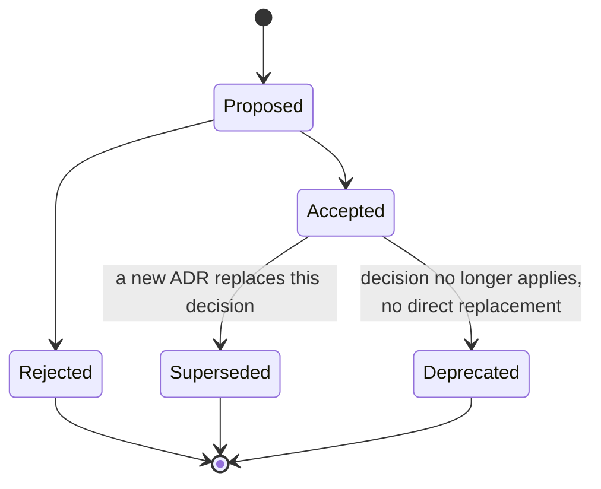
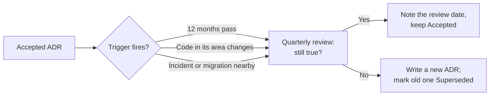

import Scenario from "../../../components/Scenario.astro";
import LevelIntro from "../../../components/LevelIntro.astro";
import Checkpoint from "../../../components/Checkpoint.astro";
import PracticeCheck from "../../../components/PracticeCheck.astro";

export const unit = {
  track: "systems",
  unitSlug: "trade-off-documentation",
};

<Scenario label="Code review, but for a document: the ADR says 'Accepted,' the system says otherwise">
  <Fragment slot="facts">
    <div class="not-prose flex flex-col gap-2 text-sm text-slate-700 dark:text-slate-300">
      <div class="flex items-center gap-1.5"><span>📄</span> <strong>What the ADR says</strong> — "Status: Accepted" — RabbitMQ is the job queue, decided 18 months ago</div>
      <div class="flex items-center gap-1.5"><span>🛠️</span> <strong>What actually happened since</strong> — six months ago, the team quietly migrated to SQS after a payload-size fix made it viable, but never updated the ADR</div>
      <div class="flex items-center gap-1.5"><span>🧑‍💻</span> <strong>The cost</strong> — a new engineer reads the ADR, builds a RabbitMQ-specific retry helper for a system that hasn't used RabbitMQ in six months</div>
    </div>
  </Fragment>

An ADR from 18 months ago says, in its Status field, "Accepted" —
RabbitMQ is the system of record for job queueing, and the
Consequences section explains why in detail. Six months ago, a fix
to how large payloads get chunked made SQS viable after all, and the
team quietly migrated — but nobody went back and updated the ADR's
status, or wrote a new one recording the switch. A new engineer, doing
exactly what L1 and L2 said to do — reading the ADR before building
on top of the queue — trusts a document that is now six months out of
date, and spends two days building a RabbitMQ-specific retry helper
for a system that hasn't touched RabbitMQ since spring. **An ADR that
goes stale without anyone noticing is arguably worse than no ADR at
all — a reader who finds nothing knows to go ask, but a reader who
finds a confident, wrong document has no reason to doubt it. What
would have to be true about how a team treats ADRs for this kind of
staleness to get caught before it costs someone two days?**

</Scenario>

<LevelIntro
  items={[
    "A full ADR document, written for a reader with none of today's context",
    "Stress-testing a decision matrix: how fragile is the winner?",
    "Superseding instead of silently editing, and the ADR lifecycle",
    "Review cadence and revisit triggers as the actual fix for the Scenario",
  ]}
/>

## A real ADR, end to end

L2 built the reasoning — reversibility, a weighted matrix, an honest
Consequences section. Here is that same RabbitMQ-vs-SQS decision
written as an actual ADR document, in the format most teams that use
this practice converge on (a numbered, append-only file per decision,
usually kept in the repo itself so it versions alongside the code it
describes):

```markdown
# ADR-014: Use self-hosted RabbitMQ instead of managed SQS for job queueing

## Status

Accepted — 2025-02-11

## Context

The order-fulfillment service needs a message queue to decouple order
creation from downstream processing (inventory, shipping, email — see
the `queues` unit for why this decoupling matters at all). Two options
were evaluated: Amazon SQS (managed) and self-hosted RabbitMQ.

Two constraints shaped this decision:

- Order payloads for bulk/wholesale orders can exceed 256KB (SQS's
  hard message-size limit) roughly 3% of the time, based on the last
  90 days of production order data.
- The infrastructure team already operates a RabbitMQ cluster for the
  notifications service, so on-call familiarity and tooling
  (dashboards, alerting, runbooks) already exist.

## Decision

We will use the existing RabbitMQ cluster, adding a new vhost for
order-fulfillment messages, rather than adopting SQS.

## Alternatives considered

| Option            | Weighted score (see decision matrix below) |
| ----------------- | ------------------------------------------ |
| RabbitMQ (chosen) | 41                                         |
| Amazon SQS        | 29                                         |

Weights: operational cost (3), team familiarity (2), message-size fit
(4 — the dominant factor given the 3% oversized-payload rate), vendor
lock-in risk (1).

## Consequences

**What we gain:** no payload-size workaround needed (no chunking, no
S3-offload hack for the 3% of oversized orders); the team can lean on
existing RabbitMQ operational experience and tooling from day one.

**What we give up:** an on-call operational burden SQS would not have
required — RabbitMQ needs patching, capacity planning, and cluster
monitoring that a managed queue handles for us. We are also forgoing
SQS's tighter native integration with the rest of our AWS-managed
stack.

**What would make us revisit this:** if the oversized-payload rate
drops meaningfully (e.g. a wholesale-order restructuring removes the
need for large payloads), the message-size argument weakens and SQS's
lower operational burden could tip the matrix the other way — see the
review-cadence note below.

## Related

Supersedes: none (first queueing decision for this service).
Superseded by: none yet.
```

Notice what's absent: there's no claim that RabbitMQ is "the right
choice" in the abstract, only that it's the right choice _given these
weights, this payload data, this team's existing operational
footprint, on this date_. That qualification is what lets a future
reader — the Scenario's new engineer, or the L1 Scenario's team
inheriting a decision from people who've left — evaluate whether the
reasoning still holds, instead of either blindly trusting or blindly
distrusting a decision they had no part in making.

<Checkpoint question="The ADR's Consequences section lists 'no payload-size workaround needed' under what we gain, and 'an on-call operational burden' under what we give up. Why does a good ADR need both sides, rather than just justifying the winning choice?">

An ADR that only lists the winning option's benefits reads as
advocacy, not a record — and it hides exactly the information a
future reader most needs, which is what to watch for if circumstances
change. Listing the operational burden explicitly is what lets a
later reader notice, correctly, "we've been paying that on-call cost
for two years and the payload-size problem it was solving no longer
exists" — the trigger for reopening a decision has to be visible in
the document, or nobody knows to look for it.

</Checkpoint>

## Stress-testing the matrix: how fragile is the winner?

**A matrix produced a winner. How much should anyone trust it?** The
honest answer depends on how far the weights have to move before the
winner changes. L2's matrix is a good case: RabbitMQ leads 41 to 29,
but that lead lives almost entirely in one criterion, message-size fit.
Re-scoring the same table with different weights shows how much the
decision rests on it:

| Weights scenario                               | SQS total | RabbitMQ total | Winner   |
| ---------------------------------------------- | --------- | -------------- | -------- |
| As recorded (size fit 4, cost 3)               | 29        | 41             | RabbitMQ |
| Size fit drops to 2 (payloads shrink)          | 25        | 31             | RabbitMQ |
| Size fit drops to 1, cost rises to 5           | 33        | 30             | SQS      |
| Size fit 0 (payloads no longer matter), cost 3 | 21        | 21             | tie      |

Reading the table: the winner survives a moderate change but flips once
size fit stops dominating. That is the single most valuable sentence an
ADR can contain, "this decision holds as long as message-size fit
outweighs operational cost", because it tells a future reader exactly
which fact to re-check. The matrix is a sensitivity probe as much as a
scoring device; the interactive demo in this unit lets you drag those
two weights yourself.

<Checkpoint question="In the stress test, why is 'what would make us revisit this' better stated as a condition on a weight (size fit outweighs cost) than as a date ('review in a year')?">

A date only says when to look, and says nothing about what to look
for. A condition on the weights names the specific fact the decision
depends on, so the reader can check it in minutes: if the oversized
payload rate has dropped, the dominant criterion has weakened and the
matrix may tip. The date is still useful as a backstop, but the
condition is what turns a review from a generic meeting into a
targeted check.

</Checkpoint>

<PracticeCheck track={unit.track} unitSlug={unit.unitSlug} topicId="real-adr" />

## Supersede, don't silently edit

**Given a flagged, stale ADR, what should actually happen to it —
edit ADR-014 in place to say "SQS" now?** No — the fix is to write a
new ADR (say, ADR-031) that records the _new_ decision, its own
context and consequences, and sets its `Superseded by` field pointing
forward while ADR-014's `Status` flips to `Superseded` with a pointer
back. Editing the original in place would erase the very history an
ADR exists to preserve — a future reader would lose the fact that
RabbitMQ was ever chosen, and why, along with whatever conditions
eventually made it worth abandoning. An ADR is meant to be
**append-only**: once accepted, a decision's record doesn't change
retroactively, it gets superseded by a new record that explains what
changed and why.



<PracticeCheck
  track={unit.track}
  unitSlug={unit.unitSlug}
  topicId="supersede-append-only"
/>

## Catching staleness before it costs someone two days

**The Scenario's ADR said "Accepted" for six months after it stopped
being true. Why didn't anyone notice?** Because nothing forced a look.
A date on a document is not a trigger; a status field nobody reads
again is not a trigger either. A team needs deliberate triggers, and
they come in two kinds:

| Trigger kind   | Example                                                                                       | What it catches                           |
| -------------- | --------------------------------------------------------------------------------------------- | ----------------------------------------- |
| Time-based     | Every Accepted ADR older than 12 months is listed at a quarterly review                       | Slow drift nobody noticed                 |
| Event-based    | A migration, an incident, or a new dependency in the area triggers "does ADR-014 still hold?" | The sudden change that makes an ADR wrong |
| Change-coupled | A pull request that touches the decision's code must link or update its ADR                   | The quiet migration in the Scenario       |

The third row is the one that would have caught this exact failure: the
quiet switch from RabbitMQ to SQS was a code change, and a rule that a
change to the queueing layer needs an ADR link or a new ADR makes the
omission visible at review time, six months earlier than anyone
noticed. Time-based sweeps are the safety net; they cannot know that
RabbitMQ was replaced, they can only make a human ask. The cost of that
human check is small next to two days of misdirected work.



<Checkpoint question="Why is a rule that code changes in the decision's area must link an ADR more reliable than a yearly staleness sweep for the Scenario's failure?">

The sweep only prompts a human to wonder, and the Scenario's ADR would
have sat unnoticed until the next sweep date, possibly months after the
migration. The change-coupled rule fires at the moment the decision is
actually overturned, because the overturning is itself a code change
reviewed by someone who can ask, "where is the ADR for this?" It moves
the check from a calendar to the event that causes the staleness, so
the gap between the system changing and the record changing shrinks
from months to the length of a code review.

</Checkpoint>

<PracticeCheck
  track={unit.track}
  unitSlug={unit.unitSlug}
  topicId="staleness-review"
/>

This unit's worked example is a case, not the whole territory: one
decision, decided once, by one team, with a clean two-option
comparison. Try extending it. What changes when the audience is a
non-technical executive instead of a future engineer? What changes if
the news in the Consequences section were worse, for example if the
chosen option had a known security gap? What changes when a
decision has to be made jointly by two teams who report to different
organizations and don't fully trust each other's numbers — does a
weighted matrix still work when the weights themselves are the
argument? That's a harder, more political version of the same
problem, and a natural next place to take this beyond what's shown
here.
