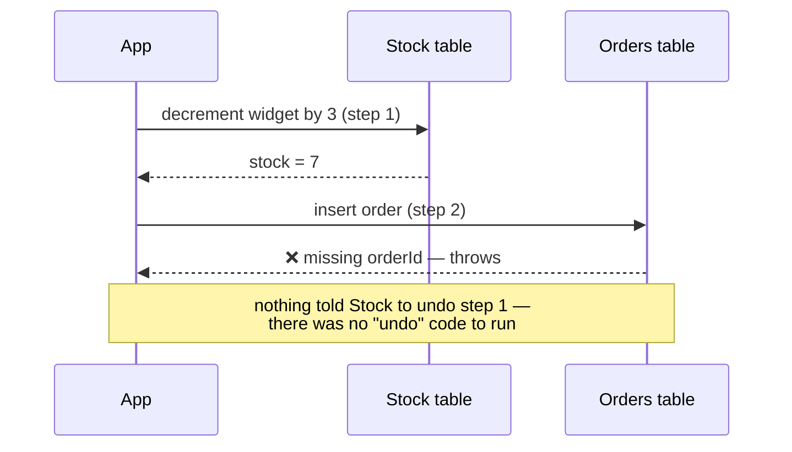
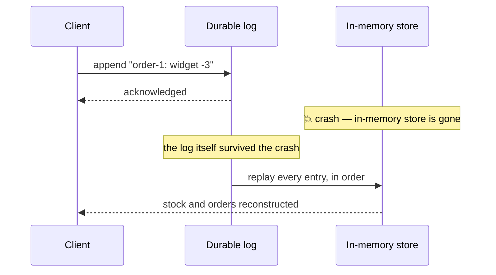

import Scenario from "../../../components/Scenario.astro";
import LevelIntro from "../../../components/LevelIntro.astro";
import Checkpoint from "../../../components/Checkpoint.astro";
import PracticeCheck from "../../../components/PracticeCheck.astro";

export const unit = {
  track: "systems",
  unitSlug: "transactions",
};

<Scenario label="Same failing order, three different levels of protection">
  <Fragment slot="facts">
    <div class="not-prose flex flex-col gap-2 text-sm text-slate-700 dark:text-slate-300">
      <div class="flex items-center gap-1.5"><span>🐛</span> <strong>Naive version</strong> — reproduces L1's exact bug</div>
      <div class="flex items-center gap-1.5"><span>🔄</span> <strong>Transactional version</strong> — atomicity + consistency via rollback</div>
      <div class="flex items-center gap-1.5"><span>💾</span> <strong>Durability</strong> — a write-ahead log surviving a simulated crash</div>
    </div>
  </Fragment>

**Before running the code: if the same failing order (a missing
`orderId`) is placed against both the naive version and the
transactional version, will the stock count end up different between
the two — or will both versions fail in the same way?**

</Scenario>

<LevelIntro
  items={[
    "Reproducing L1's bug in real code",
    "A transaction wrapper with rollback, invariant checks, and the lost-update race that neither one catches alone",
    "A write-ahead log surviving a simulated crash",
  ]}
/>

## Reproducing the bug: two separate writes, no transaction

**If step 1 (decrement stock) and step 2 (insert order) are just two
ordinary statements with nothing wrapping them, does step 1's effect
get undone when step 2 throws — or does nothing ever tell it to?**



| State           | Before the request | After the request (step 2 failed) |
| --------------- | ------------------ | --------------------------------- |
| `stock.widget`  | 10                 | **7** — step 1's effect stuck     |
| `orders.length` | 0                  | **0** — step 2 never landed       |

This is the exact bug from L1, traced to the statement level: step 1
and step 2 are two independent lines of code, so a failure on line 2
has no automatic effect on line 1's already-applied change. Nothing
in either line was buggy — the missing piece is a boundary that would
have treated both lines as one unit.

<PracticeCheck
  track={unit.track}
  unitSlug={unit.unitSlug}
  topicId="partial-write-reproduction"
/>

## The fix: wrap both steps in a transaction with rollback

**If a transaction's whole trick is "do the work somewhere private,
only publish it on success," what has to be true about where that
private work happens for rollback to require zero undo code?**

A transaction wrapper runs the operation against a private working
copy of the data, not the real store — the same "private workspace"
idea from L2's lifecycle diagram, made concrete. `deepClone` and
`stockNeverNegative` are small helpers reused by every example below:
a full copy of the store, and the one invariant this unit's scenario
cares about (stock can't go negative).

```js
function deepClone(obj) {
  return JSON.parse(JSON.stringify(obj));
}

function stockNeverNegative(state) {
  return Object.values(state.stock).every((qty) => qty >= 0);
}

function runTransaction(store, operation, invariant) {
  const working = deepClone(store); // private workspace
  try {
    operation(working); // all writes land here, not on `store`
    if (invariant && !invariant(working)) {
      throw new Error("Invariant violated");
    }
    Object.assign(store, working); // commit: publish all at once
    return { committed: true };
  } catch (err) {
    // `store` was never touched — nothing to undo
    return { committed: false, error: err.message };
  }
}
```

The real `store` is written to in exactly one place — the line right
after the invariant check passes. Every other path through this
function (`operation` throwing, or the invariant returning `false`)
falls into `catch` with `store` completely untouched. That's why
rollback doesn't need its own undo logic per operation: there is
nothing to undo, because nothing real was ever changed in the first
place.

<Checkpoint question="If operation() throws partway through — after already changing working.stock but before pushing to working.orders — would store.stock end up partially changed too?">

No — `store` would be completely untouched, not partially changed.
The mutation happened on `working`, a deep clone made at the top of
`runTransaction`, and `store` is only ever written to by the single
`Object.assign(store, working)` line, which runs only after `operation`
and the invariant check have both completed without throwing. If
`operation` throws at any point — on its first line or its last —
control jumps straight to `catch`, and that commit line simply never
executes. Partial progress inside `operation` has nowhere to leak into
the real `store` unless the commit line is actually reached.

</Checkpoint>

<PracticeCheck
  track={unit.track}
  unitSlug={unit.unitSlug}
  topicId="rollback-mechanism"
/>

## Consistency and success: the same wrapper, three different orders

**Does `runTransaction` need a separate code path for "the operation
itself failed" versus "the operation succeeded but broke a rule"?**
No — both reach the wrapper the same way (a thrown error, whether
thrown by the operation or by the invariant check), so one mechanism
covers both:

| Order attempt                                         | What happens inside `runTransaction`                                                           | Result                                     |
| ----------------------------------------------------- | ---------------------------------------------------------------------------------------------- | ------------------------------------------ |
| Missing `orderId` (L1's exact bug)                    | `operation` throws before the invariant check even runs                                        | `{ committed: false }`, stock stays **10** |
| Valid fields, but orders 15 units against 10 in stock | `operation` succeeds, but `stockNeverNegative(working)` returns `false`, so the wrapper throws | `{ committed: false }`, stock stays **10** |
| Valid fields, orders 3 units                          | `operation` succeeds, invariant holds                                                          | `{ committed: true }`, stock becomes **7** |

The middle row is the important one: that order has no missing field
and would have "worked" in the naive version, silently taking stock
negative. The invariant check catches it structurally, before commit —
consistency enforced by the transaction boundary itself, not by hoping
every caller remembers to check stock levels.

<PracticeCheck
  track={unit.track}
  unitSlug={unit.unitSlug}
  topicId="consistency-invariant-enforcement"
/>

## Durability: surviving a crash right after "success"

**If the in-memory `store` object is wiped out entirely (a crash), can
an already-acknowledged order still be recovered — and from what?**



Durability works by moving the "did this really happen" question off
the in-memory object entirely: the log is what's acknowledged as
durable, and recovery rebuilds state by replaying it — it never needs
the pre-crash `store` object to still exist.

| Moment                                           | Is the order recoverable after a crash right now?                    |
| ------------------------------------------------ | -------------------------------------------------------------------- |
| Before the log entry is appended                 | No                                                                   |
| After the log entry is appended and acknowledged | Yes — replay the log on restart                                      |
| After the in-memory store is also updated        | Yes, same as above — the in-memory copy adds nothing durability-wise |

<Checkpoint question="The diagram acknowledges the client right after the log append, before the in-memory store is ever touched. If a crash happened in that exact gap — log acknowledged, in-memory store not yet updated to match — would the recovered state after restart still include that order?">

Yes — because durability was already satisfied the moment the log
write completed, not when the in-memory store caught up to it. The
log acknowledges success as soon as the entry is durable (standing in
for an `fsync`'d disk write in a real database); everything after
that, including ever updating an in-memory store, is optional
bookkeeping that a crash is allowed to lose. Recovery doesn't need the
old in-memory store at all — it rebuilds state entirely by replaying
the log from scratch. So a crash at exactly that moment changes
nothing about the outcome: the order is in the log, the log is what
recovery replays, and the recovered state includes it regardless of
what did or didn't happen to any in-memory object in between.

</Checkpoint>

<PracticeCheck
  track={unit.track}
  unitSlug={unit.unitSlug}
  topicId="durability-wal-recovery"
/>

## Isolation: what goes wrong when two orders overlap

Atomicity and Consistency, as coded above, both check a single
transaction's own math. Neither one notices a second transaction in
flight at the same time — that gap is exactly what Isolation closes,
and it's worth seeing fail before seeing it fixed.

Three named anomalies come up whenever this topic is discussed, so it's
worth being able to tell them apart by what each one actually lets
leak across transactions:

| Anomaly                 | What leaks                                                                                                                                                     |
| ----------------------- | -------------------------------------------------------------------------------------------------------------------------------------------------------------- |
| **Dirty read**          | Transaction B reads a value Transaction A wrote but hasn't committed yet — and A then rolls back, so B acted on data that never really existed                 |
| **Non-repeatable read** | B reads the same row twice in one transaction and gets two different answers, because A committed a change to that row in between B's two reads                |
| **Phantom read**        | B re-runs the same range query twice and gets a different set of _rows_ the second time, because A inserted or deleted a row that matches the query in between |

The bug below isn't literally any of the three — it's a close cousin
called a **lost update**, and it's the one that matters most for the
stock/order scenario this unit has been using throughout.

<PracticeCheck
  track={unit.track}
  unitSlug={unit.unitSlug}
  topicId="isolation-anomalies"
/>

**Before running the code: `runTransaction` has each caller clone
`store` into its own private `working` copy before doing anything else.
If two separate calls to `runTransaction` both start — both taking
their clone — before either one commits, could both individually pass
the `stockNeverNegative` check, yet the store still end up having
"sold" more stock than it ever had?**

```js
// lost-update.js
const store3 = { stock: { widget: 10 }, orders: [] };

// Both transactions clone the SAME starting store — stock: 10 — before
// either one has committed. This is what "concurrently" means here:
// each clone is a snapshot frozen at a moment when neither transaction
// knows about the other's in-flight work.
const workingA = deepClone(store3);
const workingB = deepClone(store3);

workingA.stock.widget -= 6; // A's own view: 10 - 6 = 4
console.log(stockNeverNegative(workingA)); // true — A's invariant check passes, A commits
Object.assign(store3.stock, workingA.stock);
console.log(store3.stock.widget); // 4

workingB.stock.widget -= 8; // B's own view: 10 - 8 = 2 (B never saw A's 6)
console.log(stockNeverNegative(workingB)); // true — B's invariant check passes too, B commits
Object.assign(store3.stock, workingB.stock);
console.log(store3.stock.widget); // 2
```

The final number, **2**, isn't negative — so a naive glance at
`stockNeverNegative` never catches anything wrong. But 6 + 8 = 14
widgets were sold out of a stock of 10 that only ever existed once.
B's commit didn't add to A's result, it silently overwrote it, because
B's `working` copy was cloned from the stock=10 snapshot that existed
_before_ A ever committed. Each transaction's own math was flawless;
the two transactions' math together was not — and nothing in either
one's own invariant check could have caught that, because each only
ever sees its own `working` copy.

<Checkpoint question="The lost-update bug above happens because workingB was cloned before workingA committed. Would making B's clone happen strictly AFTER A's commit — with no other change to the code — be enough to fix it?">

Yes, for this exact pair of transactions: if B's `deepClone(store3)`
ran after `Object.assign(store3.stock, workingA.stock)` instead of
before it, B's `working` copy would start from `{ widget: 4 }`, not
`{ widget: 10 }` — so `workingB.stock.widget -= 8` would produce `-4`,
`stockNeverNegative(workingB)` would correctly return `false`, and B
would roll back instead of silently overwriting A's result. The fix
isn't a smarter invariant check; it's never letting B take its
snapshot while A still has uncommitted work outstanding. That's exactly
what an isolation mechanism (a lock, or a database's own concurrency
control) has to guarantee — not "check the math harder," but "don't
let two transactions clone the same stale moment in the first place."

</Checkpoint>

This is the difference between isolation levels in a real database:
under a weak level like **READ COMMITTED**, a database guarantees B
never sees A's _uncommitted_ writes (no dirty reads) but says nothing
about B acting on a snapshot that's gone stale the instant A commits —
the lost-update race above is exactly what READ COMMITTED still
allows. **SERIALIZABLE** is the guarantee that the end result is as if
every transaction ran one at a time, in some order, with no overlap at
all — which is strong enough to rule out dirty reads, non-repeatable
reads, phantoms, and lost updates alike, at the cost of either locking
more or aborting and retrying more transactions under contention.

A simple lock models the SERIALIZABLE end of that trade-off directly:
nobody is allowed to even take a clone of `store` while another
transaction's clone is still outstanding.

```js
// isolation-fix-lock.js
let locked = false;

function runTransactionSerialized(store, operation, invariant) {
  if (locked) {
    throw new Error("Store locked by another in-flight transaction");
  }
  locked = true;
  try {
    return runTransaction(store, operation, invariant);
  } finally {
    locked = false;
  }
}

const store4 = { stock: { widget: 10 }, orders: [] };

runTransactionSerialized(
  store4,
  (working) => {
    working.stock.widget -= 6;
  },
  stockNeverNegative,
);
console.log(store4.stock.widget); // 4 — A committed, and crucially, fully finished first

runTransactionSerialized(
  store4,
  (working) => {
    working.stock.widget -= 8;
  },
  stockNeverNegative,
);
console.log(store4.stock.widget); // still 4 — B's clone started AFTER A released
// the lock, so working.stock.widget began at 4, 4 - 8 = -4 failed
// stockNeverNegative, and B rolled back instead of overwriting A
```

Because `runTransactionSerialized` releases the lock only after a
transaction has fully committed or rolled back, B's `deepClone` can't
happen until it does — so B's invariant check runs against the real,
current stock (4), not the stale snapshot (10) from before A ever ran.
The exact same two order attempts that silently lost 4 widgets' worth
of stock in the race above now correctly let A through and reject B.

**Extend it: the lock above serializes every transaction against
every other one, for every product, even when two orders touch
completely unrelated items (one buying widgets, one buying gears).
What would change if the lock were keyed per-product instead of
global — and is there a case where even a per-product lock still isn't
enough (two orders for the same bundle of two different products, each
only holding one of the two product locks)?**

<PracticeCheck
  track={unit.track}
  unitSlug={unit.unitSlug}
  topicId="lost-update-isolation-levels"
/>

## Failure modes

| Failure mode                                                                     | What it gets wrong                                                                                                                 |
| -------------------------------------------------------------------------------- | ---------------------------------------------------------------------------------------------------------------------------------- |
| Treating "the code ran without an unhandled exception" as "it fully succeeded"   | A caught exception partway through a multi-step operation can still leave earlier steps' effects in place, unrolled back           |
| Adding a rollback only for the specific bug that was just found                  | The next multi-step operation without transaction wrapping has the identical structural problem, just with a different bug         |
| Assuming an in-memory success means the change survived                          | Without a durability mechanism (like a write-ahead log), a crash immediately after "success" can erase a change that was reported  |
| Checking invariants only in the UI or API layer, not at the transaction boundary | Anything that writes directly to the data layer bypasses UI-level checks; the invariant has to be enforced where the write happens |
| Assuming atomicity alone is enough                                               | Atomicity stops partial writes; it says nothing about two transactions racing each other — that's isolation's job                  |
