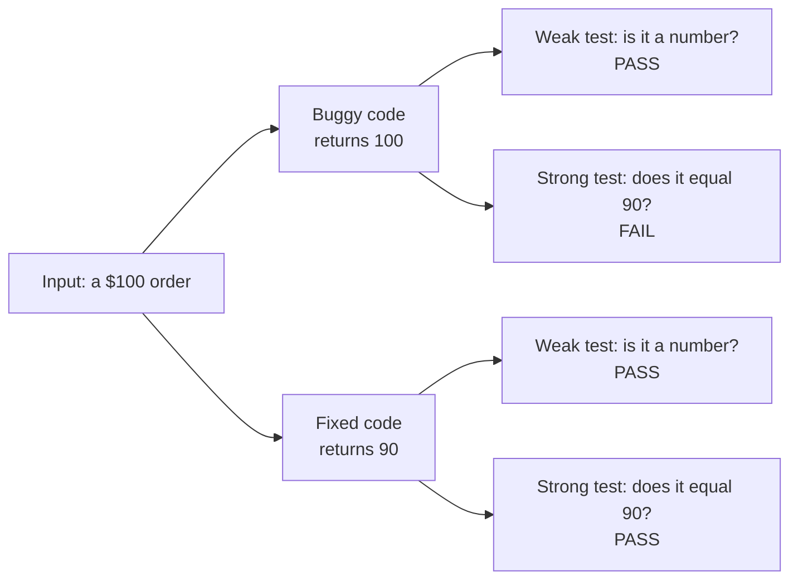

import Scenario from "../../../components/Scenario.astro";
import LevelIntro from "../../../components/LevelIntro.astro";
import PracticeCheck from "../../../components/PracticeCheck.astro";

export const unit = {
  track: "testing-quality",
  unitSlug: "assertions-matter",
};

<Scenario label="Every smoke alarm passed its check, and one had no battery">
  <Fragment slot="facts">
    

      
🔔 <strong>The alarm</strong> — screwed to the ceiling, wired to a small green light

      
🪫 <strong>The gap</strong> — the battery compartment is empty

      
✅ <strong>The check</strong> — "is it mounted on the ceiling?" Yes, so it passes

    

  </Fragment>

Each spring, someone walks through a building and checks every smoke alarm
by looking up and confirming it is mounted on the ceiling. All of them pass.
One has no battery inside. **The check ran on every alarm and never failed.
So why did it tell nobody that this alarm cannot sound?**

Because "mounted on the ceiling" is true of a working alarm and a dead one
alike. The check touched the alarm. It never asked the question that matters:
would it make a noise if there were smoke?

</Scenario>

<LevelIntro
  items={[
    "Why a passing test can prove nothing",
    "What a tautological assertion is",
    "The question that sorts weak from strong",
  ]}
/>

## Does the same trap exist in code?

**If a test can pass without checking the thing that matters, what does that
look like in a real function?** Here is a small spec and a one-character bug:

| Piece         | Detail                                                                                             |
| ------------- | -------------------------------------------------------------------------------------------------- |
| The spec      | An order of $100 or more gets 10% off, so a $100 order costs $90                                   |
| The bug       | The code checks `subtotal > 100` instead of `subtotal >= 100`, so a $100 order costs $100          |
| The old test  | Asserts that the result for a $100 order "is a number"                                             |
| What happened | The old test passes on the buggy code, because `100` is a number, and passes on the fixed `90` too |

The same $100 order goes through both versions, and the weak and strong tests
disagree about what they can see:

Only the strong test treats the buggy version and the fixed version
differently. The weak test gives the same answer for both, so its green tick
carries no information about the discount.

## What separates a weak assertion from a strong one?

**What question can you ask of any assertion before trusting it?** Ask: _if
the code had a plausible bug, would this assertion fail?_ If the honest answer
is "no, it would pass either way," the assertion is a **tautological** one: it
is guaranteed to pass whether or not the code is right.

| Assertion on the result of a $100 order | Fails on the buggy code? | What passing actually proves            |
| --------------------------------------- | ------------------------ | --------------------------------------- |
| "It is a number"                        | No                       | The function ran and returned a number  |
| "It is not empty"                       | No                       | The function returned something         |
| "It does not throw"                     | No                       | The function did not crash              |
| "It equals 90"                          | Yes                      | The discount is applied at exactly $100 |

- **A passing test only proves what its assertion checks.** "Ran without
  crashing" and "gave the right answer" are different claims.
- **More tests are not the cure.** The codebase in the story already had a
  test for this function. The cure is an assertion precise enough to tell the
  correct behaviour from the specific wrong behaviours that are likely.
- **The habit to build:** before trusting a green test, name the bug it would
  have caught. If you cannot, it needs a sharper assertion.

<PracticeCheck
  track={unit.track}
  unitSlug={unit.unitSlug}
  topicId="weak-vs-strong"
/>
