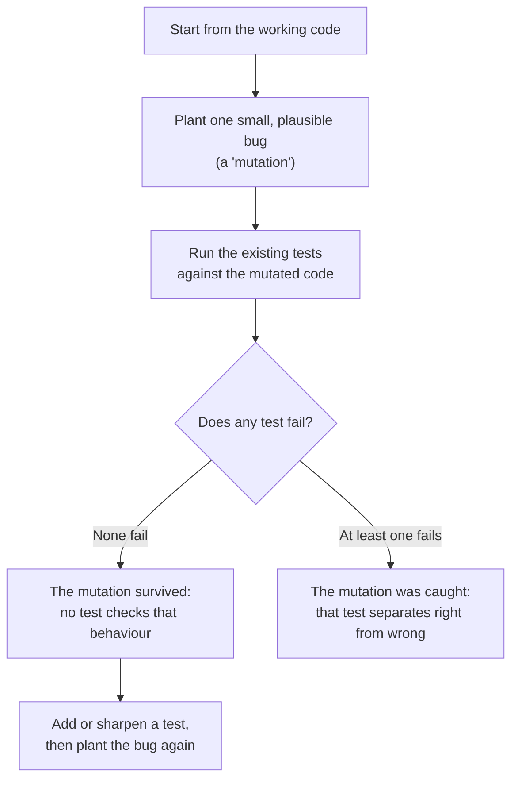

import LevelIntro from "../../../components/LevelIntro.astro";
import Checkpoint from "../../../components/Checkpoint.astro";
import PracticeCheck from "../../../components/PracticeCheck.astro";

export const unit = {
  track: "testing-quality",
  unitSlug: "assertions-matter",
};

L1 gave one question for sorting weak assertions from strong ones: would it
fail if the code had a plausible bug? L2 turns that question into a repeatable
check, shows why the input you choose matters as much as the assertion, and
works out how far "assert on the exact output" should go.

<LevelIntro
  items={[
    "The mutation check, done by hand",
    "Why the input must be able to tell versions apart",
    "Behaviour versus implementation details",
  ]}
/>

## How do you check a test is doing work, instead of eyeballing it?

**Is there a concrete procedure for "would it fail on a plausible bug", or is
it just a feeling?** There is one. Plant the bug yourself and see whether
anything notices:

Do it by hand: flip a comparison, shift an index by one, swap `&&` for `||`,
change a constant. If every test still passes, those tests ran the code
without verifying its behaviour. A tool that automates this is called
mutation testing, but the idea is the same with one edit and one test run.

Two cautions keep the check honest. A change that cannot alter behaviour,
such as renaming a local variable, is not a useful mutation, because nothing
could notice it. And "every line was executed by a test" is not the same as
"every line was checked": the weak test in L1 executed the discount line and
still missed the bug.

<PracticeCheck
  track={unit.track}
  unitSlug={unit.unitSlug}
  topicId="mutation-check"
/>

## Why did the $100 order expose the bug when a $150 order would not?

**If the assertion is strong, is the test done?** Not yet, because a test is
an input plus an assertion, and the input has to be one the two versions
disagree on. Run the same two implementations on two inputs:

| Subtotal | Buggy (`> 100`) returns | Fixed (`>= 100`) returns | Can this input tell them apart? |
| -------- | ----------------------- | ------------------------ | ------------------------------- |
| 150      | 135                     | 135                      | No, same answer                 |
| 100      | 100                     | 90                       | Yes, different answers          |

Off-by-one bugs live at the **boundary**, the exact value where the rule
changes. A suite that tries 25, 75 and 200 can look thorough, with many
different amounts all passing, and still never visit the one value where the
two versions disagree.

<Checkpoint question="A suite runs the order function on subtotals 25, 75 and 200, each with an exact-value assertion (25, 75 and 180). Does it catch the greater-than versus greater-than-or-equal bug at the $100 threshold?">

No. Every assertion is strong, because each checks an exact value, but none of
the three inputs sits on the boundary. The buggy and fixed versions return
identical results for all three: 25 stays 25, 75 stays 75, and 200 becomes 180
under both. A strong assertion only catches a bug when it is paired with an
input that separates the buggy behaviour from the correct one. This suite
looks thorough and never touches the single value, exactly 100, where the two
versions disagree.

</Checkpoint>

Each independent threshold has its own boundary, so each needs its own
exact-boundary input. The demo on this level lets you add thresholds and see
the minimum grow by one per threshold: passing a check at one boundary says
nothing about another.

<PracticeCheck
  track={unit.track}
  unitSlug={unit.unitSlug}
  topicId="boundary-inputs"
/>

## Should a strong test check how the function works inside?

**If exact output is good, are exact internals even better?** No. There are
two things a test can pin down: what the function _returns_ for an input (its
behaviour, which should stay true through any rewrite) and _how_ it gets
there (an implementation detail, free to change). A test that insists a
helper named `applyDiscount` was called breaks the day someone inlines that
helper, even though no customer sees any difference.

| Kind of assertion      | Example                                 | Breaks on a harmless refactor? | Catches the boundary bug? |
| ---------------------- | --------------------------------------- | ------------------------------ | ------------------------- |
| Tautological           | "the result is a number"                | No                             | No                        |
| Implementation-coupled | "the helper `applyDiscount` was called" | Yes                            | Only by accident          |
| Behaviour, strong      | "a $100 order returns 90"               | No                             | Yes                       |

The tautological test and the coupled test fail in opposite directions. The
first passes when it should fail. The second fails when it should pass. Both
make the red and green signal less trustworthy.

<Checkpoint question="A refactor renames the internal helper applyDiscount and inlines it, without changing what the order function returns for any input. Does a behaviour-focused suite need changes?">

No. A behaviour-focused assertion looks only at what the function returns for
a given input, so renaming or inlining a helper that callers never see does
not touch anything the test asserts on. That is the payoff of testing
behaviour: the test stays green through refactors that do not change
correctness, and turns red only if a refactor accidentally changes what comes
back, which is exactly the signal worth having.

</Checkpoint>

**Does that mean you must never assert on a general property?** No. If a
function's real contract is general, such as "returns some valid, unique ID",
there is no single exact value to assert on, and a property that matches the
contract is the strong assertion. The skill is not "always compare to an exact
value". It is to ask which plausible bug the test must catch, then pick the
assertion and the input that would fail if that bug were present.

<PracticeCheck
  track={unit.track}
  unitSlug={unit.unitSlug}
  topicId="behaviour-vs-implementation"
/>
