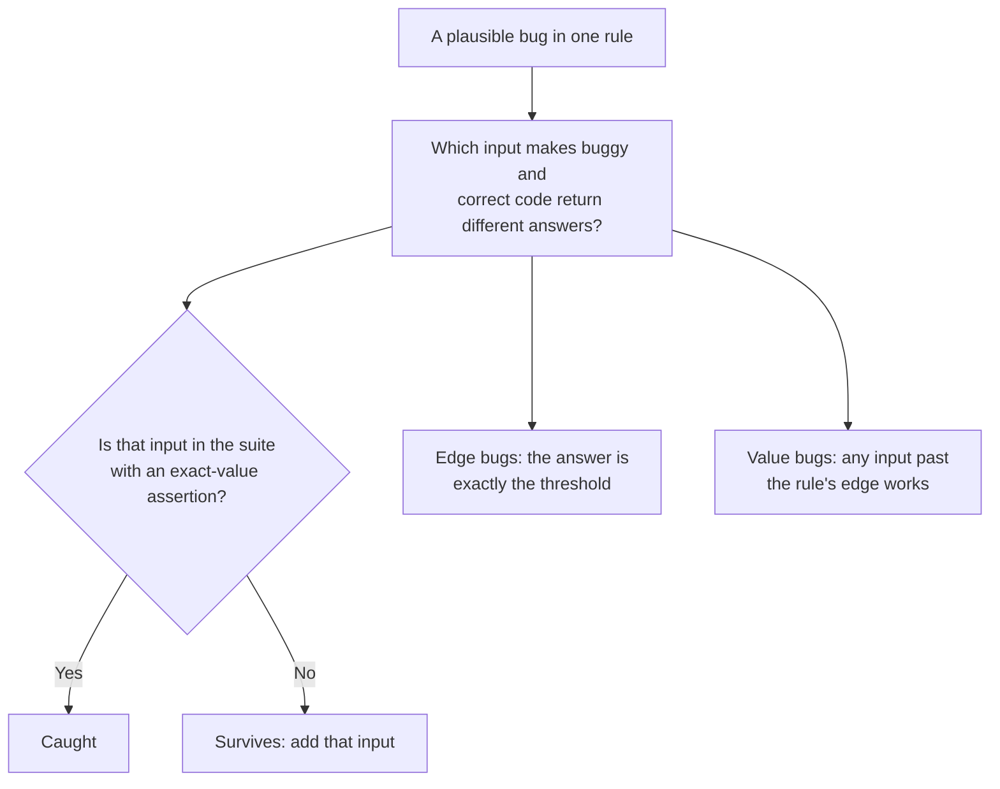

import Scenario from "../../../components/Scenario.astro";
import LevelIntro from "../../../components/LevelIntro.astro";
import Checkpoint from "../../../components/Checkpoint.astro";
import PracticeCheck from "../../../components/PracticeCheck.astro";

export const unit = {
  track: "testing-quality",
  unitSlug: "assertions-matter",
};

<Scenario label="One test at $100, and a second rule nobody tested">
  <Fragment slot="facts">
    <div class="not-prose flex flex-col gap-2 text-sm text-slate-700 dark:text-slate-300">
      <div class="flex items-center gap-1.5"><span>💰</span> <strong>Discount</strong> — subtotal 100 or more takes 10% off</div>
      <div class="flex items-center gap-1.5"><span>🚚</span> <strong>Shipping</strong> — subtotal 50 or more ships free, otherwise 7.50</div>
      <div class="flex items-center gap-1.5"><span>🧪</span> <strong>The suite</strong> — exact-value checks at 49 and 100 only</div>
    </div>
    <div class="not-prose mt-3 flex flex-col gap-1.5 text-xs text-slate-700 dark:text-slate-300">
      <div>
        <div class="flex justify-between"><span>Thresholds with an exact-boundary test</span><span>1 of 2</span></div>
        <div class="h-2 w-full overflow-hidden rounded-full bg-slate-200 dark:bg-slate-700"><div class="h-full rounded-full bg-emerald-500 animate-fill-bar" style="--target-width: 50%"></div></div>
      </div>
    </div>
  </Fragment>

The order function now has two separate rules, and the suite only tests the
exact edge of one of them. **Before reading on, predict: if someone changes
the free-shipping check from "50 or more" to "more than 50", does this suite
notice?**

</Scenario>

<LevelIntro
  items={[
    "Which inputs catch which planted bug",
    "Why one boundary never covers another",
    "A reusable test for any input and bug",
  ]}
/>

## Which planted bug does each input catch?

**How do you answer the prediction without guessing?** Run the mutation check
from L2, once per bug, over a handful of inputs. The correct function, with
both rules:

```js
function orderTotal(subtotal) {
  const afterDiscount = subtotal >= 100 ? subtotal * 0.9 : subtotal;
  const shipping = subtotal >= 50 ? 0 : 7.5;
  return afterDiscount + shipping;
}
```

Correct results are 56.5 at 49, 50 at 50, 99 at 99, 90 at 100 and 135 at 150.
Four plausible bugs get planted one at a time, and the table marks every
input that returns a different answer from the correct function (computed by
running all four mutants):

| Planted bug                            | 49  | 50  | 99  | 100 | 150 |
| -------------------------------------- | --- | --- | --- | --- | --- |
| Discount check becomes "more than 100" | -   | -   | -   | YES | -   |
| Shipping check becomes "more than 50"  | -   | YES | -   | -   | -   |
| Shipping fee becomes 9 instead of 7.5  | YES | -   | -   | -   | -   |
| Discount rate becomes 20% not 10%      | -   | -   | -   | YES | YES |

Each row has a different set of catching inputs, so no single test input is
the best. The suite from the story (49 and 100) catches rows 1, 3 and 4 and
**misses row 2**: the only input that exposes the shipping edge is exactly 50.
The answer to the prediction is no.



Notice what the table says about the two kinds of bug. A **value** bug (the
fee, the rate) shows up on any input where that rule applies, so it is
easy to catch. An **edge** bug (`>` for `>=`) shows up on one input only, the
threshold itself.

<Checkpoint question="The suite tests 49 and 100 with exact assertions and passes. A teammate says the order function's thresholds are verified. What is the strongest objection?">

Only one of the two thresholds has an exact-boundary test. The input 100
exercises the discount edge, and the input 49 sits below the shipping edge
rather than on it. Because the two rules are separate conditions, a pass at one
edge carries no information about the other: the shipping check can be wrong in
the same one-character way and still leave every existing test green. Each
independent threshold needs its own input at the threshold value.

</Checkpoint>

<PracticeCheck
  track={unit.track}
  unitSlug={unit.unitSlug}
  topicId="second-boundary"
/>

## How do you encode "does this input catch that bug" as a reusable test?

**Could the comparison you did by hand for 20 cells be one small function?**
Yes, because the whole idea is a single comparison:

```js
// true when the input separates the correct version from the buggy one
const catches = (correctFn, buggyFn, input) =>
  correctFn(input) !== buggyFn(input);
```

Calling it on the discount bug gives `catches(correct, buggy, 100)` as true and
`catches(correct, buggy, 150)` as false. Looped over every planted bug and
every candidate input, it produces the table above, and any bug whose whole
row is empty tells you which test to write next. This is writing the check
rather than reading it, and it is the only place in this unit where code is
the clearest vehicle, so the exercises for this level ask you to write a few
such helpers.

<Checkpoint question="A bug survives your whole suite: the helper reports no input catches it. Before adding a test, what should you double-check about the bug itself?">

Check that it really changes behaviour. A mutation that cannot alter any
output, such as renaming a local variable or reordering two independent
statements, will survive every suite on earth, and adding a test for it is
wasted effort. If the bug does change some output, find the input where the
two versions differ, which is usually the threshold or another edge, and write
the exact-value test there.

</Checkpoint>

<PracticeCheck
  track={unit.track}
  unitSlug={unit.unitSlug}
  topicId="test-input-code"
/>

## Extend the case: what changes if the facts change?

This is one worked example, a case, not the whole territory. Try bending it
before moving on:

- **What if a third rule appears,** say an extra 5% off at 200? Which new
  input does the suite need, and does anything about 49 or 100 change?
- **What if two rules interact,** so the shipping threshold depends on the
  discounted price instead of the raw subtotal? Which inputs now sit on the
  edge, and does the table's "any input past the edge" shortcut still hold?
- **What if the values are not whole dollars,** such as 99.99 and 100.00? How
  would the one-cent neighbours change which inputs you pick?
- **What if the spec lived in a different domain** (an age range, a retry
  limit, a password length)? The procedure is identical: list the plausible
  bugs, find the input that separates each from the correct code, and check it
  is in the suite with an exact assertion.

## Failure modes

| Failure mode                                                            | What it gets wrong                                                       |
| ----------------------------------------------------------------------- | ------------------------------------------------------------------------ |
| Asserting on type or truthiness when the risk is a specific value       | Passes identically whether the code is right or subtly wrong             |
| Testing only values well inside a range                                 | Off-by-one bugs live on the boundary and go untested                     |
| A strong assertion paired with an input that cannot tell versions apart | The test is exact but blind: both versions give the same answer          |
| Verifying one boundary and assuming the rest are covered                | Every independent threshold has its own edge and its own off-by-one risk |
| Asserting on internal calls instead of returned output                  | Breaks on harmless refactors, a false alarm instead of a false all-clear |
