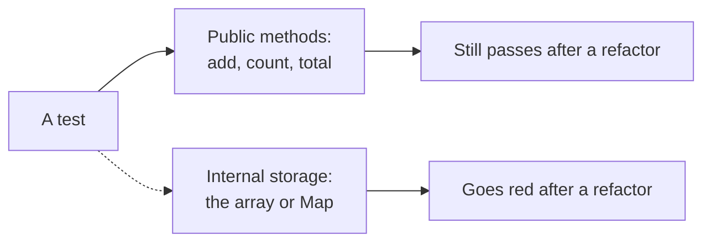

import Scenario from "../../../components/Scenario.astro";
import LevelIntro from "../../../components/LevelIntro.astro";
import PracticeCheck from "../../../components/PracticeCheck.astro";

export const unit = {
  track: "testing-quality",
  unitSlug: "bdd",
};

<Scenario label="No behavior changed, but 15 tests turned red">
  <Fragment slot="facts">
    

      
🔧 <strong>The refactor</strong> — a shopping cart's internal storage changes from an array to a Map

      
✅ <strong>What still works</strong> — adding items, getting the total, counting items

      
🔴 <strong>What broke</strong> — 15 tests that read <code>cart.items</code> directly

    

    

      

        
Tests red after the refactor15 of 15 that touch internals

        

      

    

  </Fragment>

A shopping cart stores its items in an array. Someone swaps the array for a
`Map` so that finding an item by name is quick. Adding items, the item count and
the total all give the same answers as before. Then 15 tests go red. **Nothing a
customer could notice changed. Why did the tests fail?**

The 15 tests all peek inside the cart (`cart.items`) instead of asking it
questions through its normal methods.

</Scenario>

<LevelIntro
  items={[
    "Behavior versus implementation detail",
    "The public interface as the real contract",
    "Given-When-Then as a test shape",
  ]}
/>

## What is a test really allowed to look at?

**When a test checks a cart, what can it point at?** Two very different things.

| Test points at                      | Example                           | Survives the array-to-Map change? |
| ----------------------------------- | --------------------------------- | --------------------------------- |
| The public interface (what it does) | `getTotal()` returns 40           | Yes                               |
| Internal storage (how it is stored) | `cart.items[0]` is the first item | No                                |

<PracticeCheck
  track={unit.track}
  unitSlug={unit.unitSlug}
  topicId="behavior-vs-implementation"
/>

## Key terms

- **BDD (behavior-driven development)**: describing and testing what a system
  does as seen from outside, not how it does it inside.
- **Public interface**: the methods other code is meant to call. This is the
  real contract.
- **Implementation detail**: internal structure the author may change freely, as
  long as the public behavior stays the same.
- **Given-When-Then**: a three-line way to state a behavior test: the starting
  situation, the action, the observable result.

## What the next levels cover

L2 draws the line between behavior and implementation and shows Given-When-Then
in practice, including what behavior tests do not protect against. L3 runs both
test styles against the actual array-to-Map change and then asks you to push the
case further.
