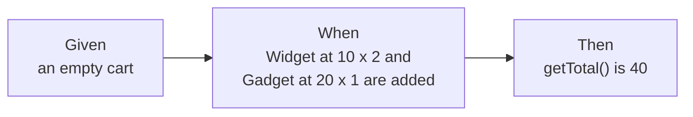

import LevelIntro from "../../../components/LevelIntro.astro";
import Checkpoint from "../../../components/Checkpoint.astro";
import PracticeCheck from "../../../components/PracticeCheck.astro";

export const unit = {
  track: "testing-quality",
  unitSlug: "bdd",
};

L1 showed the symptom: 15 tests broke on a change nobody could observe. L2
works out where the line sits between what a test may depend on and what it may
not, and how Given-When-Then keeps a test on the right side of it.

<LevelIntro
  items={[
    "Public interface versus internal state",
    "Given-When-Then structure",
    "What behavior tests do and do not protect",
  ]}
/>

## Who is allowed to depend on what?

**If a cart's storage is free to change, why would a test be allowed to depend
on it?** It is not. Other code in the codebase only calls the public methods, so
those methods are the contract. Storage is private to the class.

| Layer                | Who may rely on it            | Free to change?                         |
| -------------------- | ----------------------------- | --------------------------------------- |
| Public methods       | Every caller, including tests | Only deliberately, as a behavior change |
| Return values        | Every caller, including tests | Same                                    |
| Internal data layout | Only the class itself         | Yes, any time                           |

A test that reads internal layout quietly turns a private detail into a
promise. Every later refactor then has to either keep the detail alive or
rewrite the test.

<Checkpoint question="A test asserts that the cart's internal storage has length 2 after two different items are added. The storage is changed from an array to a Map. Is the red test evidence that the cart broke?">

No. The cart still adds, counts and totals correctly. The test was checking a
detail that was never part of the contract (that the storage is an array with a
length), so its failure is a false alarm about the refactor. The test, not the
cart, is what needs fixing.

</Checkpoint>

<PracticeCheck
  track={unit.track}
  unitSlug={unit.unitSlug}
  topicId="behavior-vs-implementation"
/>

## How does a test say what it checks without naming internals?

**What shape keeps a test about behavior?** Three parts, each phrased only in
terms an outside caller could see.

| Part  | Question it answers                | Must not mention                  |
| ----- | ---------------------------------- | --------------------------------- |
| Given | What situation are we starting in? | How the situation is stored       |
| When  | What does the caller do?           | Private helper steps              |
| Then  | What can the caller observe?       | Fields, arrays, maps, call counts |

Given-When-Then is a way to narrate a behavior test, not a different kind of
test. Relabelling an assertion on internals as three lines does not make it a
behavior test.

<PracticeCheck
  track={unit.track}
  unitSlug={unit.unitSlug}
  topicId="given-when-then"
/>

## What do behavior tests protect you from, and what not?

**If behavior tests survive refactors, are they a complete safety net?** No.
They protect against two things and are silent about a third.

| Situation                             | Behavior test result |
| ------------------------------------- | -------------------- |
| Internal refactor, same behavior      | Stays green          |
| A real change in what callers observe | Goes red, correctly  |
| A behavior nobody wrote a test for    | Nothing, either way  |

A green suite means "no tested behavior changed", not "nothing changed". The
fix for a gap is writing a test for the missing behavior, not reaching into
internals to feel safer.

<Checkpoint question="After the refactor, all behavior tests are green. Does that prove the cart behaves exactly as before in every respect?">

No. It proves the behaviors that have a test are unchanged. A behavior without
a test (say, what happens when the same item is added twice) can change
silently. Behavior tests are only as complete as the list of behaviors someone
decided to write down.

</Checkpoint>

<PracticeCheck
  track={unit.track}
  unitSlug={unit.unitSlug}
  topicId="refactor-safety"
/>

## The generalizable lesson

A test should fail for exactly one reason: something a caller can observe has
changed. Anything else it reacts to is noise, and noise teaches the team to
distrust red tests.
