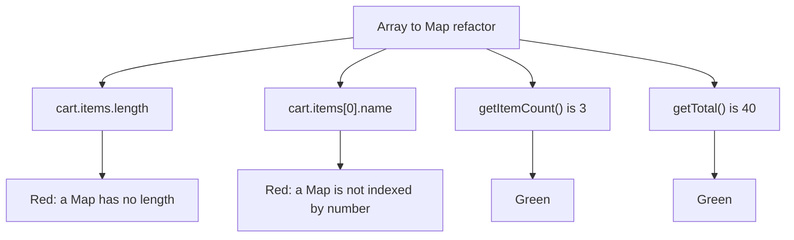

import Scenario from "../../../components/Scenario.astro";
import LevelIntro from "../../../components/LevelIntro.astro";
import Checkpoint from "../../../components/Checkpoint.astro";
import PracticeCheck from "../../../components/PracticeCheck.astro";

export const unit = {
  track: "testing-quality",
  unitSlug: "bdd",
};

<Scenario label="Same refactor, two different test suites">
  <Fragment slot="facts">
    <div class="not-prose flex flex-col gap-2 text-sm text-slate-700 dark:text-slate-300">
      <div class="flex items-center gap-1.5"><span>📦</span> <strong>V1</strong> — cart stores items in an array</div>
      <div class="flex items-center gap-1.5"><span>🗺️</span> <strong>V2</strong> — same methods, items stored in a Map</div>
      <div class="flex items-center gap-1.5"><span>🎯</span> <strong>Goal</strong> — run both test styles against both versions</div>
    </div>
  </Fragment>

**Before reading on, predict.** `cart.items[0].name` and `cart.getItemCount()`
both tell you something about the cart's contents. After the array becomes a
Map, which one still works, and why does it depend on more than "both read a
property"?

</Scenario>

<LevelIntro
  items={[
    "Both test styles run against both versions",
    "Reading a red test: regression or false alarm",
    "Where behavior tests stop helping",
  ]}
/>

## What do the two versions share, and what differs?

V1 and V2 expose the same three methods. Only the storage differs, and V2 also
merges quantities when the same item is added twice.

| Aspect                      | V1 (array)         | V2 (Map)                       |
| --------------------------- | ------------------ | ------------------------------ |
| `addItem(name, price, qty)` | pushes an entry    | sets or merges by name         |
| `getItemCount()`            | sum of quantities  | sum of quantities              |
| `getTotal()`                | sum of price x qty | sum of price x qty             |
| `cart.items.length`         | a number           | `undefined` (a Map has `size`) |
| `cart.items[0]`             | first entry        | `undefined`                    |

Test input: Widget at 10 x 2 and Gadget at 20 x 1. Count is 2 + 1 = 3 and the
total is 10 x 2 + 20 x 1 = 40.

## Which assertions survive?

The only code that matters is the pair of assertions themselves:

```js
// Implementation-coupled: reads storage
expect(cart.items.length).toBe(2);
// Behavior-based: asks the public interface
expect(cart.getTotal()).toBe(40);
```



<Checkpoint question="Both test styles build the cart with the same addItem calls. What actually separates them, if not the setup?">

What they check afterwards. Both use the public `addItem` to set up. One then
inspects private storage (`items.length`, `items[0]`), the other asks the cart's
own reporting methods. The setup is identical; the question asked of the result
is not, and only one of those questions is part of the cart's contract.

</Checkpoint>

<PracticeCheck
  track={unit.track}
  unitSlug={unit.unitSlug}
  topicId="behavior-vs-implementation"
/>

## How do you read a red test after a refactor?

**When a test goes red after an internal change, is it a regression?** Ask what
it was checking.

| What the red test checked                        | What the red means                      |
| ------------------------------------------------ | --------------------------------------- |
| An observable result (a total, a count)          | A real regression: investigate the code |
| An internal layout (a field, an index)           | A false alarm: fix or delete the test   |
| An observable result that was changed on purpose | Update the test along with the change   |

The interactive demo makes the cost concrete: with N tests reading internals, a
storage refactor turns exactly N red, while behavior tests stay at 0 however many
there are. At 15 it reproduces L1's scenario.

<PracticeCheck
  track={unit.track}
  unitSlug={unit.unitSlug}
  topicId="refactor-safety"
/>

## Extend it yourself

This is one case, not the whole territory. Try these:

- The Given-When-Then for the total: _Given_ an empty cart, _When_ Widget (10 x 2)
  and Gadget (20 x 1) are added, _Then_ `getTotal()` is 40. Write one for the
  merge behavior V2 introduced. What does the Then say, and why does it need no
  mention of a Map?
- What if the cart exposed `items` publicly and other code relied on it being an
  array? Is reading it still an implementation detail?
- What if the refactor were slower but the tests only check results: should the
  behavior suite catch that?

## Failure modes

| Failure mode                                             | What it gets wrong                                                  |
| -------------------------------------------------------- | ------------------------------------------------------------------- |
| Asserting on a private field because it is handy         | Convenience now, breakage on an unrelated refactor later            |
| Thinking the public interface excludes return values     | Outputs are part of the interface and are what behavior tests check |
| Treating every red test after a refactor as a regression | An implementation-coupled failure is a test problem                 |
| Relabelling internals checks as Given-When-Then          | Three labelled lines still reaching into storage are not behavior   |
| Avoiding refactors because "it breaks the tests"         | Usually a sign the tests are coupled to storage                     |
