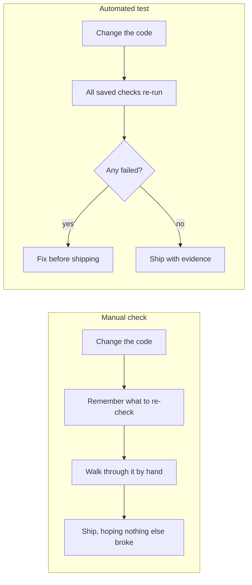

import Scenario from "../../../components/Scenario.astro";
import LevelIntro from "../../../components/LevelIntro.astro";
import PracticeCheck from "../../../components/PracticeCheck.astro";
import { Icon } from "astro-icon/components";

export const unit = {
  track: "testing-quality",
  unitSlug: "case-automated-testing",
};

<Scenario label="Leaving the house: every light you checked was off">
  <Fragment slot="facts">
    

      
<Icon name="lucide:circle-check" class="h-4 w-4" /> <strong>Kitchen</strong> — on your way out, checked, off

      
<Icon name="lucide:circle-check" class="h-4 w-4" /> <strong>Hallway</strong> — on your way out, checked, off

      
<Icon name="lucide:circle-help" class="h-4 w-4" /> <strong>Garage</strong> — not on your route, never looked at

    

    

      Nine days later you come home to a garage light that has been on the
      whole time. Every check you did was true. The check just never
      reached the garage.
    

  </Fragment>

Before a nine-day trip you walk through the house, glance at the kitchen and
the hallway, and see both lights off. You leave feeling certain the house is
switched off. When you return, the garage light has been burning the whole
time. You never walked past the garage, so you never looked.

**You checked, and everything you checked was fine. So why was "I checked the
lights" not the same as "the lights are off"?**

</Scenario>

Software has the same blind spot. A developer fixes a shared pricing function
and clicks through checkout to confirm it. Checkout works. Nine days later a
support ticket shows that the refund tool, which quietly uses the same
function, has been wrong since the day the fix shipped. Nobody walked past the
garage.

<LevelIntro
  items={[
    "What a manual check actually proves",
    "Automated tests as a checklist that runs itself",
    "Why the cost of checking decides whether it happens",
  ]}
/>

## What does "I checked it" actually prove?

**Which claims can the kitchen-and-hallway walk support, and which can't it?**
A check covers exactly what you looked at, at the moment you looked.

| Claim                                       | Supported by the walk-through? |
| ------------------------------------------- | ------------------------------ |
| The kitchen light was off when I looked     | Yes                            |
| The hallway light was off when I looked     | Yes                            |
| The garage light is off                     | No, never looked               |
| The kitchen light is still off a week later | No, a snapshot expires         |

A manual check is a **snapshot**: one run, with the inputs you happened to try,
at the moment you tried them. It is not a guarantee about other inputs, other
places that share the same code, or tomorrow's version of the code. When code
that used to work stops working after a change elsewhere, that is a
**regression**, and a snapshot taken before the change cannot see it.

<PracticeCheck
  track={unit.track}
  unitSlug={unit.unitSlug}
  topicId="manual-snapshot"
/>

## What would a checklist that runs itself change?

**What if the walk-through were written down and ran on its own every time
someone changed anything?** That is an automated test: the same check, kept
as a script, so asking "did I break something?" costs almost nothing and gets
asked every time.

| Property      | Manual check                       | Automated test                      |
| ------------- | ---------------------------------- | ----------------------------------- |
| Repeatability | Depends on a person doing it again | Runs the same steps every time      |
| Speed         | Costs a person's time on each run  | Cheap enough to run on every change |
| Specificity   | "Something is broken" found later  | Names the exact check that failed   |

The garage light in code form is the refund tool. In this unit's example the
wrong refunds went unnoticed for 9 days, with 4 affected refunds a day, each
costing 35 dollars of investigation and correction (all three numbers are
assumptions for the example, not measurements). That is 9 × 4 × 35 = 1,260
dollars. The demo below lets you drag the days back toward zero, which is where
a test that runs before shipping would put them.

This unit is the case for automated testing, not a tour of test techniques.
The goal is the argument: "it worked when I checked it" and "it works" are
different claims, and the distance between them grows as the code ages.
