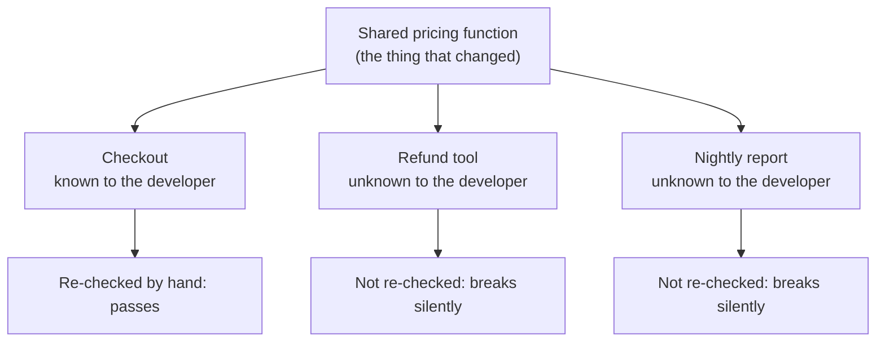
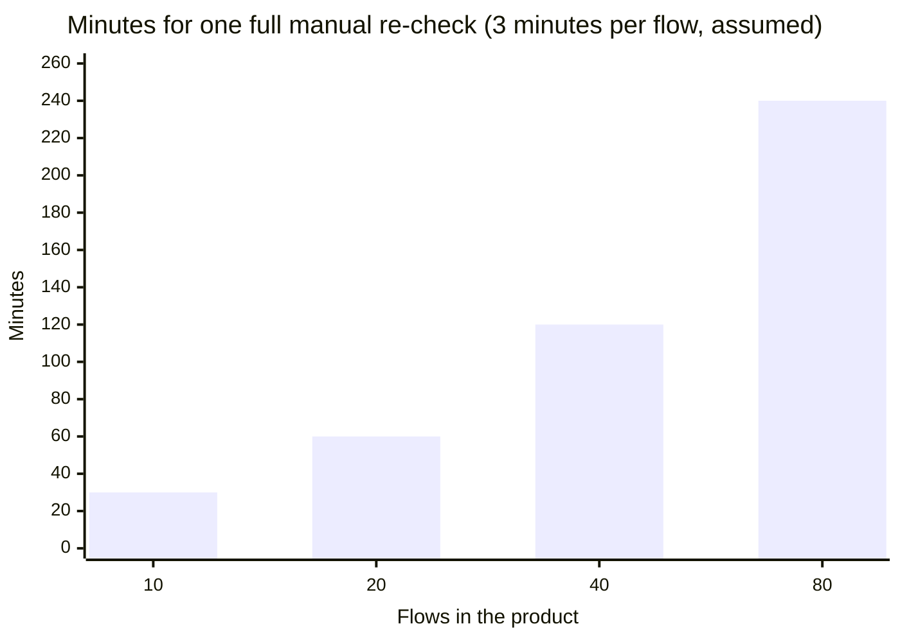
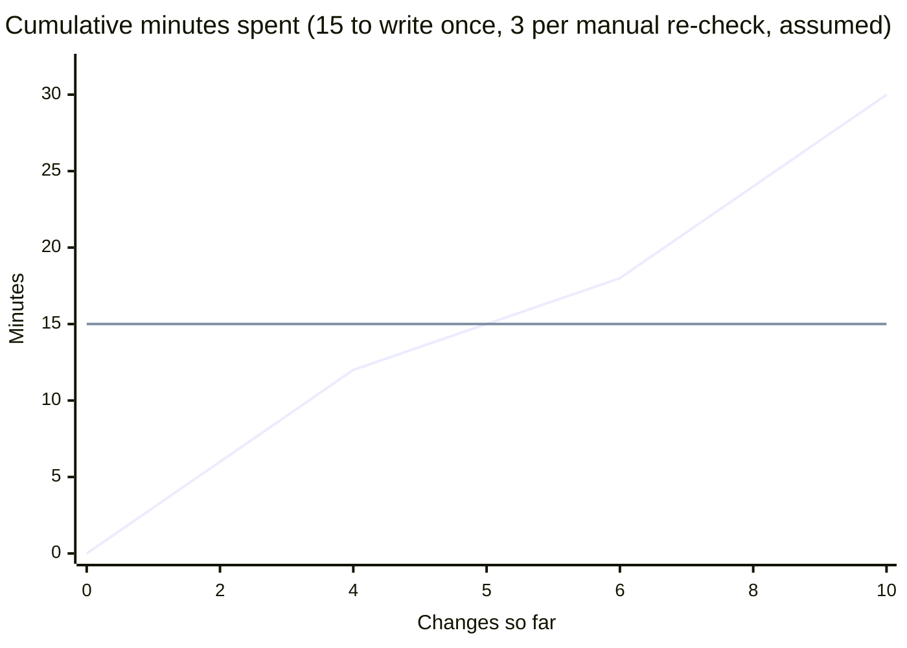

import LevelIntro from "../../../components/LevelIntro.astro";
import Checkpoint from "../../../components/Checkpoint.astro";
import PracticeCheck from "../../../components/PracticeCheck.astro";

export const unit = {
  track: "testing-quality",
  unitSlug: "case-automated-testing",
};

L1 showed that a manual check is a snapshot and that a check which runs itself
can be asked again for free. L2 asks two follow-up questions. Why does a
careful person still miss the broken thing, and why does re-checking by hand
get harder every month even if nobody gets lazier?

<LevelIntro
  items={[
    "Why careful people still miss indirect breakage",
    "How manual re-check cost grows with the codebase",
    "The upfront cost against compounding savings",
  ]}
/>

## Why does a careful person still miss the broken thing?

**The developer checked checkout thoroughly. What exactly could they not
check?** Not a lack of effort: the refund tool. They did not know it used the
function they changed. One shared function can serve many features, and the
developer can only re-check the ones they know about.

| What limits the check         | Manual re-check                     | Automated suite                      |
| ----------------------------- | ----------------------------------- | ------------------------------------ |
| Which places get re-checked   | Those the person knows depend on it | Every check that was ever written    |
| Effect of being extra careful | Better checks of the known places   | Not needed to reach the unknown ones |
| Where the blind spot lives    | In the person's picture of the code | Only in behaviors nobody wrote down  |

<Checkpoint question="If the developer had been twice as careful, would the refund tool have been re-checked? Why or why not?">

No. Care improves how well the known places are checked; it cannot add places
the person does not know exist. The limit is visibility, not effort. A saved
check for the refund behavior does not depend on anyone remembering the refund
tool at the moment of the change, because it simply runs along with every other
saved check.

</Checkpoint>

<PracticeCheck
  track={unit.track}
  unitSlug={unit.unitSlug}
  topicId="hidden-callers"
/>

## When does checking by hand stop being possible?

**If every change should trigger a full re-check, what does that cost as the
product gets more flows?** Use two stated assumptions: one hand re-check of one
flow takes 3 minutes, and the team ships 4 changes a day. These are example
numbers, not measurements.

| Flows in the product | One full manual re-check | Four changes a day |
| -------------------- | ------------------------ | ------------------ |
| 10                   | 30 minutes               | 120 minutes        |
| 20                   | 60 minutes               | 240 minutes        |
| 40                   | 120 minutes              | 480 minutes        |

At 40 flows and 4 changes a day, full re-checking would take 8 hours of one
person's day, so in practice the team re-checks only "what I touched." That
quiet shift is how the garage light gets missed: nobody decided to stop
checking, the cost simply outgrew the time.

## Is writing the test worth the time it takes?

**Writing a check costs something now. When does that pay back?** Assume
writing one automated check takes 15 minutes once, and each manual re-check of
the same behavior takes 3 minutes. Treat the automated run as close to free.

| Changes so far | Manual total | Automated total |
| -------------- | ------------ | --------------- |
| 1              | 3 minutes    | 15 minutes      |
| 5              | 15 minutes   | 15 minutes      |
| 10             | 30 minutes   | 15 minutes      |
| 50             | 150 minutes  | 15 minutes      |

The lines cross at 5 changes (15 ÷ 3). Before that the manual route is cheaper,
after that the written check wins and the gap keeps widening. The trade only
loses for code that will be touched once and then never again, which is rare
in a system under active development.

<Checkpoint question="Why does the crossing point matter more than the exact 15 and 3?">

Because it turns an argument about feeling into a question about frequency.
Whatever the real numbers are, a one-time cost and a repeating cost always
cross; the only question is how soon. Code that is changed often crosses
quickly, so the one-time cost is easy to justify, and code that will never be
touched again may never cross.

</Checkpoint>

<PracticeCheck
  track={unit.track}
  unitSlug={unit.unitSlug}
  topicId="compounding-cost"
/>
