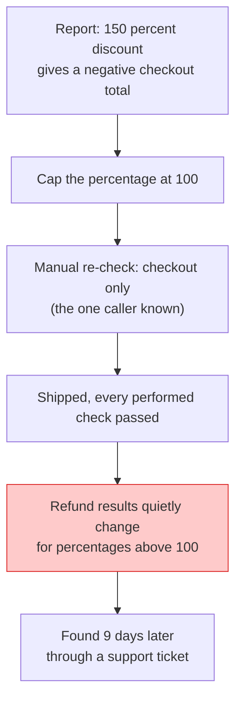

import Scenario from "../../../components/Scenario.astro";
import LevelIntro from "../../../components/LevelIntro.astro";
import Checkpoint from "../../../components/Checkpoint.astro";
import PracticeCheck from "../../../components/PracticeCheck.astro";
import { Icon } from "astro-icon/components";

export const unit = {
  track: "testing-quality",
  unitSlug: "case-automated-testing",
};

<Scenario label="One function, two unrelated callers, one silent change">
  <Fragment slot="facts">
    <div class="not-prose flex flex-col gap-1.5 text-sm text-slate-700 dark:text-slate-300">
      <div class="flex items-center gap-1.5"><Icon name="lucide:shopping-cart" class="h-4 w-4" /> <strong>Checkout</strong> — <code>applyDiscount(100, 20)</code> gives <strong>80</strong></div>
      <div class="flex items-center gap-1.5"><Icon name="lucide:receipt" class="h-4 w-4" /> <strong>Refund tool</strong> — passes percentages above 100 on purpose; a negative result is how its ledger records money owed back</div>
      <div class="flex items-center gap-1.5"><Icon name="lucide:wrench" class="h-4 w-4" /> <strong>The fix</strong> — cap the percentage at 100, safe from checkout's point of view</div>
    </div>
    <div class="not-prose mt-3 rounded border border-rose-300 bg-rose-50 p-1.5 text-xs dark:border-rose-800 dark:bg-rose-950">
      The cap silently changes refunds, a tool the fixing developer never
      opened. All names and numbers here are invented for the example.
    </div>
  </Fragment>

Two teams share one small function. Months ago each verified their own use of it
by hand, and both checks passed. Now a developer who only works on checkout sees
a 150 percent discount produce a negative price and decides to cap the
percentage at 100.

**Before reading the fix: what would you need to know about the function's
callers, not just its current behavior, to change it safely?**

</Scenario>

<LevelIntro
  items={[
    "A worked regression from shared function to silent breakage",
    "The test that catches it and what makes a test trustworthy",
    "A suite as a list of checks that re-run themselves",
  ]}
/>

## What exactly changed, and who noticed?

**Can you see the whole difference between the two versions from checkout's
point of view?** The change is one line, which is part of why it looks safe.

```js
// before
function applyDiscount(price, pct) {
  return price - price * (pct / 100);
}

// after (the "fix")
function applyDiscount(price, pct) {
  return price - price * (Math.min(pct, 100) / 100);
}
```

| Call                      | Before | After | Checkout cares? | Refund tool cares? |
| ------------------------- | ------ | ----- | --------------- | ------------------ |
| `applyDiscount(100, 20)`  | 80     | 80    | Yes, unchanged  | Unchanged          |
| `applyDiscount(100, 150)` | -50    | 0     | Wanted the cap  | Needs the -50      |



<Checkpoint question="The refund tool's -50 looks like the very bug the fix removes. Why should a test pinning -50 stay in the suite after the fix?">

Because the value is correct for one caller even though it looks wrong from
another's point of view. The test does not protect the current code; it
protects a caller's dependence on a specific input and output. Deleting it
because checkout does not need it would recreate the original failure: someone
reasoning from one caller's angle and breaking the other.

</Checkpoint>

## Which tests can you trust?

**A suite exists, and it is green. What else has to be true before its
silence means anything?**

| Failure mode                | What it looks like                               | What the team learns from it                |
| --------------------------- | ------------------------------------------------ | ------------------------------------------- |
| Asserts nothing independent | Compares a function's output to its own output   | Green means nothing, so nobody looks        |
| Pins the how, not the what  | Fails on a refactor that kept behavior identical | Failing tests get deleted or silenced       |
| Flaky                       | Fails and passes with no code change             | Re-run until green, real failures hide too  |
| Only tests known cases      | Nobody ever wrote down the refund dependency     | Coverage looks complete, blind spots remain |

A test's value comes from an expected value that is correct on its own, not from
the test existing. `expect(f(2)).toBe(f(2))` can never fail. Tests also do not
discover which behaviors matter: someone has to notice the refund dependency
and write it down once.

<Checkpoint question="Which failure mode would a green suite hide completely, and why is it the hardest to notice?">

The last one, only testing known cases. A suite that never fails looks
identical whether it covers everything or covers only what someone happened to
think of. The first three announce themselves sooner: a test that cannot fail,
a test that fails for no reason, or a test that breaks on every refactor all
produce visible noise. Missing coverage produces silence.

</Checkpoint>

<PracticeCheck
  track={unit.track}
  unitSlug={unit.unitSlug}
  topicId="test-trust"
/>

## Can the suite itself be a list of facts?

**What is the smallest thing that "remembers" the refund dependency?** A list of
cases, each with a name, the inputs and the expected result, and a runner that
reports which cases no longer hold. Writing that runner is the whole idea in a
few lines.

```js
function failingCases(fn, cases) {
  return cases
    .filter((c) => !Object.is(fn(...c.args), c.expected))
    .map((c) => c.name);
}
// cases: [{ name: "normal", args: [100, 20], expected: 80 },
//         { name: "refund over 100", args: [100, 150], expected: -50 }]
// failingCases(cappedVersion, cases) -> ["refund over 100"]
```

Run against the capped version, only `"refund over 100"` fails, and it fails by
name before anything ships. Nobody had to remember refunds at that moment; the
case was written once, when someone discovered the dependency.

<PracticeCheck
  track={unit.track}
  unitSlug={unit.unitSlug}
  topicId="suite-as-memory"
/>

## Beyond applyDiscount

This pricing story is one worked case, not the whole territory. **What changes
if the shared function is a currency formatter with three callers: checkout,
refunds, and a nightly reconciliation report?** The reasoning holds, since
each caller can have its own legitimate edge case that the others do not share.
What changes is how loudly it fails: a quietly wrong report may never produce
a support ticket at all. What would you write down, and for which caller, so
that a developer who knows only one of them still cannot break the others? And
what changes if the news were worse and the wrong number went to a customer
rather than to a ledger?
