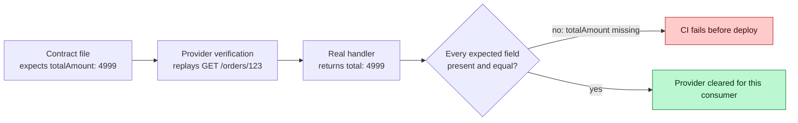
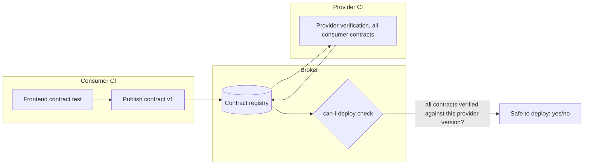

import Scenario from "../../../components/Scenario.astro";
import LevelIntro from "../../../components/LevelIntro.astro";
import Checkpoint from "../../../components/Checkpoint.astro";
import PracticeCheck from "../../../components/PracticeCheck.astro";

export const unit = {
  track: "testing-quality",
  unitSlug: "contract-testing",
};

<Scenario label="Same rename, this time caught before it ships">
  <Fragment slot="facts">
    <div class="not-prose flex flex-col gap-2 text-sm text-slate-700 dark:text-slate-300">
      <div class="flex items-center gap-1.5"><span>📄</span> <strong>Contract</strong> — generated once, from the consumer's own test</div>
      <div class="flex items-center gap-1.5"><span>🔁</span> <strong>Provider CI</strong> — replays it against real handler code on every build</div>
      <div class="flex items-center gap-1.5"><span>🐛</span> <strong>The rename</strong> — <code>total</code> → <code>totalAmount</code>, same as L1's Scenario</div>
      <div class="flex items-center gap-1.5"><span>❌</span> <strong>This time</strong> — provider verification fails in CI, before deploy</div>
    </div>
  </Fragment>

L1's Scenario showed the field rename reaching production because
nothing connected the frontend's mock to the real API. This level
builds that connection for real. **If the same rename happened here, at
what point would it get caught — and by whose test suite?**

By the provider's own CI, the moment someone tries to ship the rename
— not by a user noticing a broken order total in production. That's
the difference this level makes concrete.

</Scenario>

<LevelIntro
  items={[
    "A recorded contract replayed against a provider that fails it",
    "What contract testing still can't catch",
    "The broker, can-i-deploy, and detection time",
  ]}
/>

## What does the recorded contract say, and what does the provider return?

**Take the contract the consumer's test recorded, and the provider as it
stands today. Where exactly do they disagree?** The consumer's test ran
against a mock and recorded one interaction. The provider's handler was
written independently:

| Field           | Contract expects (from the consumer's test) | Provider returns today    | Match? |
| --------------- | ------------------------------------------- | ------------------------- | ------ |
| `status`        | HTTP 200                                    | HTTP 200                  | yes    |
| `id`            | `"123"`                                     | `"123"`                   | yes    |
| `totalAmount`   | `4999`                                      | absent (it sends `total`) | **no** |
| `status` (body) | `"paid"`                                    | `"paid"`                  | yes    |



The verification run reports one failed interaction, "a request for
/orders/123", with the expected and actual bodies side by side. The fix
is a one-line change to the provider's data shape (send `totalAmount`),
after which the same replay passes. The provider proved this without
ever running the consumer's code.

<Checkpoint question="The provider verification test never imports or runs any of the frontend's JavaScript. How is it still able to catch a bug that only shows up in the frontend's rendered page?">

Because the contract already captured the one thing that mattered —
the exact response shape the frontend's code asserts on — at the
moment the consumer test ran. The provider verification test doesn't
need to re-derive what the frontend expects; it just needs to check its
own real response against that already-recorded expectation. This is
the whole value of the contract as a shared artifact: it lets the
provider verify correctness for a consumer it never has to execute.

</Checkpoint>

## Where is the comparison itself the point?

**What rule should "matches the contract" follow — identical bodies, or
something looser?** This is the one place where reading code earns its
keep, because the rule is the whole design. The check is a _subset_
match: every field the contract lists must be present and equal, but
extra fields the provider adds are fine, since no consumer asked about
them.

```js
function verifyContract(interactions, getActual) {
  const failures = [];
  for (const it of interactions) {
    const actual = getActual(it.request);
    const expectedBody = it.response.body ?? {};
    const actualBody = actual.body ?? {};
    const statusOk = actual.status === it.response.status;
    const bodyOk = Object.entries(expectedBody).every(
      ([key, value]) => actualBody[key] === value,
    );
    if (!statusOk || !bodyOk) failures.push(it.description);
  }
  return { passed: failures.length === 0, failures };
}
```

An exact-equality check would fail the day a provider safely adds a
`currency` field, punishing exactly the change consumer-driven contracts
are meant to allow. A subset check lets additions through and still
catches renames, removals, and changed values.

<PracticeCheck
  track={unit.track}
  unitSlug={unit.unitSlug}
  topicId="verify-contract-code"
/>

## What this still doesn't catch

**If the contract replays green, is the system safe?** No. Contract
testing replaces specifically the end-to-end tests whose only job was
"does the response shape still match." A few things stay entirely out
of scope:

| Failure mode                                                      | Why contract testing misses it                                                                                                                                                                                         |
| ----------------------------------------------------------------- | ---------------------------------------------------------------------------------------------------------------------------------------------------------------------------------------------------------------------- |
| Auth/session flow across multiple calls                           | A contract checks one request/response pair at a time — it has no model of "call A must happen before call B succeeds"                                                                                                 |
| Ordering or timing across services                                | Contracts are stateless snapshots, not sequences — race conditions and ordering bugs need a real integration or e2e test                                                                                               |
| Infra issues (DNS, TLS, load balancer config, network partitions) | The provider verification test calls the handler directly (or via localhost) — it never touches the real network path production traffic takes                                                                         |
| A contract nobody actually verifies in CI                         | The contract file itself proves nothing — it's the _verification step running on every build_ that catches drift; an unverified contract is worse than no contract, because it looks like safety without providing any |

That last row is the one teams actually get wrong in practice: writing
a contract and forgetting to wire provider verification into CI is
common, and it's strictly worse than having no contract at all — a
stale, unverified contract file sitting in a repo gives false
confidence ("we have contract tests") while catching nothing, and the
team that would have been more careful without it now isn't.

<Checkpoint question="A team publishes a contract file for every consumer but never adds the replay step to the provider's pipeline. A provider engineer renames a field. What happens, and what does the team believe beforehand?">

Nothing fails, so the rename ships and breaks the consumer exactly as it
would have with no contract at all. The harmful part is the belief: the
team thinks a safety net exists because contract files exist. The
artifact only records the agreement; the replay on every build is what
enforces it.

</Checkpoint>

<PracticeCheck
  track={unit.track}
  unitSlug={unit.unitSlug}
  topicId="what-it-misses"
/>

## The broker problem: which provider version satisfies which consumer?

A single consumer and a single provider is the easy case. **What
changes once three different frontends, and a mobile app, all consume
the same order service, each with their own contract?** The provider
now has to satisfy four contracts simultaneously, not one — and a
version that breaks even one of them isn't safe to deploy, even if it
satisfies the other three perfectly.

In practice this is solved with a **broker**: a shared service both
sides publish to and query in CI, rather than passing contract files
by hand.



The broker tracks, per provider version, which consumer contracts it
has actually been verified against — and a **"can I deploy" check**
before a release simply asks the broker: has this exact provider
version been verified against every contract of every consumer
currently in production? If a mobile app's contract was never verified
against this build, the answer is no, regardless of how confident the
provider team feels. This turns "did we break someone" from a question
answered by hoping nobody notices into a question answered by a single
CI gate, even across teams that don't talk to each other day to day.

<Checkpoint question="With a broker in place, if the provider team ships a version that satisfies 3 of 4 consumer contracts but breaks the 4th, does the can-i-deploy check pass?">

No — the check is a single yes/no answer, and it requires every
contract currently recorded against production consumers to verify
successfully, not a majority. One failing contract is enough to block
the deploy, which is exactly the point: a provider team shouldn't need
to personally track down and ask four other teams "did I break you"
before every release — the broker already knows, from CI results
alone.

</Checkpoint>

<PracticeCheck
  track={unit.track}
  unitSlug={unit.unitSlug}
  topicId="broker-can-i-deploy"
/>

## How long can a breaking change hide?

**If verification only runs on a schedule, how long can a bad change sit
undetected?** In the worst case a change lands just after a run, so it
waits one full interval: the time to catch it is 1 divided by the runs
per day. The demo below lets you drag the frequency.

| Verification runs per day | Worst-case wait until caught |
| ------------------------- | ---------------------------- |
| 0.5 (every other day)     | 2 days                       |
| 1                         | 24 hours                     |
| 4                         | 6 hours                      |
| 12                        | 2 hours                      |

Running verification on every provider build pushes that wait toward
zero, which is why the verification step belongs in the build pipeline
rather than on a timer.

## Extending the worked example

This unit's example is a case, not the whole territory: one consumer, one
rename, one happy-path interaction. Three ways to push on it yourself.

- With three consumers of the same provider instead of one, what would
  have to change about `verifyContract` to report _which_ consumer's
  contract failed, not just that something did?
- Every interaction shown was a 200 happy path. What would an interaction
  for a missing order look like (a 404 with no body), and does the
  subset comparison above already handle it correctly?
- What if the news were worse: the provider team deletes a field that no
  current contract mentions, and a consumer team starts reading that field
  next week. Which step of the process, and whose job, catches it?
