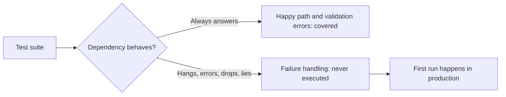

import Scenario from "../../../components/Scenario.astro";
import LevelIntro from "../../../components/LevelIntro.astro";
import PracticeCheck from "../../../components/PracticeCheck.astro";

export const unit = {
  track: "testing-quality",
  unitSlug: "fault-injection",
};

<Scenario label="The waiter who waits at the kitchen window forever">
  <Fragment slot="facts">
    

      
🍽️ <strong>The setup</strong> — 4 waiters, each hands an order to the kitchen and waits for the dish

      
🔇 <strong>The fault</strong> — the kitchen never answers one order (no "no", no "ready")

      
🧍 <strong>The rule nobody wrote</strong> — "stop waiting after some time"

      
🚫 <strong>Result</strong> — every waiter ends up stuck at the window; no table is served

    

    

      

        
Waiters stuck after 4 silent orders4 of 4

        

      

    

  </Fragment>

A restaurant has four waiters. Each hands an order through the kitchen
window and waits for the dish. On a normal night every order comes back and
the team is praised for how smoothly it runs. One night the kitchen gets
four orders and answers none of them. Not a refusal, not a delay note, just
silence. Each waiter keeps standing at the window, because nobody ever told
them when to stop waiting.

Within minutes every waiter is stuck, and the dining room is empty-handed
even though nothing is wrong with the menu, the prices or the waiters'
manners. **How could the restaurant have found this out on a quiet
afternoon, before a full night put it in front of customers?** By staging
the silence on purpose: asking the kitchen to ignore a practice order and
watching what the waiter does.

A software service that calls a third-party API is that waiter. Ordinary
tests only ever stage the kitchen answering.

</Scenario>

<LevelIntro
  items={[
    "What fault injection is, and what it is for",
    "The five ways a dependency can fail",
    "What graceful and broken look like under failure",
  ]}
/>

## Why does a fully tested service still fall over?

**The restaurant's training covered ordering, billing and allergies. Why did
none of it help?** Because every one of those drills assumed the kitchen
replies. A service with every line covered by tests is in the same position:
line coverage says which lines ran, not which situations were staged.

**Fault injection** is deliberately making a dependency fail inside a
controlled test, then checking what the caller does about it. It reuses the
same seam as the test doubles in `test-doubles` (the swap point where a
real dependency is replaced) but points it at a different question. A double
for isolation answers "does my code work when the dependency is fine?" A
fault double answers "does my code survive when the dependency is not?"

<PracticeCheck
  track={unit.track}
  unitSlug={unit.unitSlug}
  topicId="fault-injection-purpose"
/>

## Which failures are worth staging?

A dependency fails in more than one way, and each way runs different code
in the caller:

| Failure mode              | What the dependency does                | What the caller needs                     |
| ------------------------- | --------------------------------------- | ----------------------------------------- |
| Hang                      | Accepts the call, never answers         | A time limit on waiting                   |
| Error response            | Answers with a failure status           | A check of the status before using it     |
| Connection refused        | Is down or unreachable                  | Handling of a failure before any status   |
| Slow response             | Answers, but long after a sensible wait | A choice about when slow counts as failed |
| Partial or malformed body | Answers "success" with unusable data    | A check of the data's shape               |

A caller that handles every row except the first still hangs on the first.
Each row is its own bug waiting to happen, which is why one injected fault
does not stand in for the others.

<PracticeCheck
  track={unit.track}
  unitSlug={unit.unitSlug}
  topicId="fault-types"
/>

## What does a passing result look like?

A test injects the fault and then asserts one of two families of outcome:

| Graceful (contained)                             | Broken (spreads or hides)                    |
| ------------------------------------------------ | -------------------------------------------- |
| Retry with spaced attempts, then stop            | Hang while holding a connection              |
| Fall back to a cached or default value           | Crash the whole process                      |
| Stop calling for a while after repeated failures | Return wrong data as if it had succeeded     |
| Return a clear, typed error to its own caller    | Let one failure drag down unrelated requests |

<PracticeCheck
  track={unit.track}
  unitSlug={unit.unitSlug}
  topicId="graceful-vs-broken"
/>

## Key terms

- **Fault injection**: deliberately forcing a dependency to fail in a
  controlled test, to verify how the caller handles it.
- **Failure mode**: the specific way a dependency fails (hang, error status,
  refused connection, slow answer, malformed body).
- **Graceful degradation**: noticing the failure and responding in a bounded,
  visible way instead of hanging, crashing or corrupting data.
- **Timeout**: a hard limit on how long a call may wait before it is treated
  as failed.
- **Chaos engineering**: the production-scale cousin that breaks live systems
  to discover failures nobody predicted (see L3).
