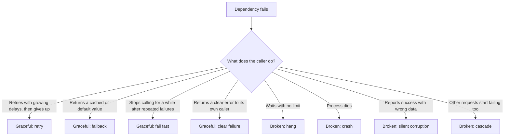

import LevelIntro from "../../../components/LevelIntro.astro";
import Checkpoint from "../../../components/Checkpoint.astro";
import PracticeCheck from "../../../components/PracticeCheck.astro";

export const unit = {
  track: "testing-quality",
  unitSlug: "fault-injection",
};

L1 showed why the waiter stuck at the kitchen window slips past every
ordinary test: nobody staged the silence. This level builds the model for
staging it on purpose, and for deciding what a "good" reaction even is.

<LevelIntro
  items={[
    "Graceful versus broken, as observable outcomes",
    "Retry, fallback and fail-fast as specific reactions",
    "Fault injection versus flaky tests, doubles and chaos",
  ]}
/>

## What does "the system handled it well" mean in terms a test can check?

**If the kitchen stays silent, the waiter could do several things. Which of
them would you accept, and which would you fail the test for?** The answer
is not a feeling; it is which branch the observed behavior lands on.

Every graceful branch keeps the failure **contained**: visible, bounded in
time, and not spreading. Every broken branch lets it **spread or hide**.
A fault-injection test forces the failure and asserts which side it landed
on.

<Checkpoint question="A caller checks the response status after every request. Does that one check protect it against a dependency that never answers?">

No. A check on the status protects the error-response row only. With a hang
there is no response yet, so there is no status to look at; the call is still
pending. Each failure mode runs different defensive code, which is why a
caller that handles an error status can still wait forever.

</Checkpoint>

<PracticeCheck
  track={unit.track}
  unitSlug={unit.unitSlug}
  topicId="graceful-vs-broken"
/>

### Is "it retried" enough to call it graceful?

Retrying is graceful only if the attempts are spaced. Compare two callers
that each make 5 attempts against a dependency that is already struggling.
The delays are example values chosen to show the shape:

| Caller           | Gaps between attempts  | Total wait spent | Effect on the struggling dependency        |
| ---------------- | ---------------------- | ---------------- | ------------------------------------------ |
| Tight loop       | 0 ms, 0 ms, 0 ms, 0 ms | about 0 ms       | 5 calls in an instant, at its worst moment |
| Doubling backoff | 100, 200, 400, 800 ms  | 1,500 ms         | 5 calls spread out, room to recover        |

Both eventually stop, so a test that only checks "it gave up" passes both.
A sharper assertion also checks that the gaps grow. That is the difference
between a retry that helps and one that adds load to a failing system.

<Checkpoint question="A service retries a failed call 5 times in a tight loop and then gives up. Graceful or not?">

Only half. It gives up instead of hanging, which has the right shape. But
firing the attempts back to back piles load on a dependency exactly when it
can least handle it, so in practice the service helps turn a hiccup into a
longer outage. A test can pin both facts: it stops eventually, and the
attempts are spaced out.

</Checkpoint>

## Is this just a flaky test, or a test double, or chaos engineering?

**Four ideas all involve things going wrong around tests. Which differs from
which, and how?**

| Idea                 | Is the failure intended? | Controlled by the test? | Where it runs              | What it builds                         |
| -------------------- | ------------------------ | ----------------------- | -------------------------- | -------------------------------------- |
| Flaky test           | No, an accident          | No                      | Test suite                 | Distrust in the suite                  |
| Test double (normal) | Not applicable           | Yes, answers normally   | Test suite                 | Fast, isolated tests                   |
| Fault injection      | Yes, on purpose          | Yes                     | Test suite, before release | Confidence in failure handling         |
| Chaos engineering    | Yes, on purpose          | Partly                  | Live system                | Discovery of failures nobody predicted |

A fault-injection test that reliably goes red when a dependency hangs is
not flaky; it is correct. The two share a surface (timing, external calls)
and are opposite in intent: one is an accident to remove, the other a probe
to keep.

Fault injection also reuses the seam from test doubles. The mechanism is
identical (swap what stands behind the seam) and only the question changes:
a normal double returns a successful answer so a test runs fast; a fault
double returns a hang, an error or a bad body to see what the caller does.
Code with no seam at all, where the network call is made inline with
nothing swappable, cannot be fault-injected until a seam is created, for
the same reason it cannot be unit tested with a stub.

Fault injection catches known risks before deploy; chaos engineering looks
for unknown risks after. Neither replaces the other.

<PracticeCheck
  track={unit.track}
  unitSlug={unit.unitSlug}
  topicId="seam-and-distinctions"
/>
