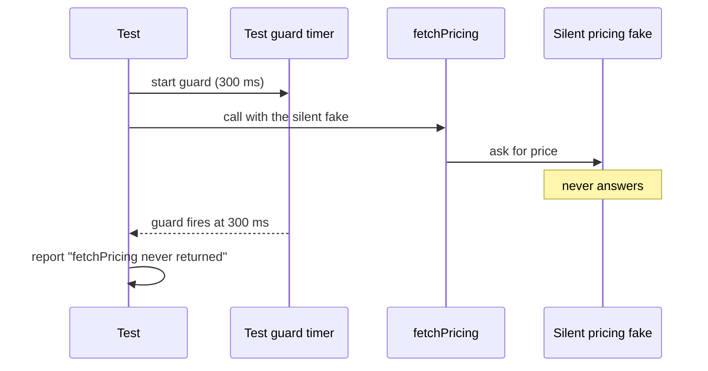

import Scenario from "../../../components/Scenario.astro";
import LevelIntro from "../../../components/LevelIntro.astro";
import Checkpoint from "../../../components/Checkpoint.astro";
import PracticeCheck from "../../../components/PracticeCheck.astro";

export const unit = {
  track: "testing-quality",
  unitSlug: "fault-injection",
};

<Scenario label="Staging the kitchen's silence without freezing the test run">
  <Fragment slot="facts">
    <div class="not-prose flex flex-col gap-2 text-sm text-slate-700 dark:text-slate-300">
      <div class="flex items-center gap-1.5"><span>🧩</span> <strong>Under test</strong> — <code>fetchPricing</code>, the one place checkout asks a pricing service for a live price</div>
      <div class="flex items-center gap-1.5"><span>🕳️</span> <strong>The bug</strong> — no time limit, so a silent dependency freezes the caller</div>
      <div class="flex items-center gap-1.5"><span>🛡️</span> <strong>The test needs its own guard</strong> — otherwise a failing test also freezes</div>
      <div class="flex items-center gap-1.5"><span>🔧</span> <strong>The fix</strong> — a timeout plus a fallback to the last known price</div>
    </div>
  </Fragment>

In L1 the waiter kept standing at the kitchen window because no rule said
when to stop. The checkout service has the same flaw in one function. This
level reproduces that hang on purpose, watches the test catch it, fixes it,
and re-runs the identical test. **If a test can make a dependency hang on
demand, what stops that test from hanging the whole test run?** The answer
is part of the design.

</Scenario>

<LevelIntro
  items={[
    "Why the naive fetchPricing hangs, and the test that proves it",
    "The timeout and fallback fix, and the guard rule",
    "Trade-offs: timeout size, stale prices, and where this stops helping",
  ]}
/>

## What exactly is wrong with the naive version?

`fetchPricing` asks a pricing service for a product's price, throws if the
answer carries a failure status, and returns the price otherwise. It is
covered by happy-path tests and it handles one failure mode correctly: an
error status. **Which row of L2's failure table does it do nothing about?**
The hang. Nothing in the function limits how long it will wait, so it waits
exactly as long as the dependency takes to settle, including forever. No line
is wrong; no line bounds the wait either.

## How do you reproduce a hang without hanging the suite?

The fake pricing service gets a mode where the call returns something that
never settles, a promise left pending. The test then runs `fetchPricing`
against it, with a **guard of its own** that gives up on the call after a
fixed wait and reports a clear failure.



Against the naive function, the guard is what ends the test, because the
function has no limit of its own. That report is the bug, made visible in
under a second instead of twenty minutes into a real outage.

<Checkpoint question="Why does the test need its own timeout when the whole point is checking whether fetchPricing has one?">

Because until the fix ships, `fetchPricing` has none, and that is exactly
the bug. Without a guard of its own, a hanging function would hang the test,
which would hang the whole run; a suite that never finishes is worse than
one that fails fast. The two limits do different jobs: the test's guard makes
a failing test report quickly, and the function's timeout is the fix being
verified.

</Checkpoint>

## What does the fix look like?

The fix needs two things: a hard limit on waiting, and a sensible reaction
when the limit is hit. Throwing a different error would swap one outage for
another.

```js
// timeout: whichever settles first wins
function withTimeout(promise, ms) {
  let timer;
  const limit = new Promise((_, reject) => {
    timer = setTimeout(() => reject(new Error("pricing timeout")), ms);
  });
  return Promise.race([promise, limit]).finally(() => clearTimeout(timer));
}
```

Around that, `fetchPricing` does the following on each call:

| Outcome of the call                   | What it returns                            |
| ------------------------------------- | ------------------------------------------ |
| Answers in time with a success status | The price, flagged fresh, and remembers it |
| Answers in time with a failure status | Falls to the same path as a timeout        |
| Times out at 500 ms                   | The last remembered price, flagged stale   |
| Times out and nothing was remembered  | A clear "pricing unavailable" error        |

Those are the graceful branches from L2: a bounded wait, a fallback, and a
clear failure only as the last resort.

The same test, re-run against the fix, now needs its guard to be longer
than the function's own 500 ms limit; with a 300 ms guard it would fire
first and blame the function for a hang that the function was about to
handle. With a 700 ms guard, the call resolves at about 500 ms with either a
stale price or the clear error, and never a hang. The identical test failing
before and passing after is what proves the fix works.

<Checkpoint question="The fixed function returns a cached price when the pricing service times out. Is a stale price always the right graceful reaction?">

No. For a product listing page, a slightly old price is a fair trade for
staying up. For the amount charged at the moment of payment, a stale price
could be worse than a clear "try again", if the real price has moved. The
test cannot make that choice. It can only verify that whichever behavior was
chosen is the one that happens under failure; choosing between retry,
fallback and clear error is a product and reliability decision.

</Checkpoint>

<PracticeCheck
  track={unit.track}
  unitSlug={unit.unitSlug}
  topicId="hang-test-and-fix"
/>

## What do the trade-offs cost?

**How long should the timeout be?** Too short and a slow-but-working service
gets treated as dead, so users see stale prices for no reason. Too long and a
truly hung service holds each connection open longer, which is L1's pile-up
again, only capped. The unit's slider models this with assumed, illustrative
numbers: a 250 ms typical slow-end response, and 8% of calls spiking to
1,200 ms. Under those assumptions the 500 ms timeout treats about 5.9% of
calls as failed unnecessarily, falling to 0% at 1,200 ms or more.

| Timeout  | Unnecessary fallbacks in the demo's model |
| -------- | ----------------------------------------- |
| 250 ms   | 8.0% of calls                             |
| 500 ms   | about 5.9% of calls                       |
| 1,200 ms | 0% of calls                               |

These figures come from the demo's assumptions, not from measurements of any
real service.

**How many faults deserve a test?** The set of things that can go wrong with
a dependency is unbounded: other status codes, other bad bodies, a failure on
the second call but not the first. Rank them the usual way, by how likely
and how costly. A hang under load is both common and the cause of the L1
outage, an easy yes; a one-in-a-billion byte pattern that the dependency has
never sent is a weak use of time. The second demo shows the shape: with the
assumed numbers there, the first few fault types tested cover most of the
modeled incident types and later ones add little.

**Fault injection is slower to write.** The silent fake, the guard, and the
rule that the guard must outlast the function's own limit are extra moving
parts a happy-path test never needs. That is the price of testing a scenario
with no natural trigger.

**Chaos engineering picks up where this stops.** This level tested one
suspected failure before it shipped. Chaos engineering injects real faults
into a live system to find failures nobody thought to write a test for, and
the findings become the next fault-injection tests. They are sequential, not
rivals.

## This is a case, not the whole territory

Try extending the worked example yourself. What changes if the pricing
service answers instantly with a success status but a price that is not a
number? Does the fixed function handle that, or does it need a shape check
before trusting the body? And if checkout also calls an inventory service,
what should happen when pricing succeeds but inventory hangs, and does the
answer change if it is the other way round?
