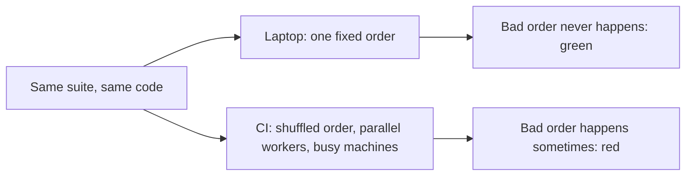

import Scenario from "../../../components/Scenario.astro";
import LevelIntro from "../../../components/LevelIntro.astro";
import PracticeCheck from "../../../components/PracticeCheck.astro";

export const unit = {
  track: "testing-quality",
  unitSlug: "flaky-tests",
};

<Scenario label="Two tests share one notepad. Run in one order they pass; in the other, one fails.">
  <Fragment slot="facts">
    

      
📒 <strong>One shared list</strong> — both tests read and write it

      
💻 <strong>Locally</strong> — always the same order, always passes

      
🤖 <strong>In CI</strong> — order sometimes differs, one test fails

      
🟰 <strong>Same code, same tests</strong> — only the order changed

    

  </Fragment>

A suite has two tests. Test A adds one pending order to a shared list and
checks the list has one item. Test B checks the same list starts empty. Run
B then A: both pass. Run A then B: B fails, because A's order is still in
the list. Nobody changed any code between the two runs.
**If the code and the tests are identical in a passing run and a failing run,
what is actually different?**

</Scenario>

<LevelIntro
  items={[
    "What makes a test flaky",
    "Where the hidden dependency lives",
    "Why CI exposes what a laptop hides",
  ]}
/>

## What is a flaky test?

| Run order | Test A (adds an order) | Test B (list starts empty) | Suite |
| --------- | ---------------------- | -------------------------- | ----- |
| B, then A | passes                 | passes                     | green |
| A, then B | passes                 | **fails**                  | red   |

A **flaky test** gives different results on the same code with no relevant
change. Look at the table: neither test has a wrong assertion. The result
depends on something outside the tests, here the order they ran in.

<PracticeCheck
  track={unit.track}
  unitSlug={unit.unitSlug}
  topicId="flaky-meaning"
/>

## Why does CI show it and a laptop doesn't?

CI is not less reliable. It simply samples more execution conditions than one
developer's machine does, so it reaches the order that exposes the bug.

<PracticeCheck
  track={unit.track}
  unitSlug={unit.unitSlug}
  topicId="ci-exposure"
/>

## Key terms

- **Non-determinism**: the outcome can vary between runs of identical code
  because something it depends on is not fixed (clock, randomness, timing,
  order).
- **Test isolation**: one test's result does not depend on whether, or in
  what order, other tests ran.
- **Environment leakage**: state left behind by one test that changes the
  result of a later one.

## What the next levels cover

L2 sorts the hidden dependencies into four causes and shows why the usual
quick fixes only hide them. L3 fixes the shared-list bug and a timing bug
step by step, then makes a clock-dependent check deterministic.
