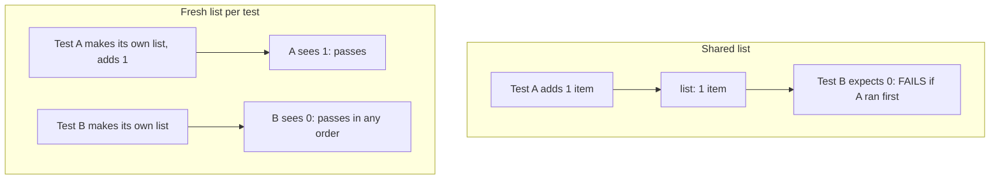
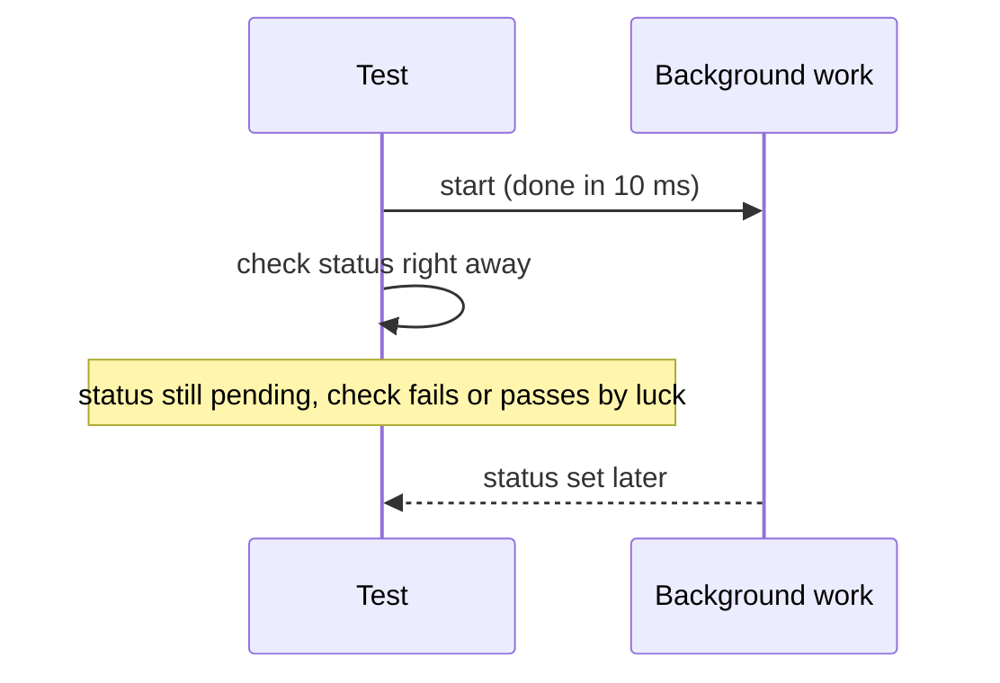

import Scenario from "../../../components/Scenario.astro";
import LevelIntro from "../../../components/LevelIntro.astro";
import Checkpoint from "../../../components/Checkpoint.astro";
import PracticeCheck from "../../../components/PracticeCheck.astro";

export const unit = {
  track: "testing-quality",
  unitSlug: "flaky-tests",
};

<Scenario label="Three flaky tests, three different hidden dependencies">
  <Fragment slot="facts">
    <div class="not-prose flex flex-col gap-2 text-sm text-slate-700 dark:text-slate-300">
      <div class="flex items-center gap-1.5"><span>📒</span> <strong>Test 1</strong> — shares one list with another test</div>
      <div class="flex items-center gap-1.5"><span>⏱️</span> <strong>Test 2</strong> — checks a result before the work finished</div>
      <div class="flex items-center gap-1.5"><span>🕒</span> <strong>Test 3</strong> — expiry check reads the real clock</div>
      <div class="flex items-center gap-1.5"><span>🎯</span> <strong>Goal</strong> — fix the cause, not the symptom</div>
    </div>
  </Fragment>

**Before reading on, pick one of these three and say what you would change
so the test could not fail on a slow machine, on a shuffled order, or at
midnight.**

</Scenario>

<LevelIntro
  items={[
    "Removing a shared list from two tests",
    "Waiting for exactly what is asserted",
    "Making a clock check deterministic",
  ]}
/>

## How do you fix the shared list?

**Why is the failure order-dependent instead of always failing?** Two tests
use one module-level list. Test A leaves an item behind; test B expects the
list empty.



The fix gives each test its own list, built by a small factory:

```js
function makeStore() {
  return { orders: [] };
}
```

Each test calls `makeStore()` first. With two tests there are 2 orders; both
pass in both. A reset line at the top of B would also pass today but would
rely on every future test remembering it.

<Checkpoint question="Test B is fixed by building its own list. Does test A still need to change?">

Not for correctness today, since A only ever reads what it just wrote. But
if A kept using the shared list it would still leave an item behind for
every other test that touches it. The principle is that every test owns its
state, so the fix is applied to all tests using the list, not only the one
that failed.

</Checkpoint>

<PracticeCheck
  track={unit.track}
  unitSlug={unit.unitSlug}
  topicId="shared-state-fix"
/>

## How do you fix a result checked too early?

**The code starts work that finishes after 10 ms. Why does the check sometimes pass?**
Because the check runs immediately, and only a stalled machine could let the
work finish first.



```js
await processOrderAsync(order, 10); // wait for exactly this operation
```

Waiting on the operation itself removes the race. Waiting a longer fixed
time only shrinks the window.

<PracticeCheck
  track={unit.track}
  unitSlug={unit.unitSlug}
  topicId="await-race"
/>

## How do you make a clock check deterministic?

**An order is expired if it is older than 30 minutes. How can a test check
this without waiting 30 real minutes?** Pass the current time in. The
function becomes a pure comparison, so the test supplies both timestamps.

| Created (min) | Now (min) | Age | Expired (limit 30)?    |
| ------------- | --------- | --- | ---------------------- |
| 0             | 29        | 29  | no                     |
| 0             | 30        | 30  | no, equal is not older |
| 0             | 31        | 31  | yes                    |

The exact boundary row is the one a real clock makes impossible to test
reliably, and a passed-in time makes it a one-line check.

<Checkpoint question="Why is the boundary row (age exactly 30) worth a dedicated test, and why was it impractical with the real clock?">

Off-by-one mistakes (`>` versus `>=`) live exactly at the boundary. With the
real clock you cannot land on "exactly 30 minutes" on purpose, so the test
would pass or fail by timing luck. With the time passed in, the boundary is
just two numbers you choose.

</Checkpoint>

<PracticeCheck
  track={unit.track}
  unitSlug={unit.unitSlug}
  topicId="injected-clock"
/>

## What generalizes, and what is only this case?

All three bugs share a shape: the outcome depended on something the test did
not control. The fixes share a principle too: give the test full control
(own state, an awaited operation, a supplied time). But the fixes do not
substitute for each other.

This is one worked case, not the whole territory. **Try extending it:** if
the awaited operation also wrote into the old shared list, would the
`await` alone make the test reliable? And what changes if the test needed
random identifiers instead of a clock?

| Failure mode                               | Why it is wrong                                    |
| ------------------------------------------ | -------------------------------------------------- |
| Re-running until green                     | The dependency remains and fails again             |
| Longer delay for a race                    | Narrows the window; slower and harder to reproduce |
| Fixing only the test that is currently red | Other tests sharing the pattern flake later        |
