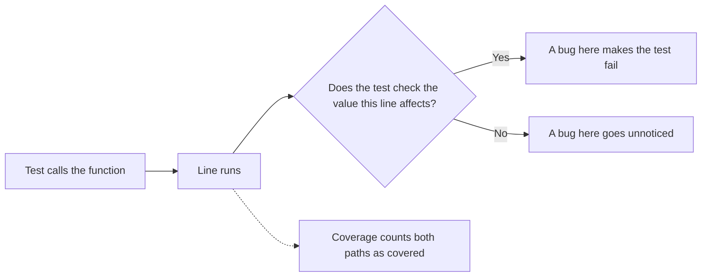

import Scenario from "../../../components/Scenario.astro";
import LevelIntro from "../../../components/LevelIntro.astro";
import PracticeCheck from "../../../components/PracticeCheck.astro";

export const unit = {
  track: "testing-quality",
  unitSlug: "mutation-testing",
};

<Scenario label="Every line ran, and the bug still got through">
  <Fragment slot="facts">
    

      

        

          Line coverage100%
        

        

          

        

      

      

        

          Mutation score (4 mutants, 2 killed)50%
        

        

          

        

      

      
📦 <strong>The code</strong> — a shipping fee with a heavy-package surcharge for weight over 20 kg

      
🐛 <strong>The bug</strong> — <code>&gt;</code> became <code>&gt;=</code>, so exactly 20 kg is wrongly surcharged

      
✅ <strong>The tests</strong> — all pass, none weighs exactly 20 kg

    

  </Fragment>

A shipping-fee function charges a surcharge for packages **over** 20 kg. The
team has three tests, and every line of the function runs during them: **100%
line coverage**. Then a one-character slip ships: `weight > 20` becomes
`weight >= 20`, and a 20 kg package is wrongly surcharged.

| Signal                                   | Value | What it tells you                      |
| ---------------------------------------- | ----- | -------------------------------------- |
| Line coverage (did the line run?)        | 100%  | Looks perfect on a dashboard           |
| Mutation score (would a bug be noticed?) | 50%   | Half of the injected bugs go unnoticed |

The numbers above come from the worked example in L3; they are not industry
averages.

**The buggy line ran in the tests. So why did no test fail?**

Because coverage asks only _did this line run_. It never asks _would a test fail
if this line were wrong_. A test can run a line and never check what it
produced. Mutation testing exists to measure exactly that gap.

</Scenario>

<LevelIntro
  items={[
    "Why full coverage can still miss bugs",
    "Mutants, kills, and survivors",
    "What a mutation score measures",
  ]}
/>

## Why can coverage be full and the suite still weak?

**If a line is "covered", has anyone checked its result?** Not necessarily.

Coverage measures **execution**. Mutation testing measures **verification**:
it plants a small bug on purpose and checks whether any test notices.

<PracticeCheck
  track={unit.track}
  unitSlug={unit.unitSlug}
  topicId="coverage-vs-verification"
/>

## What are mutants, kills, and survivors?

**How can a tool plant bugs without a human writing each one?** It applies a
tiny mechanical change, one at a time, then reruns the suite.

| Term                  | Meaning                                                                 |
| --------------------- | ----------------------------------------------------------------------- |
| **Mutant**            | A copy of the code with one small deliberate change                     |
| **Kill**              | At least one test fails against the mutant: the suite caught it         |
| **Survive**           | Every test still passes: the suite has a gap exactly there              |
| **Mutation score**    | Killed mutants divided by total mutants, as a percentage                |
| **Equivalent mutant** | A change that cannot alter behavior, so no test could ever kill it (L3) |

A survivor is a statement about the **tests**, not about the original code.
The original code is never the thing being broken.

<PracticeCheck
  track={unit.track}
  unitSlug={unit.unitSlug}
  topicId="kill-survive"
/>
