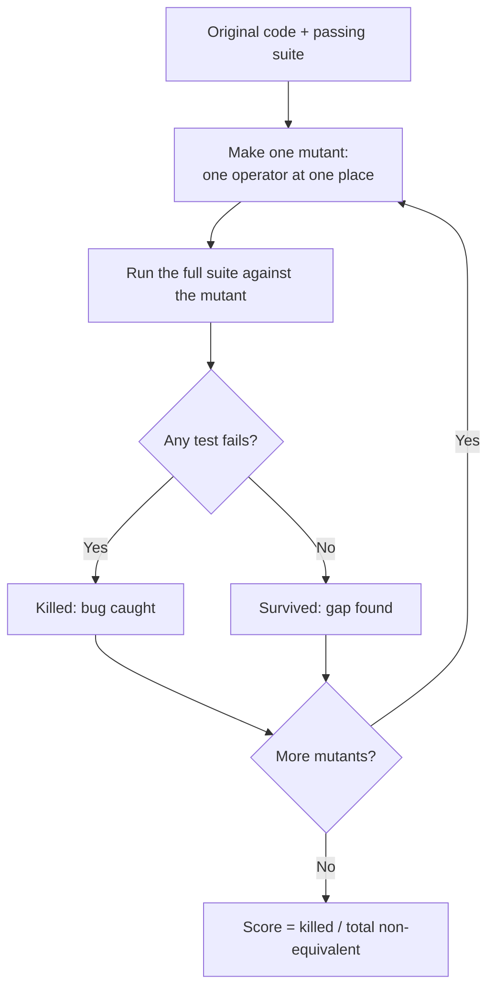

import LevelIntro from "../../../components/LevelIntro.astro";
import Checkpoint from "../../../components/Checkpoint.astro";
import PracticeCheck from "../../../components/PracticeCheck.astro";

export const unit = {
  track: "testing-quality",
  unitSlug: "mutation-testing",
};

L1 showed that a line can run without any test checking its result. This level
builds the mechanism a tool uses to find that gap automatically, and explains
why teams cannot simply run it on every commit.

<LevelIntro
  items={[
    "The mutate, test, judge loop",
    "Mutation operators and what each one probes",
    "Why the run is expensive and how teams scope it",
  ]}
/>

## What does a mutation tool do differently from running the tests once?

**It runs the whole suite many times, once per planted bug.** Each run is a
hypothesis: "if the code had exactly this mistake, would anyone notice?"

<Checkpoint question="A mutant survives. Does that mean the original code has a bug?">

No. The original code is never changed by the run; the mutant is a separate,
deliberately broken copy. A survivor means the suite would not have noticed that
exact bug if someone introduced it. It is a verdict on the tests, not on the
current code.

</Checkpoint>

## Which small bugs does a tool plant?

**Are the changes random?** No. A **mutation operator** is a rule that models one
common human mistake, so each operator asks a different narrow question.

| Operator               | Before        | After          | Question it asks the suite                  |
| ---------------------- | ------------- | -------------- | ------------------------------------------- |
| Conditional boundary   | `weight > 20` | `weight >= 20` | Does any test sit exactly on the threshold? |
| Arithmetic replacement | `a + b`       | `a - b`        | Does any test check the computed number?    |
| Statement removal      | `fee += 10`   | line deleted   | Does any test notice the line is missing?   |
| Return-value mutation  | `return fee`  | `return 0`     | Does any test check what comes back?        |

The operators are independent probes. A suite can kill every arithmetic mutant
and still let every boundary mutant survive.

<Checkpoint question="A suite kills 9 of 10 arithmetic mutants but 0 of 6 boundary mutants. Does the arithmetic result predict the boundary result?">

No. Each operator tests a different kind of mistake at different places. Strong
results on one say nothing about another, so diagnose gaps per operator or per
mutant, not from one blended percentage.

</Checkpoint>

<PracticeCheck
  track={unit.track}
  unitSlug={unit.unitSlug}
  topicId="mutation-operators"
/>

## Why not run it on every commit?

**If one suite run takes 8 seconds, how long do 400 mutants take?** Each mutant
needs one full suite run, so total time is mutants times suite time.

| Mutants | One suite run | Total time    |
| ------- | ------------- | ------------- |
| 20      | 2 s           | 40 s          |
| 200     | 2 s           | about 6.7 min |
| 200     | 30 s          | 100 min       |
| 400     | 8 s           | about 53 min  |

So teams scope it: critical modules only (pricing, permission checks), run on a
nightly or weekly schedule, and treat the survivor list as a to-do list for
better tests rather than a merge gate. Use the slider on this unit's page to see
how quickly the total grows.

<PracticeCheck
  track={unit.track}
  unitSlug={unit.unitSlug}
  topicId="mutation-cost"
/>
