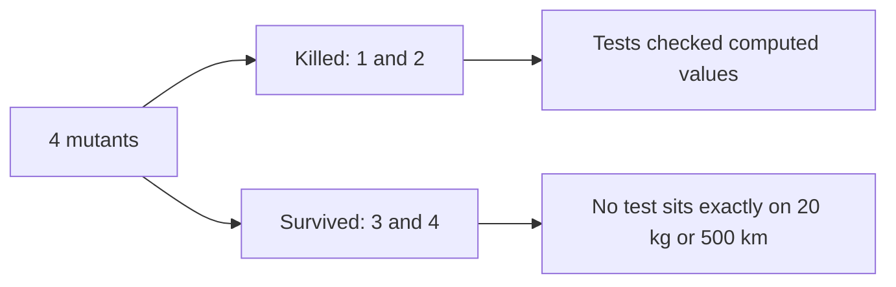

import Scenario from "../../../components/Scenario.astro";
import LevelIntro from "../../../components/LevelIntro.astro";
import Checkpoint from "../../../components/Checkpoint.astro";
import PracticeCheck from "../../../components/PracticeCheck.astro";

export const unit = {
  track: "testing-quality",
  unitSlug: "mutation-testing",
};

<Scenario label="Three passing tests, four mutants, two survivors">
  <Fragment slot="facts">
    <div class="not-prose flex flex-col gap-2 text-sm text-slate-700 dark:text-slate-300">
      <div class="flex items-center gap-1.5"><span>📦</span> <strong>Code</strong> — base 5, plus 0.5 per kg, plus 0.1 per km</div>
      <div class="flex items-center gap-1.5"><span>⚖️</span> <strong>Rules</strong> — over 20 kg adds 10; 500 km or more takes 10% off</div>
      <div class="flex items-center gap-1.5"><span>✅</span> <strong>Suite</strong> — 3 tests, none exactly on 20 kg or 500 km</div>
      <div class="flex items-center gap-1.5"><span>🧬</span> <strong>Mutants</strong> — 4 planted, 2 killed, 2 survive</div>
    </div>
  </Fragment>

The suite has one test per branch: a small nearby package, a heavy one, and a
far one. **Does "one test per branch" sound like a thorough suite?** Hold that
guess; the mutants are about to test it without anyone eyeballing the code.

</Scenario>

<LevelIntro
  items={[
    "Killed and survived, traced by hand",
    "What each survivor says about the test gap",
    "Equivalent mutants and the cost of the technique",
  ]}
/>

## The function and its three tests

The code is small enough that reading it is the point:

```js
function calculateShippingFee(weightKg, distanceKm) {
  let fee = 5 + weightKg * 0.5 + distanceKm * 0.1;
  if (weightKg > 20) fee += 10; // heavy-package surcharge
  if (distanceKm >= 500) fee *= 0.9; // long-distance discount
  return Math.round(fee * 100) / 100;
}
```

| Test | Weight (kg) | Distance (km) | Expected fee |
| ---- | ----------- | ------------- | ------------ |
| 1    | 2           | 10            | 7            |
| 2    | 25          | 10            | 28.5         |
| 3    | 2           | 600           | 59.4         |

All pass, and every line runs: 100% line coverage.

## What happens to each of four mutants?

**For each mutant, which test (if any) sees a different answer?** Running the
three tests against each gives:

| Mutant                   | Change                         | First test that fails                 | Result       |
| ------------------------ | ------------------------------ | ------------------------------------- | ------------ |
| 1 arithmetic replacement | `weightKg * 0.5` to `/ 0.5`    | Test 1 gives 10 instead of 7          | Killed       |
| 2 statement removal      | surcharge line deleted         | Test 2 gives 18.5 instead of 28.5     | Killed       |
| 3 conditional boundary   | `weightKg > 20` to `>= 20`     | None (weights 2 and 25 unchanged)     | **Survived** |
| 4 conditional boundary   | `distanceKm >= 500` to `> 500` | None (distances 10 and 600 unchanged) | **Survived** |



Score: 2 killed out of 4 is **50%**, on a suite with 100% line coverage.

<Checkpoint question="Would adding a fourth test at 100 kg and 1000 km kill either surviving mutant?">

No. A test well past a threshold takes the same branch whether the comparison is
written `>` or `>=`: `100 > 20` and `100 >= 20` are both true. Only an input
exactly on the threshold produces a different result under each version, so only
that input can kill a boundary mutant.

</Checkpoint>

## How do the survivors point to the fix?

**What does each survivor tell you to write?** Both name the same gap: neither
threshold is ever tested at its exact value. The rules say "over 20 kg" is
surcharged (so exactly 20 is not) and "500 km or more" is discounted (so exactly
500 is). Those boundary inputs have known right answers:

| New test | Weight | Distance | Expected | Original | Mutant 3 or 4 gives |
| -------- | ------ | -------- | -------- | -------- | ------------------- |
| 4        | 20     | 10       | 16       | 16       | 26 (mutant 3)       |
| 5        | 2      | 500      | 50.4     | 50.4     | 56 (mutant 4)       |

Both mutants are now killed: **4 of 4, a score of 100%.** Coverage was 100% before
and 100% after, so it could never have told the two suites apart.

<PracticeCheck
  track={unit.track}
  unitSlug={unit.unitSlug}
  topicId="boundary-tests"
/>

## When is a survivor not a real gap?

**Could a mutant survive even with a perfect suite?** Yes. Reorder the sum so it
reads `weightKg * 0.5 + 5 + distanceKm * 0.1`. Addition gives the same number
for every input, so no test can ever tell the two apart. That is an
**equivalent mutant**: technically a survivor, but there is nothing to fix.

Deciding whether two programs are equivalent is undecidable in general, so no
tool can filter these out perfectly. A person has to review survivors and
dismiss the equivalent ones. That review is a real, recurring cost of the
technique, and it is why a survivor is a prompt to look, not an automatic ticket
to write a test.

<Checkpoint question="If the function became async and fetched a live rate before computing the fee, what would change about this exercise?">

The loop itself stays the same, but two things shift. The suite gets slower, and
since total time is mutants times suite time, the whole run gets slower in
proportion. Also, new mutants become possible that a synchronous function cannot
express, such as a dropped wait or a swallowed failure around the lookup. The
extension adds cost and adds new operators worth probing.

</Checkpoint>

<PracticeCheck
  track={unit.track}
  unitSlug={unit.unitSlug}
  topicId="equivalent-mutants"
/>

## This is one case, not the whole territory

The shipping function has two thresholds and four mutants. Try extending it
yourself:

- What would the mutant list and survivor pattern look like with **three**
  independent thresholds instead of two?
- For a state machine with many `if` and `else` branches and no numbers at all,
  which operator from L2's table is most likely to expose a gap a reviewer would
  miss?
- If a team ran this nightly on one module and saw the score fall from 80% to
  60%, what would you check first, and what would change if the mutant count had
  also doubled?

## Failure modes and trade-offs

| Failure mode or trade-off                           | What it gets wrong or costs                                          |
| --------------------------------------------------- | -------------------------------------------------------------------- |
| Making the score a merge gate on every change       | Mutants times suite time is too slow for the inner loop              |
| Treating every survivor as a ticket to write a test | Equivalent mutants cannot and should not be killed                   |
| Running it across a whole large codebase            | Cost scales with mutants times suite time; scope to critical modules |
| Assuming 100% coverage means a trustworthy suite    | Coverage and mutation score measure different things                 |
| Assuming a kill proves the code is correct          | A kill shows one specific mutation was caught, nothing more          |
