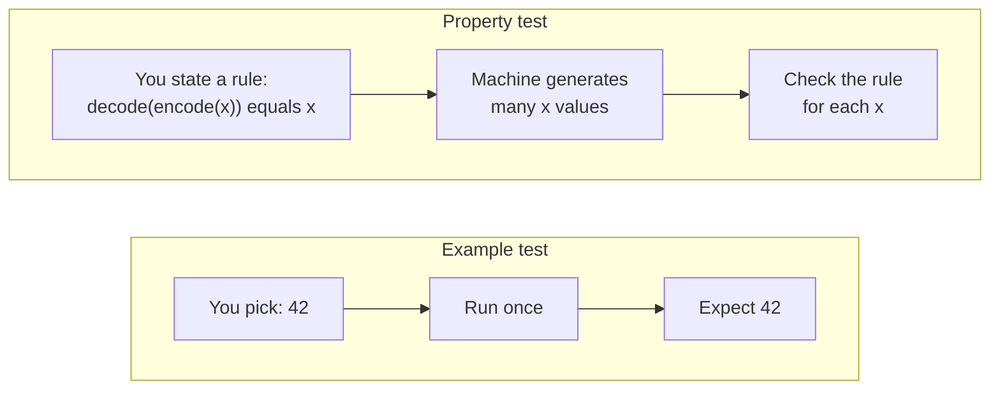
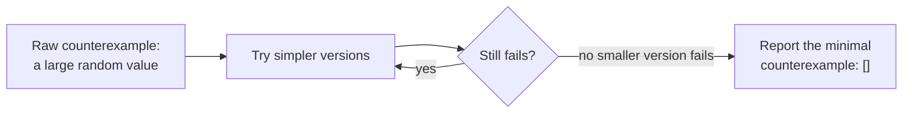

import Scenario from "../../../components/Scenario.astro";
import LevelIntro from "../../../components/LevelIntro.astro";
import PracticeCheck from "../../../components/PracticeCheck.astro";

export const unit = {
  track: "testing-quality",
  unitSlug: "property-based-testing",
};

<Scenario label="6 passing examples, 1 real bug nobody picked as an input">
  <Fragment slot="facts">
    

      

        

          Hand-picked example tests6
        

        

          

        

      

      

        

          Random cases tried before a failure appeared340
        

        

          

        

      

      
🐛 <strong>The bug</strong> — encoding an empty array returned text that decoded back to <code>undefined</code>, not <code>[]</code>

      
✅ <strong>The 6 examples</strong> — none of them happened to include an empty array

    

  </Fragment>

A small helper pair, `encode(value)` and `decode(text)`, saves app state to
`localStorage`. Six tests cover it: a number, a string, a nested object, a
boolean, `null`, and an array of three items. All six pass, so the team ships.

| Test input                 | `decode(encode(x))` equals `x`? |
| -------------------------- | ------------------------------- |
| `42`                       | ✅                              |
| `"hello"`                  | ✅                              |
| `{ name: "Ana", age: 30 }` | ✅                              |
| `true`                     | ✅                              |
| `null`                     | ✅                              |
| `[1, 2, 3]`                | ✅                              |

A week later someone stops picking inputs by hand. They generate 500 random
values (arrays, objects, numbers, nested mixes) and check one rule on every
one: `decode(encode(x))` must equal `x`. **It fails on attempt 340. An empty
array round-trips to `undefined`.**

**Six careful examples passed. Why did it take random junk to find a bug a
reviewer could have caught?**

Because each example only checks an input its author already imagined, and
nobody imagined this one. It is not obscure; a hand-written list is simply
short, and an empty array does not feel like it deserves its own line.

</Scenario>

The six tests were not wrong. They never touched the one input where the bug
lived, and that is a structural limit of choosing inputs by hand.

<LevelIntro
  items={[
    "An example versus a property",
    "Why generated inputs find what hand-picked ones miss",
    "What shrinking does after a failure",
  ]}
/>

## Who chooses the input: you, or a machine?

**Both kinds of test run the same code. What actually differs?**

|                  | Example test                            | Property test                               |
| ---------------- | --------------------------------------- | ------------------------------------------- |
| What you write   | One input and its expected output       | A rule that must hold for every valid input |
| Who picks inputs | You, in advance                         | A generator, at run time                    |
| Runs per test    | 1                                       | Hundreds by default (500 in the Scenario)   |
| Weakness         | Only as good as the inputs you imagined | Needs a rule you can state truthfully       |

A **property** is that rule. Here it is `decode(encode(x))` equals `x` for any
`x`: a **round-trip property** (do something, undo it, get the original back).
The **generator** is the part that produces the `x` values.

<PracticeCheck
  track={unit.track}
  unitSlug={unit.unitSlug}
  topicId="example-vs-property"
/>

## What happens when the rule breaks?

**A generator hands the property a 40-key random object and it fails. Is
"it failed on this blob" a useful bug report?**

Not really. When a generated input breaks the rule it is a **counterexample**
(to **falsify** a property is to find one). The tool then **shrinks** it: it
keeps trying smaller, simpler versions of the failing input and keeps any that
still fail, until nothing smaller fails.

That is why the Scenario's report reads "fails on `[]`" instead of an
unreadable blob.

<PracticeCheck
  track={unit.track}
  unitSlug={unit.unitSlug}
  topicId="shrinking-basics"
/>

## Key terms

- **Property** — a rule that holds for a whole class of inputs, not one.
- **Generator** — produces test inputs of a given type, biased toward edge cases.
- **Counterexample** — an input that breaks the property.
- **Shrinking** — reducing a failing input to the smallest one that still fails.
- **Round-trip property** — "do A, undo A, get the original" (encode/decode,
  serialize/parse, compress/decompress).

This does not replace example tests or `mutation-testing`. Example tests are
still the right tool when no clean rule exists; mutation testing asks whether
your _existing_ tests would catch a bug; property testing changes where the
inputs come from. An interactive demo on this page lets you drag the number of
generated cases and watch the chance of hitting a rare bug rise.
