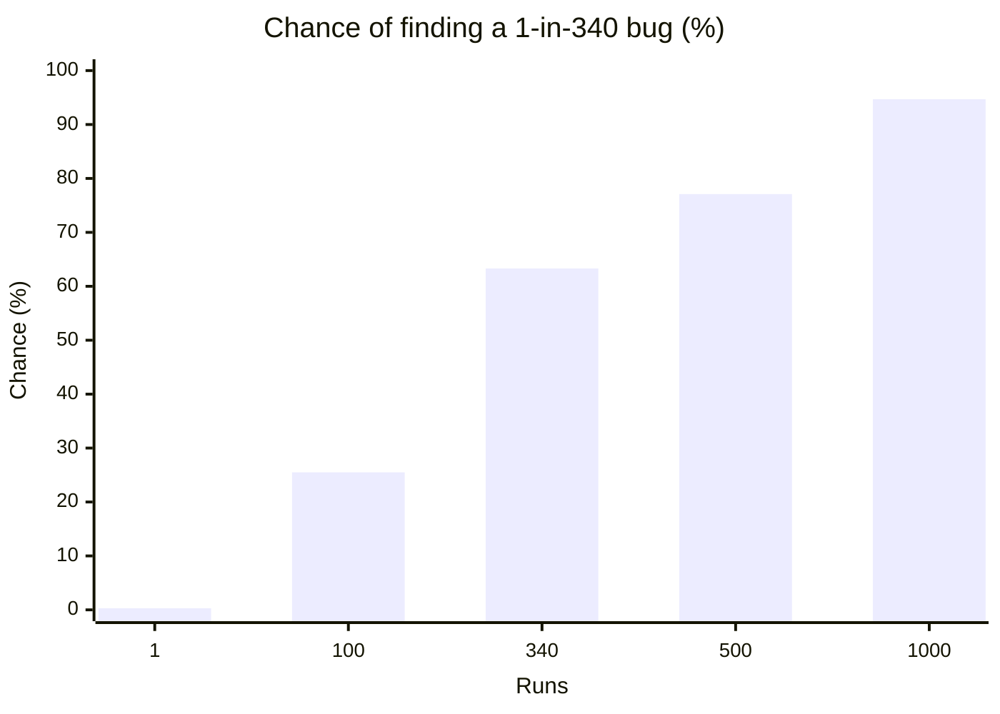
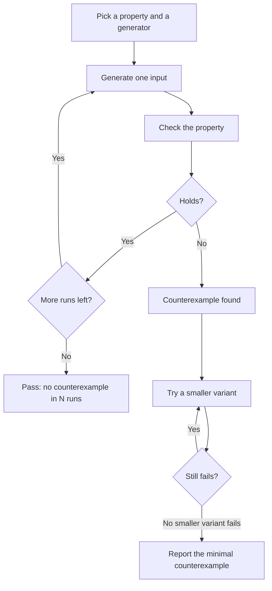

import LevelIntro from "../../../components/LevelIntro.astro";
import Checkpoint from "../../../components/Checkpoint.astro";
import PracticeCheck from "../../../components/PracticeCheck.astro";

export const unit = {
  track: "testing-quality",
  unitSlug: "property-based-testing",
};

L1 showed the gap: hand-picked examples only test inputs someone thought of,
and the empty array nobody thought of hid the bug. This level builds the
machinery that finds inputs like that automatically, and shows how far to
trust it.

<LevelIntro
  items={[
    "Four patterns for writing a good property",
    "How generators and repeated runs find edge cases",
    "The generate, check, shrink loop and its limits",
  ]}
/>

## What makes a rule worth checking?

**Every example test already has an assertion. What makes a property stronger,
and where do you find one for a function that has no obvious rule?**

The code in the assertion can look identical. What changes is who picks `x`
and how many times the check runs. A good property is a **true, checkable
invariant**: something you are confident holds for every valid input and can
verify without re-implementing the function. Four patterns cover most cases:

| Pattern                        | Plain-English rule                                                   | Example                                                 |
| ------------------------------ | -------------------------------------------------------------------- | ------------------------------------------------------- |
| Round trip / inverse           | Do A, undo A, get the original                                       | `decode(encode(x))` equals `x`                          |
| Idempotence                    | Doing it twice equals doing it once                                  | `sort(sort(list))` equals `sort(list)`                  |
| Invariant under transformation | Something about the output never changes even though the output does | `sort(list)` has the same length and elements as `list` |
| Oracle comparison              | Output matches a simple, obviously correct (if slow) version         | Your fast sort matches the built-in sort on every input |

<Checkpoint question="Is 'the function never throws an error' a good property to check on its own?">

Usually not. A function that always returns a wrong answer without throwing
passes that check every time, so a pass says almost nothing. It is a fine
companion to a real invariant ("never throws and the round trip holds"), but
alone it only catches crashes. A property has to say something about the
output, not just that execution finished.

</Checkpoint>

<PracticeCheck
  track={unit.track}
  unitSlug={unit.unitSlug}
  topicId="property-patterns"
/>

## Where do the inputs come from, and how many are enough?

**A generator could just pick uniform random numbers. Why would that miss the
empty array, and how many runs would it take to catch a rare bug anyway?**

A **generator** produces the `x` values. A good one is deliberately biased
toward the values most likely to break things, because those feel "abnormal"
to a person writing examples:

| Type   | Values a good generator over-produces               |
| ------ | --------------------------------------------------- |
| Number | `0`, negatives, very large values, repeats          |
| String | empty string, one character, whitespace, long text  |
| Array  | empty array, one element, duplicates, nested arrays |
| Object | missing or empty fields, deeply nested values       |

Generators compose: one for `name: string, age: number` is built from a string
generator and a number generator, the way the type itself is built from its
fields.

Now the run count. Take the Scenario's observed rate as an assumption: the bug
shows up on about 1 generated case in 340, and cases are independent. The
chance of at least one hit in `n` runs is $$1 - (339/340)^n$$:

| Runs | Chance of hitting the bug at least once |
| ---- | --------------------------------------- |
| 1    | 0.3%                                    |
| 100  | 25.5%                                   |
| 340  | 63.3%                                   |
| 500  | 77.1%                                   |
| 1000 | 94.7%                                   |

<Checkpoint question="A property test runs 100 times and all 100 pass. Has the property been proven for every input?">

No. It is a strong automated search for a counterexample, not a proof. With
the 1-in-340 bug above, 100 clean runs happen about three times out of four
(100% minus 25.5%), so a pass can coexist with a real bug. More runs raise
confidence and never reach certainty; proof would need every possible input.

</Checkpoint>

## What does the full loop look like?

**Once one run fails, what does the tool do next, and when does it stop?**

Shrinking is what turns "the tool found a failure somewhere" into "here is the
smallest input that reproduces it." Without it a bug is still found, but you
debug a 40-key random object instead of `[]`. The failing input shrinking
reaches is the smallest one **the shrinker's moves can reach**, not always the
global smallest possible.

<PracticeCheck
  track={unit.track}
  unitSlug={unit.unitSlug}
  topicId="generators-and-runs"
/>
