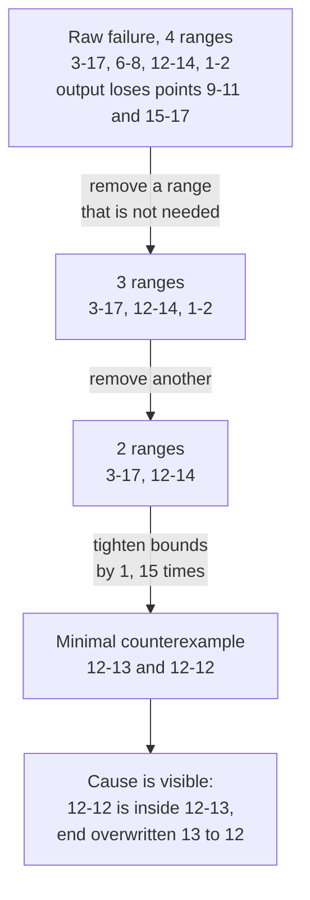

import Scenario from "../../../components/Scenario.astro";
import LevelIntro from "../../../components/LevelIntro.astro";
import Checkpoint from "../../../components/Checkpoint.astro";
import PracticeCheck from "../../../components/PracticeCheck.astro";

export const unit = {
  track: "testing-quality",
  unitSlug: "property-based-testing",
};

<Scenario label="4 passing examples, one contained interval nobody wrote">
  <Fragment slot="facts">
    <div class="not-prose flex flex-col gap-2 text-sm text-slate-700 dark:text-slate-300">
      <div class="flex items-center gap-1.5"><span>📦</span> <strong>Code</strong> — <code>mergeIntervals</code>: merges overlapping ranges like 1–3 and 2–6 into 1–6</div>
      <div class="flex items-center gap-1.5"><span>✅</span> <strong>Suite</strong> — 4 examples, all pass, all with "walking forward" ends</div>
      <div class="flex items-center gap-1.5"><span>🕳️</span> <strong>Missing case</strong> — a range fully <em>inside</em> another, like 2–3 inside 1–10</div>
      <div class="flex items-center gap-1.5"><span>🐛</span> <strong>The bug</strong> — the merged end is set to the new range's end, not the larger of the two</div>
    </div>
  </Fragment>

`mergeIntervals` turns overlapping ranges like 1–3, 2–6 and 8–10 into 1–6 and
8–10. Four example tests cover it and all four pass. **Every one of those
examples has ends that increase as you scan left to right. Is that true of
every list the function could ever receive?**

No, and that gap is where this level is headed.

</Scenario>

<LevelIntro
  items={[
    "A true invariant and the bug four examples missed",
    "A shrink trace from four ranges down to two",
    "When no property exists or the generator misleads",
  ]}
/>

## What does the function do, and why did four examples pass?

The merge loop is short enough that reading it is the point:

```js
function mergeIntervals(intervals) {
  if (intervals.length === 0) return [];
  const sorted = intervals
    .map((iv) => ({ ...iv }))
    .sort((a, b) => a.start - b.start);
  const merged = [sorted[0]];
  for (const curr of sorted.slice(1)) {
    const last = merged[merged.length - 1];
    if (curr.start <= last.end) {
      last.end = curr.end; // bug: should keep the larger end
    } else {
      merged.push(curr);
    }
  }
  return merged;
}
```

| Example input                          | Output                   | Right?       |
| -------------------------------------- | ------------------------ | ------------ |
| 1–2 and 5–6 (no overlap)               | 1–2 and 5–6              | ✅           |
| 1–4 and 3–6                            | 1–6                      | ✅           |
| 1–3, 2–5 and 4–8                       | 1–8                      | ✅           |
| 1–3, 2–6 and 8–10                      | 1–6 and 8–10             | ✅           |
| **1–10 and 2–3 (second inside first)** | **1–3 (should be 1–10)** | ❌ not tried |

In the first four, each new range ends later than the last, so "take the new
end" happens to equal "take the larger end." Only a contained range separates
the two.

## What should always be true, whatever the input?

**Instead of adding a fifth example, what is the rule the function promises?**

| Invariant           | Meaning for the output                                              |
| ------------------- | ------------------------------------------------------------------- |
| Sorted              | Ranges appear in increasing order of start                          |
| Non-overlapping     | No two ranges share a point (touching at a point counts as sharing) |
| Coverage-preserving | The integer points covered by the output equal those of the input   |

The third is the strong one: it says merging gained nothing and lost nothing.
A property test checks all three on every generated list.

<Checkpoint question="Coverage is checked by listing every integer point in each range. Would that work if the ends could be decimals like 1.5?">

No. It works because the ranges are bounded and integer-valued, so each range
has finitely many points. Between 1.5 and 2.5 there are infinitely many
points, so there is nothing to list. A decimal version needs a different
check, such as sampling many probe points and comparing whether input and
output cover each one. That is weaker evidence than exact enumeration but
still strong, and it shows a property sometimes has to be redesigned when the
data type changes.

</Checkpoint>

<PracticeCheck
  track={unit.track}
  unitSlug={unit.unitSlug}
  topicId="write-the-property"
/>

## How does the machine find the bug, and what does shrinking leave?

**A generator hands the property random lists. Why would it hit a contained
range far more often than a person writing examples?**

A generator for this function is deliberately narrow: starts between 0 and 20,
range lengths between 0 and 8, one to six ranges per list. In a small space, ranges
overlap and nest constantly. If it picked ends up to a million, nearly every
range would miss every other one and the merge logic would hardly run.

It soon produces a failing list. The run below was executed against the buggy
function above:



Whole-range removals come first because they simplify the most. After the
list is down to two ranges, tightening bounds one unit at a time walks it to
the smallest pair that still fails: 12–13 with 12–12. Two ranges, one inside
the other, and the output loses point 13. That is the bug in the smallest
words possible.

<Checkpoint question="Why does a shrinker try removing a whole range before tightening a bound by one unit?">

Removing a range is a much bigger simplification, so trying it first reaches a
small input in fewer steps. The loop also repeats: once a removal succeeds,
the smaller list may allow a bound to tighten that could not before, so the
two moves alternate until neither makes the failing input smaller.

</Checkpoint>

The fix is one line, `last.end = Math.max(last.end, curr.end)`. The minimal
counterexample then becomes a permanent, readable example test, so one
random find turns into documentation of the case a reviewer would otherwise
miss again.

<PracticeCheck
  track={unit.track}
  unitSlug={unit.unitSlug}
  topicId="contained-interval"
/>

## Where does property testing stop helping?

**If this is so effective, why not replace every example test with a
property?**

| Situation                          | What goes wrong                                                                                    | What to do                                                     |
| ---------------------------------- | -------------------------------------------------------------------------------------------------- | -------------------------------------------------------------- |
| No clean rule exists               | `formatCurrency(4210)` returning `"$42.10"` has no rule simpler than the implementation itself     | Keep example tests                                             |
| Generator too narrow               | Bugs outside its reach never appear; four forward-walking examples were a narrow generator by hand | Widen it, add the empty and boundary shapes                    |
| Generator too broad                | Many runs are wasted on inputs a real caller could never send, like start after end                | Add a precondition filter (`fc.pre` in the fast-check library) |
| A failure that appears once in 500 | Looks like a flaky test                                                                            | Record the random seed so the exact input replays              |

<Checkpoint question="If the generator never produced a range whose start equals its end, which bugs could this test never find?">

Any bug specific to single-point ranges such as 5–5. Shrinking cannot discover
a shape the generator is unable to produce, and more runs do not help. A
property test's reach is bounded by what the generator can produce, not by how
many times it runs.

</Checkpoint>

The mergeIntervals case is one worked example, not the whole territory.
**Extend it yourself.** What would the coverage check need if the function
also had to accept ranges in descending order? And for a shopping cart
`applyDiscount(cart, code)` with no round trip or idempotence, what invariant
is worth checking (hint: the total after a discount should never exceed the
total before), and where would a precondition filter be needed to keep every
generated cart valid? Then drag the shrink-iterations slider to see how
quickly a failing input collapses toward its floor.

<PracticeCheck
  track={unit.track}
  unitSlug={unit.unitSlug}
  topicId="generator-tradeoffs"
/>
