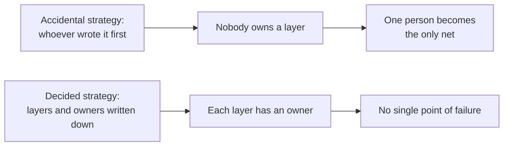

import Scenario from "../../../components/Scenario.astro";
import LevelIntro from "../../../components/LevelIntro.astro";
import PracticeCheck from "../../../components/PracticeCheck.astro";

export const unit = {
  track: "testing-quality",
  unitSlug: "quality-culture",
};

<Scenario label="The QA engineer took two weeks off. The defect rate quintupled.">
  <Fragment slot="facts">
    

      

        
Defects reaching production, QA present3%

        

          

        

      

      

        
Defects reaching production, QA on leave15%

        

          

        

      

      
🧍 One person's absence, <strong>5x</strong> the escaped defects. The rates are illustrative, not measured data.

    

  </Fragment>

An illustrative team ships fast and its numbers look fine: about 3% of
changes reach production with a defect, and a dedicated QA engineer
catches most of what slips past code review. Engineers write code, get
approval on style and logic, and merge. QA runs a manual pass before
each release. It has worked for over a year.

Then the QA engineer takes two weeks of leave and nobody covers the
role. **In those two weeks the share of defective changes reaching
production jumps from 3% to 15%.** Same engineers, same review process,
same release cadence. The only thing that moved was whether one person
was in the building.

**If the defect rate depends this much on one person, was it ever the
team's quality?**

</Scenario>

It was not. Every pull request merged with a shallow test, on the
unspoken grounds that QA would catch anything missed, quietly handed
responsibility for correctness to one downstream gate. No engineer did
anything wrong. The system was built so that catching bugs looked like
somebody else's job, and two weeks without that person made it visible.

<LevelIntro
  items={[
    "How a downstream gate externalizes quality",
    "Testing strategy as a deliberate decision",
    "Why culture is built with incentives, not slogans",
  ]}
/>

## Why does a gate downstream make people upstream less careful?

**Picture two engineers each writing the same edge-case test. One knows a
QA pass follows; the other knows nothing does. Who spends the extra
twenty minutes?**

- **Externalizing quality** means responsibility for correctness drifts
  from the person writing the code to a downstream gate (QA, a senior
  reviewer, a release manager), because the gate's existence makes
  moving on locally rational.
- This is a **moral hazard**: the person best placed to prevent a bug
  cheaply (the author, while writing) is not the one who pays when it
  escapes.
- The cause is the incentive the system rewards, not carelessness. A
  careful engineer facing that incentive will still trim the test.

| Question                  | With a QA-only gate  | With shared ownership         |
| ------------------------- | -------------------- | ----------------------------- |
| Who is the safety net?    | One role, downstream | Every author, plus automation |
| Who feels a thin test?    | QA, later            | The author, immediately       |
| What does one absence do? | Defect rate jumps    | Little change                 |

<PracticeCheck
  track={unit.track}
  unitSlug={unit.unitSlug}
  topicId="externalized-quality"
/>

## What does it mean to decide a testing strategy?

**Ask the team who owns the test for a given piece of code, and at what
level it should be caught. If nobody can answer, who decided?**

Nobody did. The strategy accreted: one module set a pattern, others
copied it. **Testing strategy as an architectural decision** means
choosing, visibly and revisitably, what is tested at which level (unit,
integration, end-to-end) and by whom, the way a team chooses its
service boundaries.

- **Quality culture**: the habits and incentives that decide whether
  engineers write, run, and trust tests as part of the work.
- **Blocking CI gate**: a suite whose failure stops the merge, so passing
  is the path of least resistance and not a matter of discipline (it
  rests on the trust covered in `test-suite-architecture`).
- "Quality is everyone's job" is not announced. It is an incentive
  structure someone builds, which is what L2 and L3 work through.
