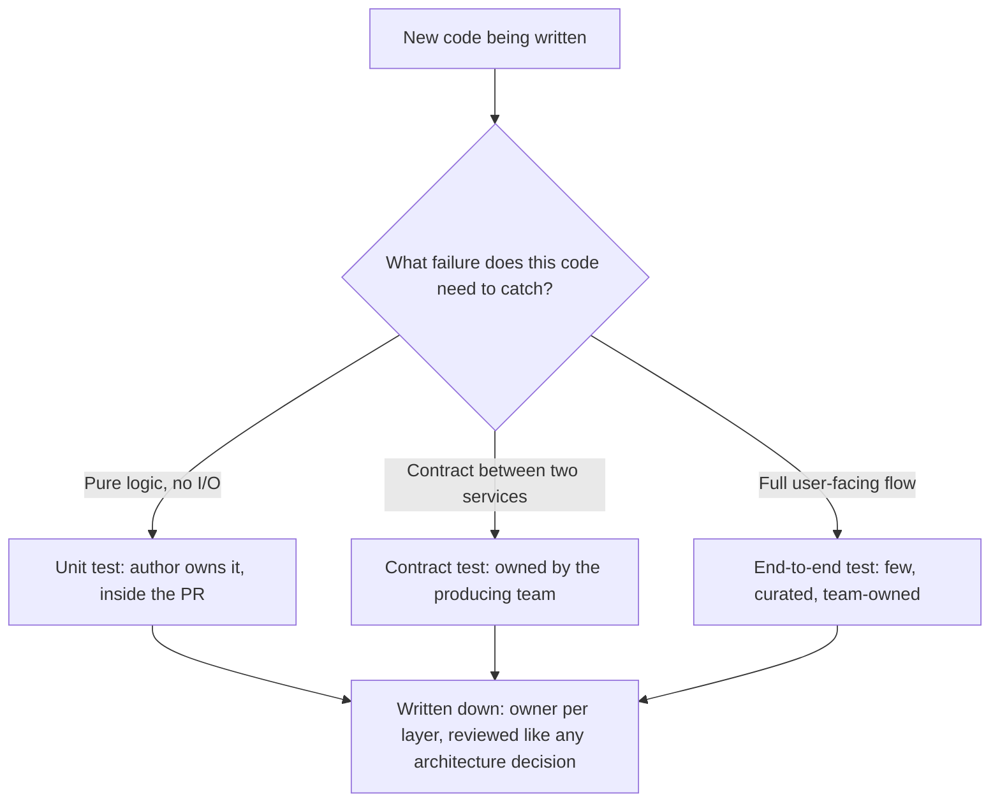

import LevelIntro from "../../../components/LevelIntro.astro";
import Checkpoint from "../../../components/Checkpoint.astro";
import PracticeCheck from "../../../components/PracticeCheck.astro";

export const unit = {
  track: "testing-quality",
  unitSlug: "quality-culture",
};

L1 showed a team whose defect rate turned out to depend on one person
being present. This level asks what a strategy for testing really is
once someone decides it, and what a person with influence but no
authority over other engineers can actually change.

<LevelIntro
  items={[
    "Testing strategy as a written, owned decision",
    "The four levers available without authority",
    "Why a blocking gate is pulled first",
  ]}
/>

## What does a decided testing strategy look like on paper?

Suppose a new engineer asks two questions: who writes the test for this
change, and at what level? **If the honest answer is "whoever feels like
it", what would a deliberate answer look like?**

Deciding it means doing for tests what a team already does for service
boundaries: choose deliberately, write it down where anyone can read it,
and revisit it as the system grows. Without the second step the decision
lives in one senior engineer's head. Without the third it fossilizes.

| Layer                   | What it catches                                  | Owner                                    | Blocks merge?               |
| ----------------------- | ------------------------------------------------ | ---------------------------------------- | --------------------------- |
| Unit tests              | Logic errors in one function or module           | The author, in the same PR               | Yes                         |
| Contract / integration  | A service breaking its agreement with a consumer | The team that owns the producing service | Yes                         |
| End-to-end              | A user flow breaking across services             | Shared, reviewed in one channel          | Yes, on a small curated set |
| Manual QA pass, if kept | Exploratory, judgment-based issues               | QA, as a complement to automation        | No, informational           |

The last row is the point. Manual QA does not vanish; its job shrinks
from "the only net between a bug and production" to exploratory judgment
on top of a suite that already catches the mechanical failures.

<PracticeCheck
  track={unit.track}
  unitSlug={unit.unitSlug}
  topicId="strategy-decision"
/>

<Checkpoint question="A team deletes its QA role with no other change and tells engineers to 'step up'. Using the moral-hazard idea from L1, is that likely to work?">

Not reliably. Removing the gate does remove the thing engineers leaned
on, but the problem was never what people were told; it was what the
system rewarded. If nothing concrete replaces the gate (a blocking suite,
named owners per layer, regressions treated seriously), engineers keep
shipping the same thin tests and the bugs now reach production directly.
The lesson is not "delete QA". It is "never let one downstream gate be
the only thing between a thin test and a shipped bug."

</Checkpoint>

## What can someone without authority actually change?

An influential engineer usually cannot order colleagues to write better
tests. **So what moves a team's habits if instructions do not?** Four
levers, none of which require managing anyone:

1. **Make a trusted, blocking gate the path of least resistance.** A fast
   suite that actually stops the merge button removes the need to ask
   anyone to care more. It applies to every PR automatically.
2. **Make broken-test ownership fast and visible.** A test red for three
   days with no owner teaches that red does not matter. Quick triage
   (who owns it, by when) protects the gate's credibility; this is the
   quarantine discipline from `test-suite-architecture`.
3. **Lead by example on the hardest code.** Nothing erodes "quality is
   everyone's job" faster than the person saying it skipping tests on
   their own gnarliest change.
4. **Treat an escaped regression as a real incident.** A short retro
   asking what in the strategy let it through, not a quiet fix.

| Lever                | Needs others to follow voluntarily? | Works on day one? |
| -------------------- | ----------------------------------- | ----------------- |
| Blocking gate        | No, it is mechanical                | Yes               |
| Fast, visible triage | Yes, over weeks                     | Partly            |
| Leading by example   | Yes, over months                    | No                |
| Regression retros    | Yes, to attend and act              | Partly            |

<PracticeCheck
  track={unit.track}
  unitSlug={unit.unitSlug}
  topicId="culture-levers"
/>

<Checkpoint question="If literally nobody else changes their behavior voluntarily, which lever still works?">

The blocking gate. The other three compound only as colleagues notice
and follow along. A gate that really prevents a merge puts every
engineer in front of the same constraint whether or not they have bought
into the philosophy, and it makes the other three easier to land once
the mechanical floor exists. That is why it is usually pulled first.

</Checkpoint>

## Why are architecture and culture the same problem?

An undecided testing strategy is as fragile as an undecided system
architecture: both drift toward whatever is locally convenient and
concentrate risk in whoever is paying attention that week. L1's team
had, without choosing to, built a design with a single point of failure:
one person's presence. Making the decision explicit and backing it with
a gate that does not depend on anyone's daily discipline is what turns
"quality is everyone's job" into something true of the system. L3
follows one engineer doing exactly this, including the pushback.
