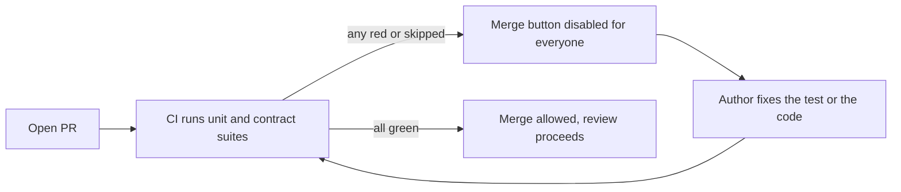
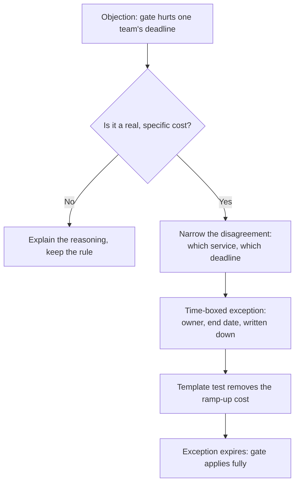

import Scenario from "../../../components/Scenario.astro";
import LevelIntro from "../../../components/LevelIntro.astro";
import Checkpoint from "../../../components/Checkpoint.astro";
import PracticeCheck from "../../../components/PracticeCheck.astro";

export const unit = {
  track: "testing-quality",
  unitSlug: "quality-culture",
};

<Scenario label="Week 1: propose a blocking gate. Week 3: a colleague pushes back, and is right.">
  <Fragment slot="facts">
    

      
🧑‍💻 <strong>Priya</strong>, an engineer on L1's team with no authority over colleagues

      
📉 <strong>Start</strong>: 3% to 15% defects during QA's leave (illustrative, from L1)

      
⚔️ <strong>Pushback</strong>: Marcus says the gate lands on his team's hardest deadline

      
🤝 <strong>Resolution</strong>: a tracked, two-week exception, not an override

    

  </Fragment>

L2 named the levers in the abstract. This level follows one of them being
pulled on the team from L1 over six weeks, including the part a clean
story skips: a credible objection from someone who is not wrong to worry,
and how it gets resolved instead of overridden.

**Before reading on: if you were Priya, which week would you expect to be
the hardest, and why?**

</Scenario>

<LevelIntro
  items={[
    "The strategy table and the mechanical gate",
    "A pushback negotiated, not steamrolled",
    "A regression handled as a short incident review",
  ]}
/>

## Weeks 1 and 2: how does a proposal become a constraint?

Priya cannot tell anyone how to write tests. She has the leave data and a
standing slot at the team's biweekly standards meeting. She brings one
artifact, not an opinion: the L2 strategy table, with the team's current
accidental practice next to the proposal.

| Layer            | Current practice (accidental)                    | Proposed (decided)                               |
| ---------------- | ------------------------------------------------ | ------------------------------------------------ |
| Unit tests       | Whatever the author felt like; not reviewed      | Required for new logic; reviewers check for them |
| Contract tests   | None; two services drifted apart twice this year | Required at service boundaries                   |
| End-to-end tests | A handful, unmaintained, status unknown          | A small curated set with a named owner           |
| Manual QA pass   | The only real gate before release                | A complement on top of an automated floor        |

**Why show the current state beside the proposal?** "You're doing it
wrong" invites defense. "Here is what we do, which nobody chose" invites
the team to recognize its own accident, and it makes clear QA was asked to
be the only net, which was never a fair ask of one person.

Agreement in a meeting is cheap, though. **What makes it true of the
system by Friday?** In week 2 Priya changes what merging requires:

A branch protection rule makes the CI job a required check, so no norm has
to be remembered: a PR without passing tests simply cannot land, including
Priya's own.

<Checkpoint question="Priya could have asked, in the same meeting, 'please write more tests going forward.' What does a required CI check do that the request cannot?">

A request depends on everyone remembering it under whatever deadline
pressure they face that week, and the first skip without consequence makes
it optional for everyone who notices. A required check holds by default:
the merge button is unavailable until the suite passes, for every PR. It
converts a norm that needs constant social upkeep into a constraint, which
is the L2 point that incentives beat instructions.

</Checkpoint>

## Week 3: what do you do with an objection that is correct?

Marcus, a respected colleague, raises a concrete worry. His team has a hard
external deadline in three weeks, and the contract tests for the payments
service they are changing do not exist yet, so the new requirement blocks
every PR touching it. His words: "I'm not against this. I'm against it
landing on my team's hardest deadline with no ramp-up."

He is not wrong. Dismissing him as resistance to change would be untrue and
would make the next proposal harder. Override or withdraw are the two easy
options; the useful one is to notice the disagreement is narrower than it
sounds. Marcus is not objecting to the strategy, only to zero ramp-up on
one service under one deadline. After one follow-up conversation:

1. The payments service gets a **two-week exception** with a named owner
   and an end date, the same discipline `test-suite-architecture` uses for
   quarantined flaky tests, applied to a missing test instead of a broken
   one.
2. Priya pairs with one of Marcus's engineers for half a day to write the
   first contract test as a template.
3. The exception is written in the strategy document, visible to everyone,
   not agreed quietly in chat.

A rule with no exceptions invites quiet workarounds. A rule with a visible,
dated exception process stays credible because it bends without breaking.
The date matters: the demo on this unit models trust in the gate using
assumed numbers (starting near 97%, eroding toward a floor of 20%). In that
model trust is still about 67% when an exception is 14 days past its end
date, and about 47% at 30 days. An exception that is never closed teaches
that the gate is negotiable by default.

<PracticeCheck
  track={unit.track}
  unitSlug={unit.unitSlug}
  topicId="negotiated-exception"
/>

## Week 6: why treat a rare regression as an incident?

Five weeks in, a bug reaches production anyway: a null-handling edge case in
a branch nobody tested. Before, it would have been a quiet message and a
same-day fix. Priya proposes a 30-minute retro, a scaled-down version of
what `incident-response` describes for outages, asking one question: **what
about the testing strategy let this through, and does the table need a new
row?** The answer is concrete. The table said nothing about boundary and
null-handling paths, so the team adds that row.

<Checkpoint question="The team could have quietly patched the bug and said nothing. What would that choice have taught, even unspoken?">

That a gap past the gate costs nothing, which is the lesson L1's leave
scenario showed before any of this started, relocated rather than removed.
The gate stops obviously thin PRs, but a gap that slips through and is
absorbed silently teaches that catching it is somebody else's problem, or
nobody's. A short real retro keeps the gate meaningful six months later,
not only in its first excited weeks.

</Checkpoint>

<PracticeCheck
  track={unit.track}
  unitSlug={unit.unitSlug}
  topicId="regression-retro"
/>

## What changed, and what is still open?

Nothing here required authority over Marcus, the payments team, or anyone's
review. What changed was the system: a gate that does not depend on memory,
a strategy document that makes "who owns this layer" answerable, an
exception process that kept the gate credible under pressure, and a retro
habit that stops a rare regression from teaching the wrong lesson.

This is one case, not the whole territory. **Two ways to extend it.** First:
this was one team of about eight with a standing meeting seat. At a
200-person organization with dozens of independently deployed services,
does a single blocking gate work the same way, or must the strategy table
be written at a different level? Second: Marcus raised his objection as a
peer and it was negotiated. What changes if the same sentence, "this will
slow us down before the deadline", comes from a director who could simply
mandate an exception? Does a tracked, dated exception still survive, and
what extra visibility would it need?
