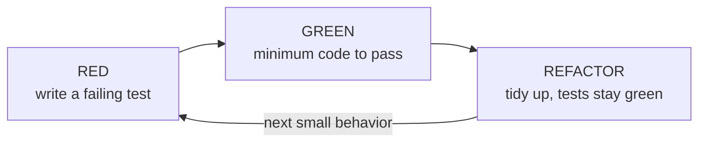

import Scenario from "../../../components/Scenario.astro";
import LevelIntro from "../../../components/LevelIntro.astro";
import PracticeCheck from "../../../components/PracticeCheck.astro";

export const unit = {
  track: "testing-quality",
  unitSlug: "tdd-basics",
};

<Scenario label="Two runners, one 100 m track. Only one of them paints the finish line first.">
  <Fragment slot="facts">
    

      
🏃 <strong>Runner A</strong> — runs until it "feels far enough", then says "done"

      
🏁 <strong>Runner B</strong> — paints a line at 100 m first, then runs to it

      
❓ <strong>The question</strong> — who can say, honestly, that they finished?

    

    

      

        
Line painted before the run100 m

        

      

    

  </Fragment>

Runner A sets off with no mark on the ground and stops when the legs feel
tired. Runner B paints a line 100 m away, then runs. Both stop running at some
point. **Which of them can say "I finished the race", and what did the line
change before either one took a step?**

Only Runner B can answer, because "done" was written down before the effort
started. Runner A's finish line is wherever they happened to stop, so it can
never be missed. Writing a test before the code is painting the line first.

</Scenario>

<LevelIntro
  items={[
    "A test as the finish line, set first",
    "The red-green-refactor loop",
    "Testability as a pressure on design",
  ]}
/>

## What does it change to paint the line first?

**You are about to build a password-strength checker. What do you have to
decide before you write a single line of the checker itself?** If you start
with the assertion, you must say what the checker hands back for `"short"`: a
yes/no, a printed message, a score with a list of complaints? The assertion
cannot be written until that is decided.

| Starting point | What exists first         | What you are forced to decide early                 |
| -------------- | ------------------------- | --------------------------------------------------- |
| Code first     | Logic that finds problems | Nothing about the result's shape; printing is easy  |
| Test first     | An assertion that fails   | What the function returns, so something can compare |

The assertion is the first user of your function. If it is awkward to write,
the function's interface is awkward, and you find out before anything depends
on it.

<PracticeCheck
  track={unit.track}
  unitSlug={unit.unitSlug}
  topicId="finish-line-first"
/>

## What is the loop that keeps the line honest?

TDD repeats one small cycle for each piece of behavior.

| Step     | What you do                                  | What it protects you from               |
| -------- | -------------------------------------------- | --------------------------------------- |
| Red      | See a new test fail                          | A test that could never fail            |
| Green    | Write just enough code to make it pass       | Code no test asked for                  |
| Refactor | Clean up while the passing tests stand guard | Messy code that quietly breaks behavior |

<PracticeCheck
  track={unit.track}
  unitSlug={unit.unitSlug}
  topicId="red-green-refactor"
/>

## Key terms

- **TDD (test-driven development)** — writing a failing test for a small
  piece of behavior before the code that implements it.
- **Red-green-refactor** — the three-step loop: fail, pass, tidy.
- **Minimum code to pass** — in green, write only what the current test
  demands. Extra code has no test proving it is needed or correct.
- **Design pressure** — the nudge toward an interface that is easy to assert
  against, because the assertion is written before the interface exists.

## What the next levels cover

L2 explains why each step of the loop is there on purpose, and where the
design pressure comes from. L3 builds the password checker through four real
cycles, then asks what happens when a requirement does not fit the shape the
first cycle chose.
