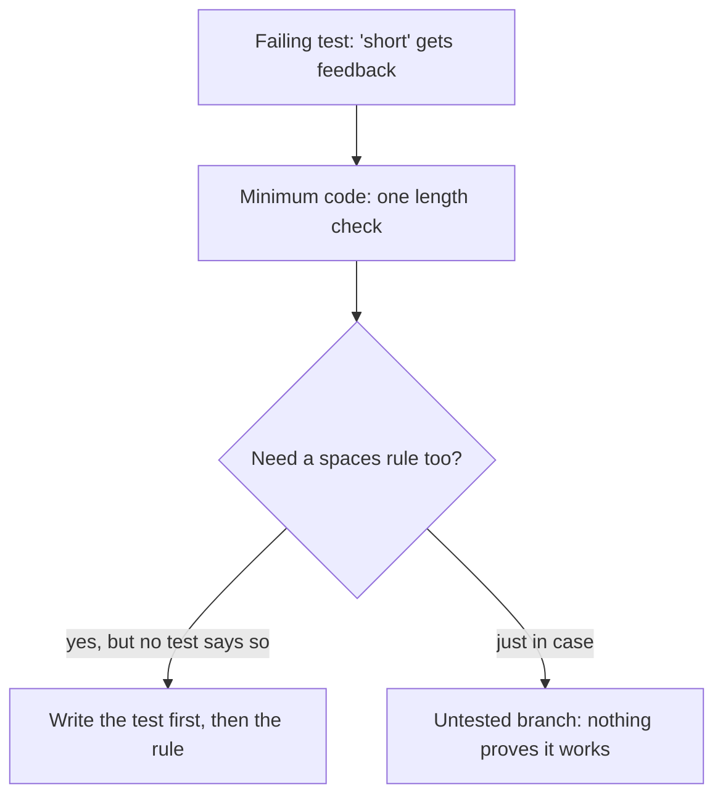

import LevelIntro from "../../../components/LevelIntro.astro";
import Checkpoint from "../../../components/Checkpoint.astro";
import PracticeCheck from "../../../components/PracticeCheck.astro";

export const unit = {
  track: "testing-quality",
  unitSlug: "tdd-basics",
};

L1 compared a runner who paints the finish line first with one who does not,
and said TDD is the first kind. L2 asks why each step of the loop is built the
way it is, and where exactly the pressure on design comes from.

<LevelIntro
  items={[
    "Why 'minimum code to pass' is a rule",
    "How the first assertion shapes the interface",
    "What refactoring is safe against",
  ]}
/>

## Why write less code than you already know you will need?

**You can see the whole feature in your head. Why stop at the smallest code
that passes the one failing test?** Because every extra line is a bet on a
requirement nobody has written down. Code written only to pass a given test can
be traced back to that test. Code written ahead of the tests cannot.

Small steps also keep a red test informative. If one new test fails after a
change of a few lines, the cause is within those lines.

<Checkpoint question="A test passes on the very first run, before any implementation was written. Good news or warning sign?">

A warning sign. The loop asks you to watch a test fail first because a test that
has never failed has not shown it can. It may be asserting something always
true, or checking the wrong thing. When it later passes for real, you would have
no reason to trust the pass.

</Checkpoint>

<PracticeCheck
  track={unit.track}
  unitSlug={unit.unitSlug}
  topicId="minimum-code"
/>

## Where does the design pressure come from?

**Both engineers' checkers find weak passwords. Why does writing the assertion
first tend to produce the one you can reuse?** An assertion needs something to
compare. A function that returns `{ score, feedback }` gives it that. A
function that prints a warning gives it nothing, so the awkwardness shows up at
the moment the test is written, before the printing design is built.

| Design            | Can an assertion check it? | Can another screen or service reuse it?       |
| ----------------- | -------------------------- | --------------------------------------------- |
| Prints to console | Only by capturing text     | Only where a console exists                   |
| Returns a result  | Directly, with `toEqual`   | Anywhere: a form, an API reply, another check |

The easiest design to test and the easiest design to reuse turn out to be the
same design: a function with inputs in and a value out. Writing the code first
does not forbid landing there. It just removes the early discomfort that pushes
you toward it.

<PracticeCheck
  track={unit.track}
  unitSlug={unit.unitSlug}
  topicId="design-pressure"
/>

## What is a refactor actually safe against?

**After green, why not simply move on?** Green often leaves duplication, a
shortcut that was fine for one test. Refactor is where that is cleaned up, and
it can be done boldly because the passing tests will fail the moment a change
alters behavior they check.

<Checkpoint question="You refactor a function with three passing tests and all three still pass untouched. Does that prove behavior is unchanged?">

Only the behavior those three tests check. A clean run is exactly as strong as
what the tests assert. If something the tests never look at shifted during the
refactor, nothing turns red. So the more of a function's real behavior its tests
pin down, the more a green run after refactoring actually means.

</Checkpoint>

TDD does not guarantee good design. A loosely written test can pass against a
poor interface forever. What it does give you is a specific early moment where
an awkward interface has to be faced, because an assertion has to be written
against it right now. Using that moment is still your decision.

<PracticeCheck
  track={unit.track}
  unitSlug={unit.unitSlug}
  topicId="refactor-safety"
/>
