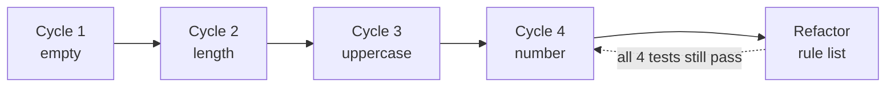

import Scenario from "../../../components/Scenario.astro";
import LevelIntro from "../../../components/LevelIntro.astro";
import Checkpoint from "../../../components/Checkpoint.astro";
import PracticeCheck from "../../../components/PracticeCheck.astro";

export const unit = {
  track: "testing-quality",
  unitSlug: "tdd-basics",
};

<Scenario label="Four cycles, one refactor. What did the very first assertion already decide?">
  <Fragment slot="facts">
    <div class="not-prose flex flex-col gap-2 text-sm text-slate-700 dark:text-slate-300">
      <div class="flex items-center gap-1.5"><span>1️⃣</span> <strong>Cycle 1</strong> — empty password</div>
      <div class="flex items-center gap-1.5"><span>2️⃣</span> <strong>Cycle 2</strong> — too short</div>
      <div class="flex items-center gap-1.5"><span>3️⃣</span> <strong>Cycle 3</strong> — no uppercase letter</div>
      <div class="flex items-center gap-1.5"><span>4️⃣</span> <strong>Cycle 4</strong> — no number</div>
      <div class="flex items-center gap-1.5"><span>🧹</span> <strong>Refactor</strong> — three checks into one rule list</div>
    </div>
    <div class="not-prose mt-3 flex flex-col gap-1.5 text-xs text-slate-700 dark:text-slate-300">
      <div>
        <div class="flex justify-between"><span>Rules in the finished checker</span><span>3 of 3</span></div>
        <div class="h-2 w-full overflow-hidden rounded-full bg-slate-200 dark:bg-slate-700"><div class="h-full rounded-full bg-emerald-500 animate-fill-bar" style="--target-width: 100%"></div></div>
      </div>
    </div>
  </Fragment>

Back on the track: you have painted the line, and now you run it in four short
sprints. The checker is called `describePasswordStrength`. **Before any code
exists, the first assertion is written as `expect(describePasswordStrength("")).toEqual(...)`.
What does that single line already tell you about what the function returns?**

</Scenario>

<LevelIntro
  items={[
    "Four cycles on one small function",
    "A refactor the tests can vouch for",
    "A requirement that breaks the first shape",
  ]}
/>

## What does each cycle add, and what does it decide?

**If each cycle adds one assertion and the least code to satisfy it, what does
the whole build look like?** Here is the full sequence. The result is always
`{ score, feedback }`: `score` counts rules passed, `feedback` lists messages
for rules failed.

| Cycle | Assertion added (input → expected)                      | Least code that passes       | Design decision it forced                     |
| ----- | ------------------------------------------------------- | ---------------------------- | --------------------------------------------- |
| 1     | `""` → score 0, `["Password is required"]`              | early return for empty input | Result is an object, not a boolean or a print |
| 2     | `"short"` → score 0, `["Add more characters (min 8)"]`  | one length check             | `score` counts passes, `feedback` lists fails |
| 3     | `"longenough"` → score 1, `["Add an uppercase letter"]` | one uppercase check          | Rules accumulate; order of messages matters   |
| 4     | `"Longenough1"` → score 3, `[]`, plus a number rule     | one number check             | A fully good password has empty feedback      |



One honest wrinkle: when cycles 3 and 4 add rules, the earlier `"short"` and
`"longenough"` expectations must grow, because those inputs now also fail the
new rules. After cycle 4, `"short"` expects score 0 with three messages, and
`"longenough"` expects score 1 with `["Add an uppercase letter", "Add a number"]`.
Updating them is a deliberate change to the spec, made in the open, not a test
quietly edited to go green. Running the finished function in Node gives exactly
those results. The cost of that honesty grows with the rule count: the demo on
this level plots how many earlier expectations have to be edited as rules
accumulate.

<Checkpoint question="A fifth rule, 'no spaces', is added directly to the function with no failing test written first. What is true of that branch and not of the other four?">

It is the only branch nothing demanded. Each of the other four exists because a
specific red test required exactly that behavior. The new one is a guess,
indistinguishable by reading from the rest, with nothing checking that it
works, that it does not clash with an existing rule, or that a later refactor
leaves it alone.

</Checkpoint>

## What does the refactor change, and what proves it changed nothing?

**The three checks repeat the same shape. With four green tests, how do you
tidy them safely?** Replace the three `if/else` blocks with one list of rules and
one loop over it. This is the one place a code block earns its space, because
the structure is the point.

```js
const rules = [
  { check: (p) => p.length >= 8, message: "Add more characters (min 8)" },
  { check: (p) => /[A-Z]/.test(p), message: "Add an uppercase letter" },
  { check: (p) => /[0-9]/.test(p), message: "Add a number" },
];
```

Running the four tests against the new version gives identical results to the
old one. That claim is checkable only because the tests are specific. If the
uppercase and number rules were accidentally swapped in the list, `"longenough"`
would produce `["Add a number", "Add an uppercase letter"]`, the array
comparison in `toEqual` is order-sensitive, and the cycle-4 test would go red
immediately.

<Checkpoint question="Would a test that only checked feedback.length for 'longenough' catch that swap?">

No. Both orderings have two messages, so a length-only assertion stays green
while the user sees the advice in a different order. The refactor's safety is
bounded by how specifically the tests pin the behavior. A looser assertion would
have let a harmless-looking reorder, or a real mistake of the same kind, pass
unnoticed.

</Checkpoint>

<PracticeCheck
  track={unit.track}
  unitSlug={unit.unitSlug}
  topicId="password-checker-code"
/>

## What if the next requirement does not fit the shape the first cycle chose?

**Every rule so far was independent: a check and a message. What if the next
requirement is "reject common passwords outright, whatever the score"?** The
loop does not change. Write the failing test first, for example
`"password123"` → score 0, `["This password is too common"]`. Run the rule list
over it as it stands and the result is score 2 (length and number pass, uppercase
fails), so the new test fails for a real reason. The least code that passes is a
common-password check that runs before the rules and returns early.

| Design option                      | `"password123"` result                     | Passes the new test? |
| ---------------------------------- | ------------------------------------------ | -------------------- |
| Rule list only (before the change) | score 2, `["Add an uppercase letter"]`     | No (red)             |
| Early return before the rule list  | score 0, `["This password is too common"]` | Yes (green)          |

The test did not choose between "early return" and "a special rule", it only
guaranteed that whichever you pick is checked. That is the honest limit of the
method: TDD supplies the pressure and the safety net, and the design remains
your call.

<PracticeCheck
  track={unit.track}
  unitSlug={unit.unitSlug}
  topicId="new-requirement"
/>

## This is a case, not the whole territory

The password checker is one small, pure function. Try bending the example
yourself:

- What changes if the checker had to call a service to look up common passwords?
  Which part would you test first, and what would the assertion look like?
- What changes if the audience were a banking app that must show every complaint
  at once versus a sign-up form that shows only the first?
- What changes if the news were worse: the first test you write turns out to be
  impossible to satisfy without printing? What does that tell you about the
  interface?

## Failure modes

| Failure mode                                         | What it gets wrong                                                        |
| ---------------------------------------------------- | ------------------------------------------------------------------------- |
| Writing the test after the code and calling it TDD   | Skips the design pressure: the interface is fixed before the test exists  |
| Writing more in green than the current test requires | Adds behavior that no assertion demands or verifies                       |
| Skipping refactor once tests pass                    | Leaves duplication with no forcing function to remove it                  |
| Writing a vague assertion just to reach green        | A test that cannot meaningfully fail gives none of red's guarantee        |
| Assuming TDD alone guarantees good design            | The pressure only helps if an awkward interface, once noticed, is changed |
