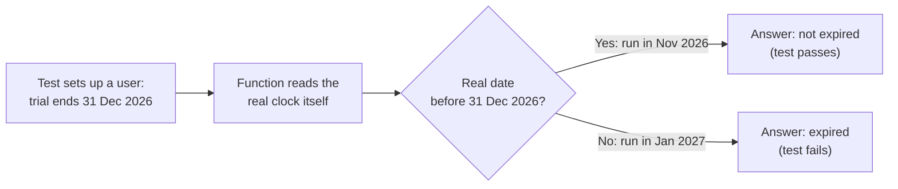

import Scenario from "../../../components/Scenario.astro";
import LevelIntro from "../../../components/LevelIntro.astro";
import PracticeCheck from "../../../components/PracticeCheck.astro";

export const unit = { track: "testing-quality", unitSlug: "test-doubles" };

<Scenario label="A test that passes today and fails 57 days from now, with no code change">
  <Fragment slot="facts">
    

      
🕐 <strong>The function</strong> — asks the real system clock whether a trial has ended

      
📅 <strong>The test</strong> — hardcodes a trial end date of 31 Dec 2026 and expects "not expired"

      
✅ <strong>Written on 4 Nov 2026</strong> — passes

      
❌ <strong>Run on 1 Jan 2027</strong> — the same test fails

    

    

      
The test never controlled time

      time controlled the test, from outside, whenever it happened to run
    

  </Fragment>

Ines writes a function, `isTrialExpired(user)`, that answers one
question: has this user's free trial ended? It reads the real clock
inside its own body. Her test creates a user whose trial ends on
31 December 2026 and checks that the answer is "not expired". On
4 November 2026 it passes. Fifty-seven days later, with nobody touching
the function or the test, it fails. **How do you test a function that
depends on the current moment, so the result does not depend on the day
the test runs?**

Picture a quiz that asks "is it before noon?" and is marked by looking at
the wall clock in the classroom. The answer changes with when the
teacher grades it. The fix is not a better quiz question; it is handing
the quiz a clock whose hands you set yourself.

</Scenario>

<LevelIntro
  items={[
    "What a seam is, and why its absence blocks testing",
    "Stub, fake, spy and mock told apart",
    "Which question each kind of double answers",
  ]}
/>

## The shape of the problem

Some code depends on things a test cannot easily control: the current
time, a random number, a call to another service, a real database. If the
code reaches out and grabs those things directly, the test's result
depends on things the test does not own.

| Dependency      | Why a test cannot control it directly     |
| --------------- | ----------------------------------------- |
| Current time    | Changes every moment the test runs        |
| Random number   | Different on every run                    |
| Another service | May be slow, down, or cost real effort    |
| Real database   | Shared state left behind by earlier tests |

The remedy has two parts. First a **seam**: a place where the dependency
can be swapped. Then a **test double**: the stand-in that gets swapped in.

<PracticeCheck track={unit.track} unitSlug={unit.unitSlug} topicId="seam" />

## Key terms

| Term              | One-line meaning                                                                              | The question it answers                          |
| ----------------- | --------------------------------------------------------------------------------------------- | ------------------------------------------------ |
| **Seam**          | A point where a dependency arrives from outside (a parameter) instead of being grabbed inside | "Can I substitute anything here at all?"         |
| **Stub**          | Returns canned values; no logic, no memory of calls                                           | "What happens if the dependency returns X?"      |
| **Fake**          | A real but simplified working version (an in-memory list instead of a database)               | "Does my code work against something realistic?" |
| **Spy**           | Records how it was called; the test inspects the record afterward                             | "Did my code call it correctly?"                 |
| **Mock** (strict) | Told its expectations before the call; fails itself during the call if they are not met       | "Did my code call it correctly, checked live?"   |

Everyday speech calls all of these "mocks", and many testing libraries do
too. That is a workable habit, not a mistake. This unit uses the precise
terms because the mechanisms differ, and the difference decides which one
to reach for.

## What this unit covers

L2 shows why "hard to test" usually means "no seam", and how to pick a
double by the question being asked, including where a strict mock differs
from a spy. L3 adds seams to the trial function and the refund function it
feeds, then tests the same code with a stub, a fake and a spy.
