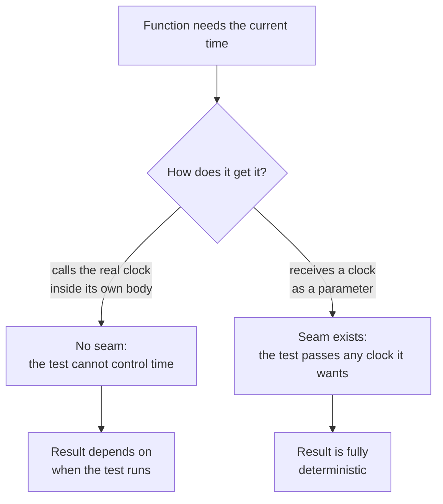
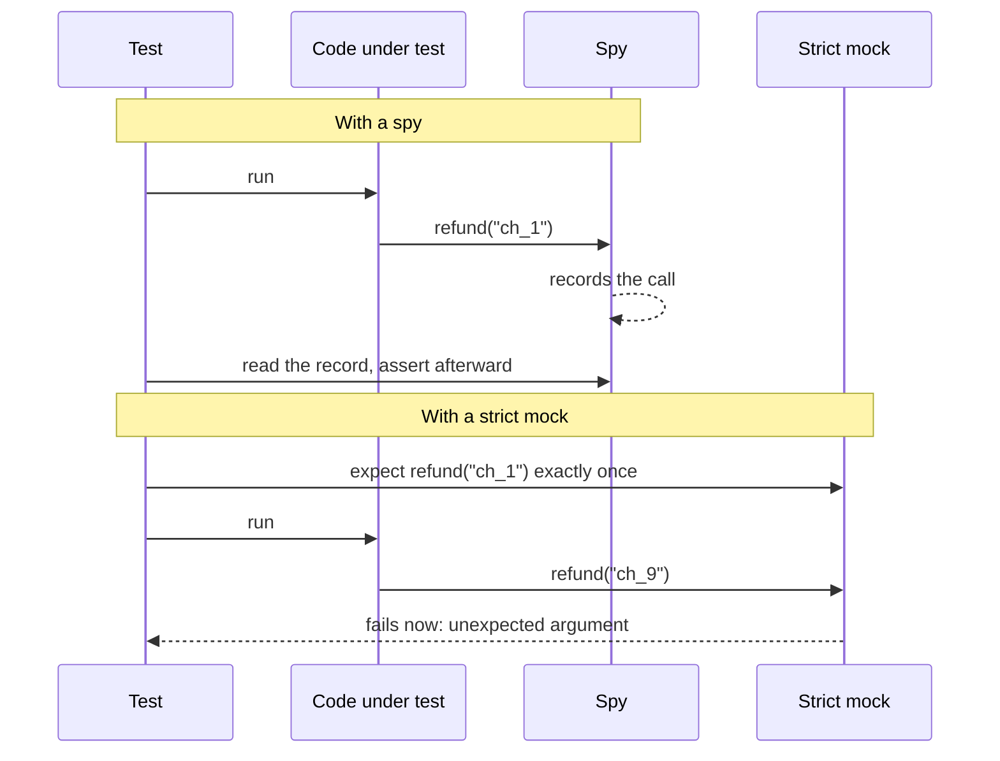

import LevelIntro from "../../../components/LevelIntro.astro";
import Checkpoint from "../../../components/Checkpoint.astro";
import PracticeCheck from "../../../components/PracticeCheck.astro";

export const unit = { track: "testing-quality", unitSlug: "test-doubles" };

L1 named the doubles and the word "seam" without yet showing why a seam is
what makes any of them possible. L2 works out where seams come from, and
which double answers which question.

<LevelIntro
  items={[
    "Why where a dependency is obtained decides testability",
    "Stub versus fake: canned versus working",
    "Spy versus mock: when the call is checked",
  ]}
/>

## Where the dependency gets grabbed matters more than what it is

**If the current time and a payment service are both "external", why is one
function easy to test and another stuck, when both depend on something
outside themselves?** The difference is not what is depended on. It is
_where_ the dependency is obtained:

In production both versions do the same thing: call something that returns
the time. The only difference is whether that call happens _inside_ the
function (no seam) or is _handed to_ it (a seam). That single structural
choice decides whether deterministic testing is possible at all.

<Checkpoint question="A teammate says 'we cannot unit test this function, it depends on the database.' What is the first thing to check before agreeing?">

Whether the database access is a seam. Does the function receive its
database dependency from outside, or does it open a real connection itself,
inside its body? Depending on a database does not make a function
untestable; many database-dependent functions are tested easily once a
database-shaped seam lets a stand-in take the real one's place. "It depends
on X" and "it is hard to test" only look like the same claim when no seam
separates them.

</Checkpoint>

## Stub versus fake: canned versus working

**Once a seam exists, why is there more than one kind of stand-in?** Because
"replace the real thing for a test" is not one question. Take a dependency
that stores refunds. A test might need it to answer a fixed way, or it might
need it to behave like a small working store across several calls:

| Double | Has state across calls? | Has real logic? | Typical use                                               |
| ------ | ----------------------- | --------------- | --------------------------------------------------------- |
| Stub   | No                      | No              | Force one situation: "the clock says 15 June"             |
| Fake   | Yes                     | Yes, simplified | Run a multi-step flow: store a refund, read it back later |

A stub hands back whatever canned value it was told to. A fake keeps
working consistently: a fake in-memory store really stores what is put in
it. The fake's realism has a price. It is code someone must build and
maintain, and it proves the code works against _fake-like_ behavior. Where a
real database differs from the simplified fake (limits, ordering, failures),
the fake stays silent.

<Checkpoint question="A test only needs one fixed answer from a dependency, once. Stub or fake, and what would the fake cost you?">

A stub. The test needs one canned answer, not behavior that holds up over
several calls. A fake would cost extra code to write and keep correct, and
would add behavior the test never exercises. A fake earns its place when the
code under test makes several calls and later calls depend on earlier ones.

</Checkpoint>

<PracticeCheck
  track={unit.track}
  unitSlug={unit.unitSlug}
  topicId="stub-fake"
/>

## Spy versus mock: when the call is checked

**If a spy already records every call so a test can check it later, what is
left for a stricter "mock" to do?** Both answer "did my code call the
dependency correctly?" They differ in _when_ the check happens:

| Double        | When it checks                        | Who does the asserting                |
| ------------- | ------------------------------------- | ------------------------------------- |
| Stub          | Never; it has no opinion about calls  | Nobody; it only returns a value       |
| Spy           | After the run, in the test's own code | The test reads the recording          |
| Mock (strict) | During the call itself                | The double fails itself on a mismatch |

A spy is a passive recorder: the _test_ asserts, afterward. A strict mock is
an active participant: it enforces expectations in real time, so its failure
points at the exact call that broke them. Plenty of tools blur the two on
purpose; a "mock function" that records calls for later inspection is, in
this precise sense, a spy. That naming is a convention worth recognizing, not
an error.

## When is a spy overkill, and when is it required?

**If a stub can already stand in for a payment service, why would anyone need
a spy?** Because a stub only helps check the _result_ of the code under test.
It cannot show whether the code called the service with the right argument,
the right number of times, or in the right order. A spy exists for the case
where the call itself is the thing worth testing: "the refund was requested
for exactly one charge, not zero and not two."

<Checkpoint question="A test only checks that the trial function returns true for an expired user and false for an active one. Stub clock or spy clock?">

A stub clock. The test cares about the return value for a controlled input;
nobody needs to know how often or with what the clock was called. A spy would
add an assertion about interaction details that no one needs, making the test
brittle to harmless internal changes without buying any extra guarantee. A spy
pays for itself only when the fact of the call is what the test is meant to
verify.

</Checkpoint>

<PracticeCheck track={unit.track} unitSlug={unit.unitSlug} topicId="spy-mock" />

## Failure modes at this level

- **Treating "hard to test" as a property of the dependency.** The system
  clock is not inherently untestable; code that grabs it directly, with no
  seam, is. The fix is almost always adding a seam, not avoiding the
  dependency.
- **Reaching for a spy when a stub answers the question.** Recording or
  pre-expecting calls encodes how the code works inside, which breaks on
  harmless refactors.
- **Building an elaborate fake when a stub would do.** Realism is only worth
  its upkeep when tests actually exercise the stateful behavior.
