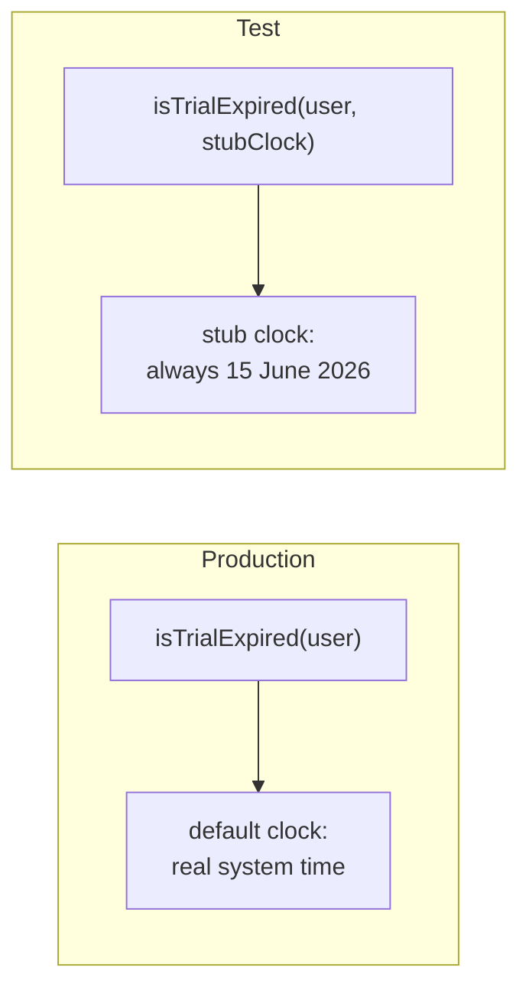
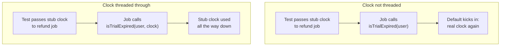
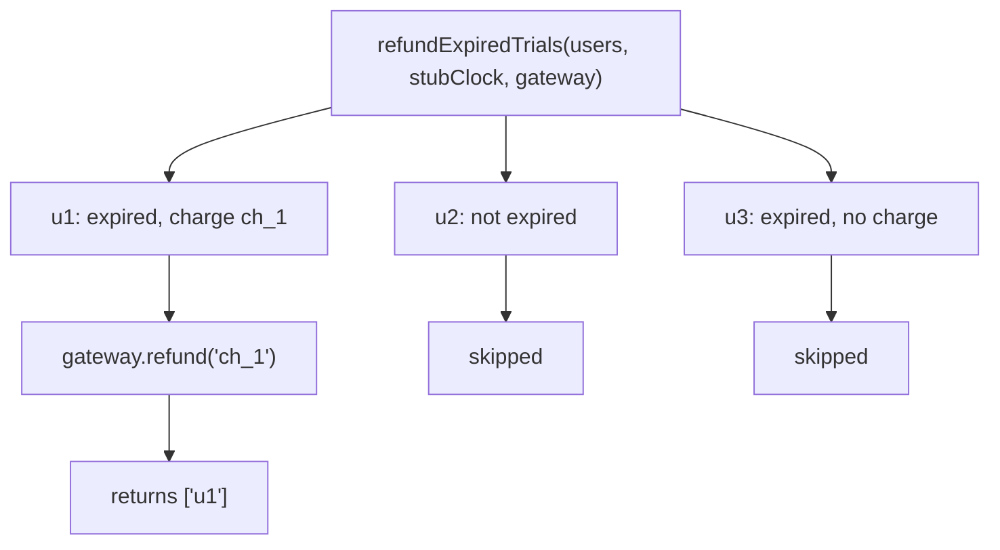

import Scenario from "../../../components/Scenario.astro";
import LevelIntro from "../../../components/LevelIntro.astro";
import Checkpoint from "../../../components/Checkpoint.astro";
import PracticeCheck from "../../../components/PracticeCheck.astro";

export const unit = { track: "testing-quality", unitSlug: "test-doubles" };

<Scenario label="Three users, one fixed date: who gets a refund?">
  <Fragment slot="facts">
    <div class="not-prose flex flex-col gap-2 text-sm text-slate-700 dark:text-slate-300">
      <div class="flex items-center gap-1.5"><span>🕐</span> <strong>Stub clock</strong> — fixed at 15 June 2026</div>
      <div class="flex items-center gap-1.5"><span>1️⃣</span> <strong>u1</strong> — trial ended 1 June, has charge <code>ch_1</code> (14 days ago)</div>
      <div class="flex items-center gap-1.5"><span>2️⃣</span> <strong>u2</strong> — trial ends 1 July, has charge <code>ch_2</code> (16 days away)</div>
      <div class="flex items-center gap-1.5"><span>3️⃣</span> <strong>u3</strong> — trial ended 1 May, no pending charge</div>
    </div>
  </Fragment>

The refund job should refund only users whose trial has ended and who still
have a pending charge. Three users, one frozen date. **Before running
anything: which users get refunded, and what exactly should the payment
service be asked to do?**

</Scenario>

L2 established that a seam makes a dependency testable and that stub, fake
and spy each answer a different question. L3 takes the trial function from
L1, adds the seams it was missing, and tests the same behavior three ways.

<LevelIntro
  items={[
    "Turning the clock into a seam with a default",
    "Threading a seam through a call chain",
    "One function, three doubles, three questions",
  ]}
/>

## How does the clock become a seam without breaking production?

**Does adding a seam mean every existing caller has to change?** No. The
broken version asks the real clock directly. The seamed version takes a clock
as a parameter whose default is the real one:

```js
function isTrialExpired(user, clock = () => Date.now()) {
  return clock() > user.trialEndsAt;
}
```

Calling `isTrialExpired(user)` still uses the real clock, so production
callers are untouched. A test passes a **stub clock** that always returns
15 June 2026. With that clock, a trial ending 1 June reads as expired and one
ending 1 July does not, and that result never changes, whatever day the suite
runs. The unit's interactive demo drags the stub clock across the trial's
boundary and shows the answer flipping exactly once, at the trial end date.



## What happens to the seam one level up?

**The refund job calls the trial function for every user. If the job calls it
without passing a clock, is the seam still doing anything?** No. The default
kicks in inside the job and the real clock is back, in a function the test
meant to make deterministic.



```js
function refundExpiredTrials(users, clock, paymentGateway) {
  const refunded = [];
  for (const user of users) {
    if (isTrialExpired(user, clock) && user.pendingChargeId) {
      paymentGateway.refund(user.pendingChargeId);
      refunded.push(user.id);
    }
  }
  return refunded;
}
```

The job has two seams: `clock` and `paymentGateway`. Both are parameters, and
the clock is forwarded rather than re-defaulted.

<Checkpoint question="The refund job accepts a clock but calls isTrialExpired(user) without it. The test passes a stub clock and still fails on some days. Why?">

The stub clock never reaches the trial check. The default parameter silently
substitutes the real system clock inside the job, so the result depends on the
real date again. A seam removes the dependency on the real clock only for the
whole call chain if every caller on the way down forwards it. Adding a seam to
a function and ignoring it one level up leaves the test exactly as
date-dependent as before.

</Checkpoint>

<PracticeCheck
  track={unit.track}
  unitSlug={unit.unitSlug}
  topicId="seam-chain"
/>

## Same function, three doubles, three questions

With both seams in place, one run of the job over the three users can be
checked in three different ways. The stub clock is fixed at 15 June 2026 in
all three:

| Double used for the gateway  | Question it answers                     | What the test asserts                                   | Result for these users                 |
| ---------------------------- | --------------------------------------- | ------------------------------------------------------- | -------------------------------------- |
| Stub (returns "success")     | Does the job return the right user ids? | The returned list                                       | `["u1"]`                               |
| Fake (in-memory refund list) | Does the stored state end up right?     | The fake's stored refunds after the run                 | `["ch_1"]`                             |
| Spy (records each call)      | Did the job call the gateway correctly? | The recorded calls: one call, with `ch_1`, nothing else | one `refund` call with argument `ch_1` |

These were checked by running the job in Node: u1 is expired and has a charge,
so it is refunded; u2's trial has 16 days left; u3's trial ended but there is
no charge to refund. Only u1 reaches the gateway.



<Checkpoint question="Both the fake and the spy end up showing that ch_1 was refunded. If you only ever used the fake, what exactly would you lose?">

The ability to assert on the call itself. The fake shows the refund as its own
simplified storage recorded it, one step removed from the call. The spy shows
the exact interaction: one call, one argument, no more and no fewer. That
difference only matters when the interaction is the thing under test (for
example, accidentally refunding the same charge twice). Where only the
end result matters, the fake or even a stub is enough, and a spy would add
brittleness for no extra guarantee.

</Checkpoint>

<PracticeCheck
  track={unit.track}
  unitSlug={unit.unitSlug}
  topicId="build-doubles"
/>

## What does this example prove, and what does it leave open?

**Does the lesson say "inject every dependency"?** No. When a dependency makes
a function hard to test deterministically (time, randomness, network,
infrastructure), that is a signal to add a seam for that dependency. It is not
a rule to parameterize everything. This example is a case, not the whole
territory: it covers one function, one clock and one gateway, and says nothing
yet about dependencies that return results over time, fail halfway, or arrive
in a different order each run.

**Try extending it yourself.** The job must also write an audit entry for each
refund, through a third dependency (an audit logger). Which double would you
use to check that the log receives exactly the right entries? Does your answer
change if the test also needs to read the log's stored history back during the
same run? And what changes if the gateway can fail after a charge was
partially refunded?

## Failure modes

| Failure mode                                                 | What it gets wrong                                                                                                                     |
| ------------------------------------------------------------ | -------------------------------------------------------------------------------------------------------------------------------------- |
| A seam on every dependency "just in case"                    | Most calls between a function's own helpers need no seam; add one where control is genuinely missing                                   |
| A spy everywhere out of habit                                | Recording every call encodes how the code works inside, so harmless refactors break the test                                           |
| A required clock parameter with no default                   | Forces every existing caller to change for no functional reason; the default keeps the seam invisible in production                    |
| Only ever testing against a fake                             | The fake proves the code works against fake-like behavior; a few tests against the real dependency catch what its simplifications hide |
| Asserting on call details that are not the point of the test | If only "u1 got refunded" matters, asserting the exact call shape adds brittleness without a real guarantee                            |
