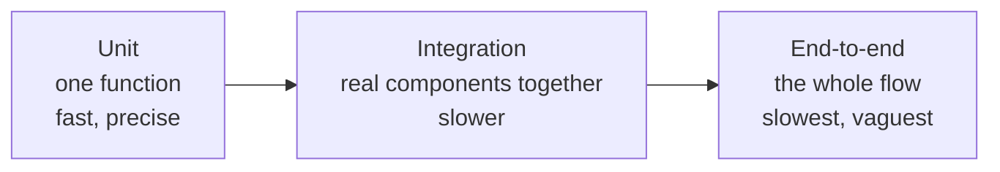

import Scenario from "../../../components/Scenario.astro";
import LevelIntro from "../../../components/LevelIntro.astro";
import PracticeCheck from "../../../components/PracticeCheck.astro";

export const unit = {
  track: "testing-quality",
  unitSlug: "test-pyramid",
};

<Scenario label="You are hosting a dinner party and want to know it will go well.">
  <Fragment slot="facts">
    

      
🧂 <strong>Taste one ingredient</strong> — seconds, and you know exactly what is off

      
🍲 <strong>Cook one dish</strong> — about 20 minutes, shows how the parts combine

      
🎉 <strong>Rehearse the whole party</strong> — about 3 hours, shows everything and explains little

    

    

      The times are made up for illustration. The pattern is the point: the more of the evening you check at once, the longer it takes and the vaguer the verdict.
    

  </Fragment>

You are cooking for twelve guests. You could taste the sauce for salt, cook
the whole stew once to see how the flavours combine, or hold a full dress
rehearsal with guests, oven timing and seating. All three tell you something
about whether the evening will work. **Which one do you use to find out
whether the sauce is too salty, and which one do you really need to find out
whether the oven can handle two dishes at once?**

A spoonful answers the first question in seconds and points straight at the
sauce. The rehearsal could also answer it, but only after three hours, and
all it would say is "something tasted off".

</Scenario>

<LevelIntro
  items={[
    "Unit, integration and end-to-end tests",
    "Why the pyramid has its shape",
    "What an upside-down pyramid costs",
  ]}
/>

## What does each kind of test actually check?

Software tests come in the same three sizes as the dinner party.

| Level                 | Dinner party equivalent    | What it checks                                    |
| --------------------- | -------------------------- | ------------------------------------------------- |
| Unit test             | Tasting one ingredient     | One function or module, on its own                |
| Integration test      | Cooking one dish           | That real components work together                |
| End-to-end (e2e) test | Rehearsing the whole party | A whole user-facing flow, driven like a real user |

The three are not ranked from bad to good. Each answers a different
question, and the skill is matching the question to the level.

<PracticeCheck
  track={unit.track}
  unitSlug={unit.unitSlug}
  topicId="three-levels"
/>

## Why is the pyramid a pyramid?

**If every level finds bugs, why not write the same number of each?**
Because they do not cost the same. The numbers below are an assumption used
throughout this unit: a unit test takes 50 ms, an integration test 1.5 s and
an e2e test 12 s, and each test has a small chance of failing for reasons
unrelated to any real bug (0.005%, 0.1% and 0.6%). They are round numbers
chosen to show the shape of the trade-off, not measurements of any real suite.

Take a suite of 500 tests and split it two ways, with the non-e2e remainder
divided 80/20 between unit and integration tests:

| Shape                 | Unit | Integration | E2E | Total runtime | Chance a run has at least one unrelated failure |
| --------------------- | ---- | ----------- | --- | ------------- | ----------------------------------------------- |
| Pyramid (5% e2e)      | 380  | 95          | 25  | about 7.7 min | about 23%                                       |
| Upside-down (60% e2e) | 160  | 40          | 300 | about 61 min  | about 84%                                       |

```mermaid
xychart-beta
    title "Seconds of CI time spent at each level (500 tests, assumed timings)"
    x-axis ["Unit", "Integration", "E2E"]
    y-axis "Seconds" 0 --> 3700
    bar [19, 142.5, 300]
    bar [8, 60, 3600]
```

The first bar in each group is the pyramid, the second the upside-down
suite. Most of the volume sits at the cheap base of a pyramid, and the slow,
failure-prone top is kept small on purpose.

<PracticeCheck
  track={unit.track}
  unitSlug={unit.unitSlug}
  topicId="pyramid-shape"
/>

- **The pyramid is a shape, not a law.** It follows from cost: cheap tests in volume, expensive tests sparingly.
- **The upside-down pyramid ("ice cream cone")** feels thorough but is slow to run, slow to diagnose and unreliable, because every e2e test depends on many moving parts.
- **Pick the level by asking what would make the test fail.** A pure logic error belongs in a unit test. A mismatch between two real components belongs in an integration test. A broken critical flow belongs in a small number of e2e tests.

This unit builds on `testing-quality/case-automated-testing`, which argues for
writing tests at all. The question here is only which level each one belongs at.
