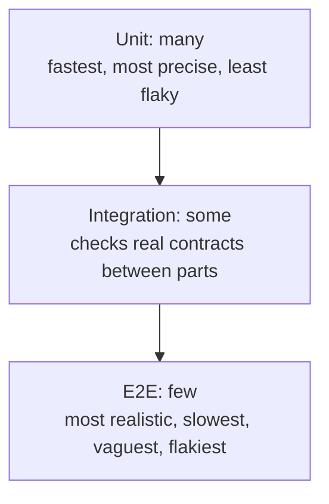
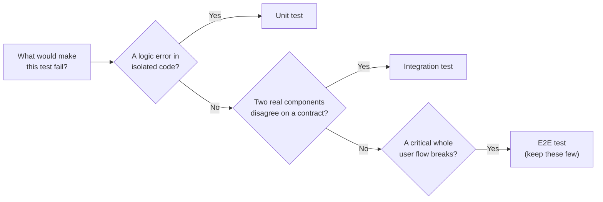

import Scenario from "../../../components/Scenario.astro";
import LevelIntro from "../../../components/LevelIntro.astro";
import Checkpoint from "../../../components/Checkpoint.astro";
import PracticeCheck from "../../../components/PracticeCheck.astro";

export const unit = {
  track: "testing-quality",
  unitSlug: "test-pyramid",
};

<Scenario label="Too much salt, caught in two different places">
  <Fragment slot="facts">
    

      
🧂 <strong>Spoonful of sauce</strong> — verdict in seconds: "too salty"

      
🎉 <strong>Full rehearsal</strong> — verdict hours later: "the meal tasted wrong"

      
🔍 <strong>What is left to do</strong> — after the rehearsal, someone still has to taste every dish to find the cause

    

  </Fragment>

You over-salted the sauce. If you taste it before it goes in the stew, you
find out at once and you know exactly what to fix. If you only find out at
the dress rehearsal, the verdict is a vague "the meal tasted off", and
somebody still has to taste every dish to track it down.

**Both checks caught the same mistake, so what makes one of them the right
place to catch it?**

</Scenario>

<LevelIntro
  items={[
    "Speed, precision and fragility by level",
    "Why the upside-down pyramid costs more",
    "A way to pick a test's level",
  ]}
/>

## Speed, precision and fragility: three separate axes

**Why did the spoonful and the rehearsal disagree so much if they caught the
same mistake?** Because "catches the bug" is only one property of a test. A
test's level fixes three others at the same time.

| Property                       | Unit                    | Integration                             | E2E                                                     |
| ------------------------------ | ----------------------- | --------------------------------------- | ------------------------------------------------------- |
| Speed                          | Milliseconds            | Seconds                                 | Seconds to minutes                                      |
| What it can see                | One function on its own | Real components talking to each other   | The whole system, driven like a user                    |
| Failure specificity            | Points at one function  | Points at a boundary between components | Says "the flow is broken"; the cause still needs a hunt |
| Fragility (unrelated failures) | Low: few moving parts   | Moderate                                | High: network, timing and rendering all involved        |

No level wins on every row. Unit tests are fast and precise but cannot see
across a boundary. E2E tests see everything but pay for it on every other
row. The shape of the pyramid is simply "buy the cheap properties in volume
and the expensive ones sparingly".

<Checkpoint question="A test checks a pure calculation function that does no I/O and has no dependencies. You could write it as a unit test or an e2e test. What do you lose by choosing e2e, given that both would catch the same bug?">

You lose speed and precision, and gain nothing in return. The e2e version
takes seconds or minutes rather than milliseconds, and when it fails it only
says that a whole flow is broken instead of naming the function. The things
e2e is actually good at, such as noticing a broken contract between
components or a broken user flow, do not exist here, because there is only a
function and its inputs. You pay e2e's whole price for a question a unit test
already answers completely.

</Checkpoint>

## Why does an upside-down pyramid cost more without catching more?

**The same features, tested by 500 tests either way. What differs?** Using
the assumed timings from L1, a 500-test suite split two ways:

| Shape                 | Total runtime | Share of runtime spent in e2e | Chance a run has at least one unrelated failure |
| --------------------- | ------------- | ----------------------------- | ----------------------------------------------- |
| Pyramid (5% e2e)      | about 7.7 min | about 65%                     | about 23%                                       |
| Upside-down (60% e2e) | about 61 min  | about 98%                     | about 84%                                       |

Even the healthy pyramid spends most of its time in its few e2e tests, which
is why it keeps them few. The upside-down suite takes about eight times
longer and almost always fails at least once for no real reason. It does not
check more behaviour: moving a check from unit level up to e2e level does not
make it able to detect anything new, it only makes the check slower and
harder to trust.

<Checkpoint question="Two suites cover exactly the same behaviours with 500 tests each: one mostly unit tests, one mostly e2e. Why does the e2e-heavy suite not catch more real bugs, even though it is slower and flakier?">

Because the number of bugs a suite can catch depends on which behaviours it
covers, not on how high up the stack it checks them. A discount-calculation
edge case is caught equally well by a millisecond unit test and by a
multi-minute e2e run that happens to pass through it. What the higher level
adds is cost: more moving parts per test means more runtime and more
failures that have nothing to do with the code change. Thoroughness comes
from covering the right behaviours, not from using the most expensive level
available.

</Checkpoint>

<PracticeCheck
  track={unit.track}
  unitSlug={unit.unitSlug}
  topicId="level-tradeoffs"
/>

## How do you pick the level for a new test?

**Faced with a behaviour to test, how do you choose without defaulting to
whatever is most familiar?** Ask what would make the test fail, and let the
answer pick the level.

Habit and comfort are not on the chart. "E2E feels more thorough" and "unit
tests are what I already know how to write" are the two common ways to get
the answer wrong. Applied to the opening scenario, an over-salted sauce is a
fault in one ingredient, which the chart routes to the spoonful, not the
rehearsal.

<PracticeCheck
  track={unit.track}
  unitSlug={unit.unitSlug}
  topicId="choosing-level"
/>
