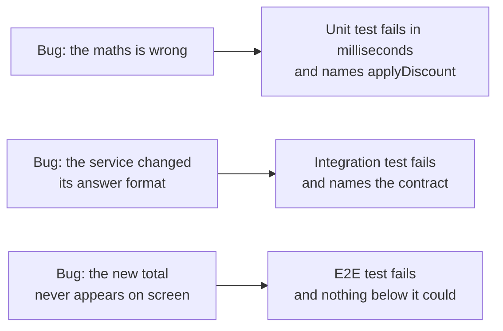
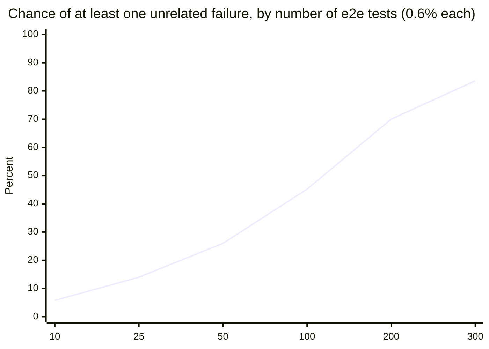

import Scenario from "../../../components/Scenario.astro";
import LevelIntro from "../../../components/LevelIntro.astro";
import Checkpoint from "../../../components/Checkpoint.astro";
import PracticeCheck from "../../../components/PracticeCheck.astro";

export const unit = {
  track: "testing-quality",
  unitSlug: "test-pyramid",
};

<Scenario label="Applying a discount code at checkout: three different risks hiding in one feature.">
  <Fragment slot="facts">
    <div class="not-prose flex flex-col gap-2 text-sm text-slate-700 dark:text-slate-300">
      <div class="flex items-center gap-1.5"><span>🧮</span> <strong>The arithmetic</strong> — is the price after the discount right?</div>
      <div class="flex items-center gap-1.5"><span>🔗</span> <strong>The conversation</strong> — does the discount service answer in the shape the checkout expects?</div>
      <div class="flex items-center gap-1.5"><span>🌐</span> <strong>The experience</strong> — can a person actually type a code and finish buying?</div>
    </div>
    <div class="not-prose mt-3 rounded border border-amber-300 bg-amber-50 p-1.5 text-xs dark:border-amber-800 dark:bg-amber-950">
      Three risks, three different places to look. Checking all of them the same way wastes effort or leaves one unwatched.
    </div>
  </Fragment>

A shop lets people enter a discount code at checkout. Three things can go
wrong, and they have nothing to do with each other: the percentage maths can
be wrong, the service that looks up codes can start answering in a different
format than the checkout expects, and the page can fail to show the new total
even though everything underneath is right. **Which of these would you expect
to be quickest to check, and which would you expect to reveal the widest
range of problems? Are they the same test?**

</Scenario>

<LevelIntro
  items={[
    "One feature, three test levels",
    "Fake integration tests and flaky arithmetic",
    "Stretching the example to a harder case",
  ]}
/>

## Unit level: the arithmetic

Reading this one is the point, because it shows how little a unit test needs.
The function has no network, no database and no page. The tests below use
plain `expect` calls rather than any particular framework's syntax.

```js
function applyDiscount(subtotal, discountPercent) {
  if (discountPercent < 0 || discountPercent > 100) {
    throw new RangeError("discountPercent must be within 0 and 100");
  }
  return subtotal - subtotal * (discountPercent / 100);
}

expect(applyDiscount(100, 20)).toBe(80);
expect(applyDiscount(50, 0)).toBe(50);
expect(() => applyDiscount(50, 150)).toThrow();
```

These run in milliseconds and would have caught a discount above 100% making
the total negative. They cannot say anything about what the real discount
service returns, because they never call it.

## Integration and e2e level: the same feature, without the code

| Level       | What the test does                                                                | What only this level can catch                                        | What it deliberately leaves alone                 |
| ----------- | --------------------------------------------------------------------------------- | --------------------------------------------------------------------- | ------------------------------------------------- |
| Integration | Starts a real (local, throwaway) discount service and asks it about a seeded code | The service answers with a text "20" where the checkout expects 20    | Percentage maths edge cases, which unit tests own |
| E2E         | Drives a real browser: type a code, see the new total, finish buying              | The page never shows the discounted total, though the parts are right | Every maths case and every response shape         |



Each level owns a class of bug that the others are structurally blind to,
which is why the levels complement each other instead of duplicating each
other.

<Checkpoint question="All the applyDiscount unit tests pass. Why can they never catch the discount service starting to return the percentage as the text '20' instead of the number 20?">

The unit tests call the function with hand-written numbers, so no response
from the real service ever reaches them. A change in the service's answer
format lives on the boundary between two components, and a unit test removes
that boundary by design. Only a test that calls the real service and feeds
its actual answer to the checkout code can see the mismatch, which is the
entire reason integration tests exist as a separate level.

</Checkpoint>

## When does an integration test stop being one?

**A team has 200 green "integration tests" and a contract mismatch still
reached staging. What went wrong?** The usual cause is that the discount
service is replaced by a stand-in inside every test. The test then proves the
checkout code works with the stand-in, which returns whatever shape its author
assumed. If the real service drifts, nothing real is ever contacted to
notice.

| Question to ask of a test                           | If the answer is "stand-in"                               |
| --------------------------------------------------- | --------------------------------------------------------- |
| What answers the call the code makes?               | It is a unit test with an integration test's name         |
| Can the real component change without this failing? | Yes, so the boundary is unprotected                       |
| Where does the stand-in's shape come from?          | From a person's assumption, which is exactly what can rot |

Stand-ins are fine inside unit tests, where isolation is the goal. The
failure is calling the result an integration test and then relying on it for
boundary safety.

<PracticeCheck
  track={unit.track}
  unitSlug={unit.unitSlug}
  topicId="fake-integration"
/>

## Why do flaky failures pile up as a suite grows?

**If each e2e test only has a 0.6% chance of failing for no real reason, why
does a big e2e-heavy suite fail almost every run?** Because the chances
compound. A run is clean only if every test is clean, so with $$p$$ the
chance that one test flakes and $$n$$ tests of that kind, the chance of at
least one unrelated failure is:

$$1-(1-p)^n$$

Using the assumed 0.6% per e2e test:

| e2e tests in the suite | Chance of at least one unrelated e2e failure |
| ---------------------- | -------------------------------------------- |
| 10                     | about 6%                                     |
| 25                     | about 14%                                    |
| 100                    | about 45%                                    |
| 300                    | about 84%                                    |



This is why a flaky e2e failure needs a moment of triage before anyone treats
it like a failing unit test, and why a healthy suite keeps the e2e layer
small enough that a failure still means something.

<Checkpoint question="A suite has 100 e2e tests that each flake 0.6% of the time. A run fails and the change was a one-line text edit. Before blaming the edit, what should you ask?">

Whether this failure could be one of the roughly 45% of runs in which at
least one of the 100 tests fails for no reason at all. A change this small
has little chance of breaking an unrelated flow, so the first move is to
re-run or inspect which test failed and whether it touches the edit. Treating
every red e2e run as a real regression teaches the team to either ignore
failures or distrust the suite, and both outcomes defeat the point of having
it.

</Checkpoint>

<PracticeCheck
  track={unit.track}
  unitSlug={unit.unitSlug}
  topicId="suite-math"
/>

## This is a case, not the whole territory

The checkout example has one pure calculation, one boundary and one flow. It
shows the reasoning but not every shape a real feature takes. The part that
generalises is the question "what would make this fail?", not the specific
split of one unit test, one integration test and one e2e test.

**Try extending it yourself.** What changes if the feature is a refund that
touches payments, stock and email, three separate boundaries? Would one big
e2e test be a good way to cover them, and what would its failure tell you?
What changes if the discount service is run by another company and you cannot
start a copy of it? Which of the unit, integration and e2e roles is hardest to
fill then, and what would you do instead?

## Failure modes

| Failure mode                                          | What it gets wrong                                                          |
| ----------------------------------------------------- | --------------------------------------------------------------------------- |
| E2E test for a pure calculation                       | Pays for browsers and networks to answer a question about arithmetic        |
| "Integration" tests that replace the other component  | Cannot notice when the real component changes                               |
| Reading every red e2e run as a real regression        | Ignores that unrelated failures compound with suite size                    |
| Skipping the middle layer because units and e2e exist | Units cannot cross boundaries and e2e buries the cause under the whole flow |
