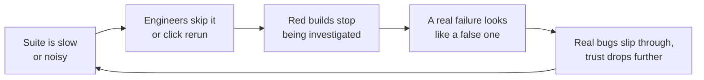

import Scenario from "../../../components/Scenario.astro";
import LevelIntro from "../../../components/LevelIntro.astro";
import PracticeCheck from "../../../components/PracticeCheck.astro";

export const unit = {
  track: "testing-quality",
  unitSlug: "test-suite-architecture",
};

<Scenario label="4 minutes a year ago. 38 minutes today. Nobody decided that.">
  <Fragment slot="facts">
    

      

        
Suite runtime, a year ago4 min

        

          

        

      

      

        
Suite runtime, today38 min

        

          

        

      

      
🔁 <strong>12</strong> "just rerun CI" clicks on the same intermittent failure before anyone looked closer

    

  </Fragment>

Picture a smoke alarm that beeps falsely every week. Within a month,
nobody gets up when it beeps, and the night it is real, it gets the same
shrug.

A team's test suite went the same way. A year ago it ran in 4 minutes,
every test in one process, one after another. Nobody rewrote it. Tests
were simply added, each one reasonable, until the same suite took 38
minutes. Engineers stopped running it locally, and a few tests started
failing at random, so the fastest route to a green build became the
"rerun" button. One of those reruns hid a real race bug: it failed 12
times over three weeks, and each time someone clicked rerun and moved on.

**No individual test got worse. So why did the whole suite stop being
trustworthy?**

</Scenario>

<LevelIntro
  items={[
    "Why runtime grows with nobody deciding",
    "Sharding as the fix for slowness",
    "Quarantine as the fix for noise",
  ]}
/>

## Why does a suite get slower when every test is fine?

A serial suite's wall-clock time is the sum of every test's time. Take an
illustrative average of 1.9 seconds per test (an assumption, chosen to
fit the numbers above):

| When       | Runtime | Tests implied at 1.9 s each |
| ---------- | ------- | --------------------------- |
| A year ago | 4 min   | about 126                   |
| Today      | 38 min  | 1,200                       |

Nothing here is a bad decision. Each merged pull request adds a few
seconds, and the total climbs by simple addition. The damage is not the
minutes themselves, it is what people do about them.

A slow suite gets skipped. A noisy suite gets rerun instead of read. Both
end at the same place: the suite no longer works as a safety signal,
however correct its tests are.

<PracticeCheck
  track={unit.track}
  unitSlug={unit.unitSlug}
  topicId="growth-trust"
/>

## What are the two fixes?

| Symptom                          | Fix                                                                          | What it protects |
| -------------------------------- | ---------------------------------------------------------------------------- | ---------------- |
| Runtime grows with test count    | **Sharding**: split the suite into slices run concurrently                   | Speed            |
| Chronic flaky tests, rerun habit | **Quarantine**: move a confirmed-flaky test to a tracked, non-blocking track | Signal           |

Sharding only works if tests do not interfere with each other when they
run at the same time. That is a constraint on how tests are written, not
only on how they are run. Quarantine only works if every quarantined test
has an owner, a reason, and a revisit-by date. Without those, it is a
shelf where tests go to be forgotten.

## Key terms

- **Sharding**: splitting a suite into disjoint slices that run at the
  same time, then merging their results into one verdict.
- **Test isolation**: a test's outcome does not depend on which other
  tests ran, in what order, or at the same time.
- **Quarantine**: pulling a confirmed-flaky test out of the merge-blocking
  suite into a visible, non-blocking track while a real fix is pending.
- **Trust erosion**: the slide from "investigate red" to "rerun red".

## What this unit covers

L2 builds the model: how sharding flattens runtime and where it stops
helping, the ways tests break when run concurrently, and the quarantine
lifecycle. L3 works one full example, a shared counter that fails only
when tests overlap, then the isolated fix and a small quarantine check.
