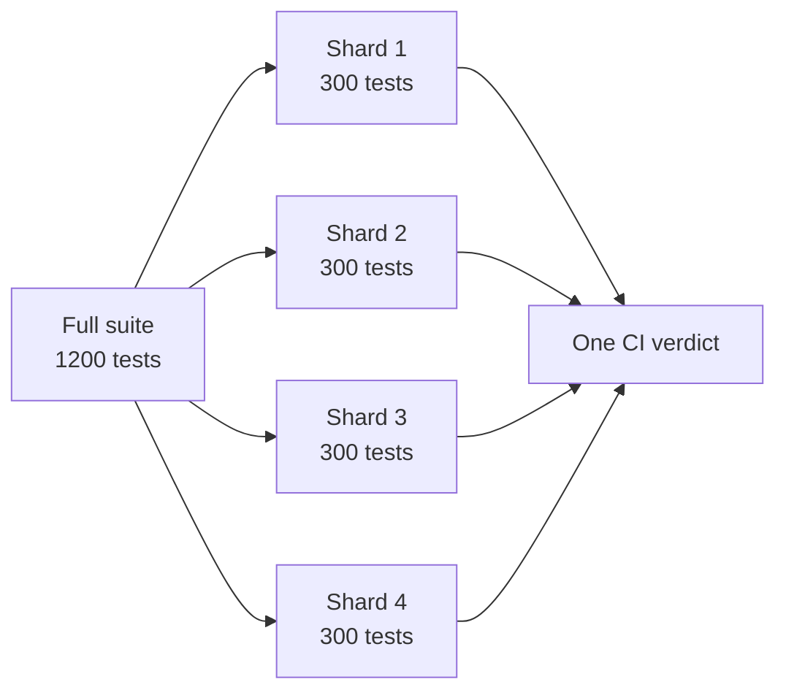
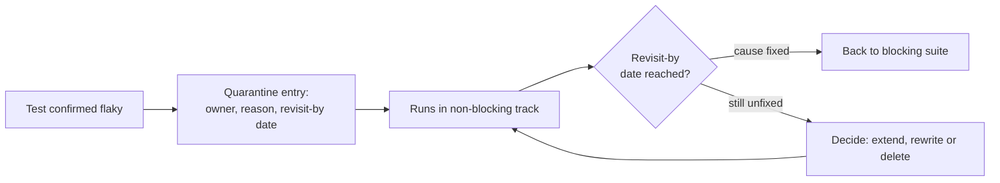

import LevelIntro from "../../../components/LevelIntro.astro";
import Checkpoint from "../../../components/Checkpoint.astro";
import PracticeCheck from "../../../components/PracticeCheck.astro";

export const unit = {
  track: "testing-quality",
  unitSlug: "test-suite-architecture",
};

L1 named two separate problems: a suite that grew serially from 4 minutes
to 38, and a suite noisy enough that "rerun it" hid a real bug for twelve
cycles. This level builds the mechanism behind each fix, and what each
needs in order to work rather than only look like it works.

<LevelIntro
  items={[
    "How sharding flattens runtime, and where it stops",
    "How parallel-unsafe tests break",
    "Quarantine as a time-boxed detour",
  ]}
/>

## If tests run at the same time, what happens to wall-clock time?

Run serially, a suite takes the sum of every test. **What changes if
slices of it run at once?**

No test gets faster. Wall-clock time becomes roughly what the **slowest
shard** takes, not the sum of all four. That is **sharding**: disjoint
slices run concurrently, results merged into one verdict.

Sharding has two costs. Each shard pays a fixed overhead (starting up,
receiving its files, reporting back), and one slow test sets a floor that
no shard count can lower. Using this unit's demo model (38 minutes of
serial work, 0.4 minutes of overhead per shard, a slowest test of 1.5
minutes), runtime is the larger of the shard's work plus overhead and that
floor:

| Shards | Work per shard | Plus overhead | Runtime         |
| ------ | -------------- | ------------- | --------------- |
| 1      | 38 min         | 0.4           | 38.4 min        |
| 4      | 9.5 min        | 0.4           | 9.9 min         |
| 16     | 2.375 min      | 0.4           | 2.78 min        |
| 40     | 0.95 min       | 0.4           | 1.5 min (floor) |

The early shards pay off enormously. The late ones barely move it, and the
interactive demo on this page lets you drag the shard count to see where
the curve flattens.

<Checkpoint question="A team doubles its runners from 4 to 8 and expects half the runtime. The suite only gets about 15 percent faster. What does the sharding model suggest?">

Runtime follows the slowest shard, plus fixed per-shard overhead. If one
shard happens to hold most of the slow tests, or one test dominates, extra
shards leave that bottleneck untouched. Near-linear gains need many
roughly equal tests and small overhead.

</Checkpoint>

<PracticeCheck
  track={unit.track}
  unitSlug={unit.unitSlug}
  topicId="sharding-limits"
/>

## What kinds of tests silently assume they are alone?

Sharding is only safe if no test depends on another test not running at
the same moment. **Which tests carry that unwritten assumption?**

| Hazard                                              | What goes wrong when tests overlap                           | Fix pattern                                           |
| --------------------------------------------------- | ------------------------------------------------------------ | ----------------------------------------------------- |
| Shared mutable state (module-level object, counter) | Two tests read and write the same object in an unlucky order | Give each test its own fresh instance                 |
| Hardcoded port or resource name                     | Two tests try to bind the same port, one fails               | Assign the port or name per worker or per test        |
| Shared database rows                                | One test's cleanup deletes data another still uses           | Isolate data per test: rollback, unique keys, schemas |
| Fixed temp file path                                | One test reads another's half-written file                   | Put a worker or test id in the path                   |
| Global cache or singleton never reset               | One test's leftovers change another's result                 | Reset or rebuild it per test                          |

Every row has the same shape: something that exists **once**, that more
than one test writes to or depends on. Serial execution hides it because
tests never overlap in time. Parallelism does not create these bugs. It
gives them the first chance to collide.

<Checkpoint question="A suite ran serially with zero flakiness for two years. The team turns on 4-way parallelism and sees random failures in tests that never failed before. Did parallelism introduce a bug?">

No, it exposed an existing one. A test that shares mutable state, a port,
or rows was never safe to run beside another test touching the same thing.
Serial order just guaranteed they never met.

</Checkpoint>

<PracticeCheck
  track={unit.track}
  unitSlug={unit.unitSlug}
  topicId="parallel-hazards"
/>

## Once a test is confirmed flaky, where does it live while the fix is pending?

Why a test becomes flaky is covered in `flaky-tests`. The operational
question here comes after the diagnosis. Leaving it blocking means every
red build is either a slow false alarm or a quick rerun, which is the
habit that hid L1's real bug. Deleting it throws away whatever it checked,
with nothing tracking that coverage is gone.

**Quarantine** is the middle path: move the test out of the merge-blocking
suite into a labeled, non-blocking track that still runs, so its results
stay visible but it cannot fail a build.

It is an escape valve, not a graveyard, only if three things are attached
the moment a test enters:

- **An owner**: a named person or team, not "someone should look".
- **A reason**: what is known about the cause, captured while fresh.
- **A revisit-by date**: a concrete point that forces a decision.

Without the date, quarantine becomes a second suite nobody trusts, now
invisible instead of blocking. A test that fails every time because of a
real regression is not flaky at all and should be fixed, not quarantined.

<PracticeCheck
  track={unit.track}
  unitSlug={unit.unitSlug}
  topicId="quarantine-lifecycle"
/>

## How do the two fixes relate?

|            | Sharding          | Quarantine                     |
| ---------- | ----------------- | ------------------------------ |
| Protects   | Speed             | Signal                         |
| Needs      | Isolated tests    | Owner, reason, revisit-by date |
| Fails when | Tests share state | Nobody enforces the date       |

A team that only shards gets a fast suite people still ignore. Sharding a
suite full of unisolated tests does not cure flakiness, it makes failures
appear sooner and in different places each run, which L3 shows directly.
