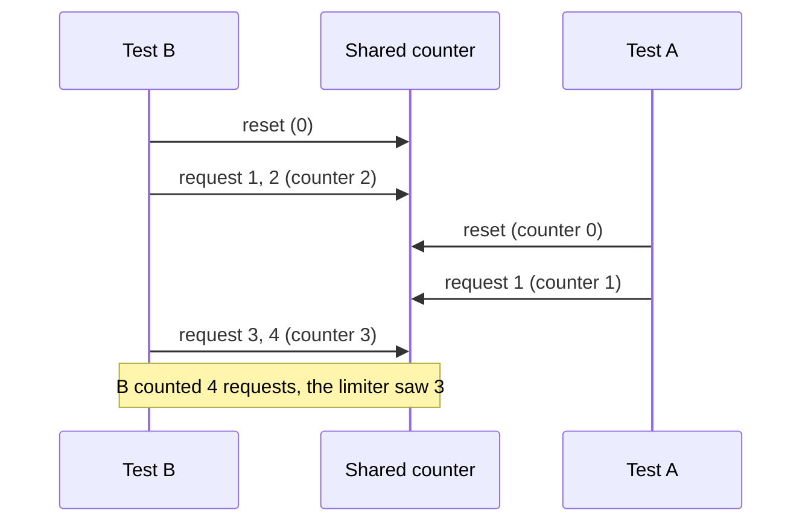

import Scenario from "../../../components/Scenario.astro";
import LevelIntro from "../../../components/LevelIntro.astro";
import Checkpoint from "../../../components/Checkpoint.astro";
import PracticeCheck from "../../../components/PracticeCheck.astro";

export const unit = {
  track: "testing-quality",
  unitSlug: "test-suite-architecture",
};

<Scenario label="Green for two years. Red within minutes of running tests together.">
  <Fragment slot="facts">
    <div class="not-prose flex flex-col gap-2 text-sm text-slate-700 dark:text-slate-300">
      <div class="flex items-center gap-1.5"><span>🧩</span> <strong>Under test</strong>: a limiter that allows at most 3 requests</div>
      <div class="flex items-center gap-1.5"><span>🕳️</span> <strong>The bug</strong>: all tests share one limiter object</div>
      <div class="flex items-center gap-1.5"><span>🧪</span> <strong>Test A</strong>: reset, 1 request, expects allowed</div>
      <div class="flex items-center gap-1.5"><span>🧪</span> <strong>Test B</strong>: reset, 4 requests, expects the 4th blocked</div>
      <div class="flex items-center gap-1.5"><span>🔧</span> <strong>The fix</strong>: one fresh limiter per test</div>
    </div>
  </Fragment>

Two tests share one limiter. Serially each passes, every day, for two
years. Then the team lets them run side by side and Test B starts failing,
though nothing in the limiter or in Test B changed. **If a test passes
serially for years and fails the moment it overlaps with another, is it
newly broken, or was it always broken and never exposed?**

</Scenario>

<LevelIntro
  items={[
    "A step-by-step trace of how overlap breaks Test B",
    "The one-fixture-per-test fix",
    "A quarantine check that enforces the revisit-by date",
  ]}
/>

## What exactly happens when the two tests overlap?

The limiter allows 3 requests, then blocks. Both tests start by resetting
the shared counter so they begin from zero. Run one after the other, that
is perfectly safe. Now let the runner interleave them, as an async runner
does when tests wait on I/O:

| Step | Who | Action    | Shared counter after | Result                          |
| ---- | --- | --------- | -------------------- | ------------------------------- |
| 1    | B   | reset     | 0                    |                                 |
| 2    | B   | request 1 | 1                    | allowed                         |
| 3    | B   | request 2 | 2                    | allowed                         |
| 4    | A   | reset     | 0                    |                                 |
| 5    | A   | request 1 | 1                    | allowed (A passes)              |
| 6    | B   | request 3 | 2                    | allowed                         |
| 7    | B   | request 4 | 3                    | **allowed**, B expected blocked |



Test A passed, and Test B failed, in the same run, for a reason that has
nothing to do with the limiter. B's assertion depends on **its own four
requests being the only ones the counter saw**. Serial order guaranteed
that by accident.

This failure needs a real overlap of tests on one shared object. Separate
worker processes each get their own copy of an in-memory object, so for
them the shared thing is usually an external resource: a database, a
port, a file. The shape of the bug is identical.

<Checkpoint question="In the trace, the limiter itself behaved correctly at every step. Where exactly is the bug?">

In the tests' setup, not in the limiter. Each test assumes the counter is
its own, and nothing enforces that. The limiter honestly counted every
request it received, including A's. Reading the limiter's code for the bug
would find nothing, which is part of why this class of failure wastes so
much time.

</Checkpoint>

## What is the smallest change that removes the bug?

Give each test its own limiter. In the original, a limiter is created once
at module level. In the fix, creation moves inside each test:

```js
// before: one limiter shared by every test in the file
const shared = createLimiter(3);

// after: each test builds its own, so nothing is left to share
function testFourthBlocked() {
  const limiter = createLimiter(3);
  // ...four requests against `limiter`, expect the 4th blocked
}
```

With no shared object, there is nothing for another test to reset or
increment. Serial, 8 shards, reversed order: every run gives B the same
answer. The reset calls are no longer needed, because a fresh limiter
starts at zero.

| Rejected "fix"                | Why it falls short                                         |
| ----------------------------- | ---------------------------------------------------------- |
| Retry failed tests            | Hides the collision, and a real failure now looks the same |
| Run everything serially again | Gives up the speed sharding bought                         |
| Add a lock inside the limiter | The limiter was never wrong; the tests' assumption is      |

<PracticeCheck
  track={unit.track}
  unitSlug={unit.unitSlug}
  topicId="shared-fixture-fix"
/>

## How does the quarantine rule become something the pipeline enforces?

Suppose one test stays flaky for a cause nobody has found: it depends on a
downstream clock in CI. The quarantine entry records what the lifecycle
needs:

| Field      | Example value                                           |
| ---------- | ------------------------------------------------------- |
| Test       | `rate-limiter.fourth-blocked`                           |
| Owner      | `team-checkout` (a fake team)                           |
| Reason     | Intermittent clock skew in CI, root cause not yet fixed |
| Revisit by | `2026-09-19`, two weeks out, not indefinite             |

A date nobody checks is the same as no date, so a scheduled job asks one
question: which entries are past their revisit-by date? ISO dates
(year-month-day) compare correctly as plain strings, which keeps the check
small enough to read at a glance:

```js
function overdueIds(entries, today) {
  return entries.filter((e) => e.revisitBy < today).map((e) => e.testId);
}
```

Whatever that returns goes into a report a team must act on: extend with a
reason, rewrite, or delete. The function is tiny, but it is the difference
between a time-boxed detour and a shelf.

<Checkpoint question="Why should creating a quarantine entry fail when the owner, reason, or revisit-by date is missing?">

Because an entry without them is just a test that can no longer block
anything, with none of quarantine's tracking. Making the mechanism refuse
incomplete entries turns "remember to add an owner" from a convention into
a rule, the same way a required field does in a form.

</Checkpoint>

<PracticeCheck
  track={unit.track}
  unitSlug={unit.unitSlug}
  topicId="quarantine-code"
/>

## What do the two techniques cost?

**Sharding has diminishing returns.** With this unit's demo model, going
from 1 to 4 shards saves almost 29 minutes, while going from 32 to 40
shards barely saves 5 seconds, because overhead per shard is fixed and the
slowest test sets a floor. You cannot out-shard one slow test.

**Quarantine is only as good as its enforcement.** If entries only grow,
the team has quietly built a second suite nobody trusts.

**Sharding needs isolation first.** Sharding the original shared-limiter
suite does not just fail to help. It turns a latent bug into one that fails
in a different test on each run, which is harder to diagnose than leaving
the suite serial ever was.

This worked example is one case, not the whole territory. Two directions
to extend it yourself:

1. Two different quarantined tests turn out to share the same root cause.
   What single field would you add to a quarantine entry so that connection
   is visible without reading every entry?
2. The suite grows and moves from 4 to 40 shards. What would you measure to
   know you have crossed from "sharding helps" to "sharding is mostly
   overhead", instead of guessing?
