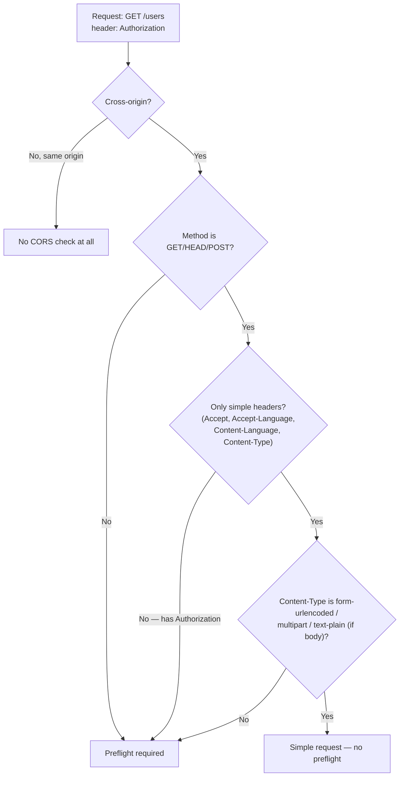
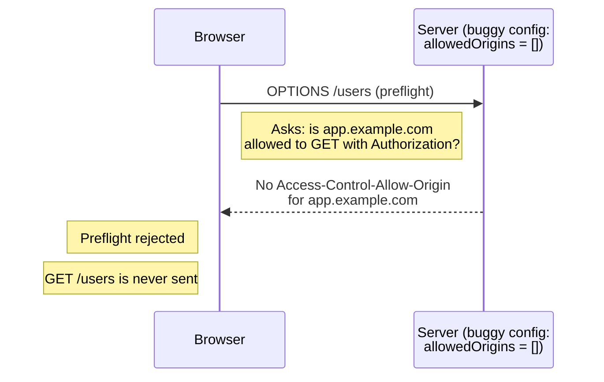
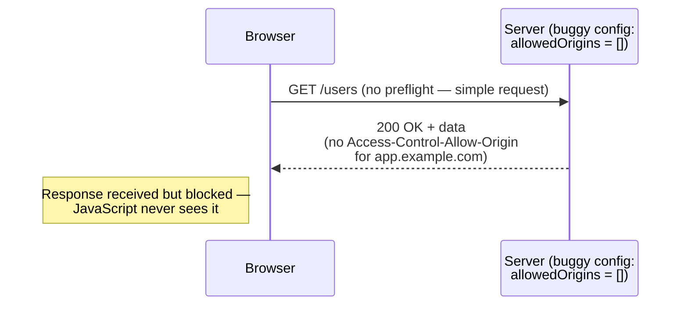

import Scenario from "../../../components/Scenario.astro";
import LevelIntro from "../../../components/LevelIntro.astro";
import Checkpoint from "../../../components/Checkpoint.astro";
import PracticeCheck from "../../../components/PracticeCheck.astro";

export const unit = { track: "web", unitSlug: "cors" };

<Scenario label="Same request, misconfigured server vs. fixed server">
  <Fragment slot="facts">
    <div class="not-prose flex flex-col gap-2 text-sm text-slate-700 dark:text-slate-300">
      <div class="flex items-center gap-1.5"><span>🐛</span> <strong>Buggy config</strong> — reproduces L1's exact "works in Postman, fails in browser" bug</div>
      <div class="flex items-center gap-1.5"><span>✅</span> <strong>Fixed config</strong> — the one-line server fix that resolves it</div>
      <div class="flex items-center gap-1.5"><span>🎯</span> <strong>Second goal</strong> — show exactly why try/catch alone misses a 404</div>
    </div>
  </Fragment>

**Before walking through it: `app.example.com` calling
`api.example.com` with an `Authorization` header — does this request
need a preflight, given `GET` alone is a "simple" method? And if the
server's CORS config is missing `app.example.com` from its allowed
origins, at which point does the browser actually stop the request —
before it reaches the server, or after?**

</Scenario>

<LevelIntro
  items={[
    "Walking a real request through the preflight decision tree",
    "Tracing the exact preflight-block and simple-request-block failures step by step",
    "Fixing the fetch() gap that swallows HTTP error statuses",
  ]}
/>

This L3 uses the **non-simple** version of the L1 problem: the request includes
an `Authorization` header, so the browser must ask permission with a preflight
before sending the real `GET`. L1's server-log story is the **simple** version:
no custom header, no preflight, real request reaches the server, then the
browser blocks JavaScript from reading the response. Both are CORS failures;
they happen at different checkpoints.

## Walking a request through the preflight decision tree

**L2's table says method, headers, and `Content-Type` are each
independently sufficient to force a preflight — but what does actually
_applying_ that table to one real request look like, step by step?**
Take `GET https://api.example.com/users` with an `Authorization`
header, called from `https://app.example.com`:



Walking this request through the tree: it's cross-origin (fails the
first branch), its method (`GET`) passes the second check — but it
carries an `Authorization` header, which isn't on the simple-headers
list. That one branch alone routes it to **"Preflight required,"**
regardless of how the remaining branches would have resolved. Drop the
`Authorization` header and the exact same method and origin instead
reach **"Simple request"** — the method never changed; only the header
did.

<PracticeCheck
  track={unit.track}
  unitSlug={unit.unitSlug}
  topicId="preflight-decision-tree"
/>

<Checkpoint question="A teammate says: 'GET is always a simple method, so a cross-origin GET request never needs a preflight.' Using the decision tree above, what's wrong with that claim?">

The tree has four independent branches, and method is only one of
them — passing the method check doesn't short-circuit the rest. A
`GET` request still gets evaluated against the headers branch and the
`Content-Type` branch; if it carries a non-simple header like
`Authorization`, it's routed to "Preflight required" regardless of its
method. "Simple method" is necessary but not sufficient — the request
only reaches "Simple request" if it clears every branch, not just the
first one.

</Checkpoint>

## Origin matching: when do two URLs count as "the same place"?

**`https://app.example.com` and `https://app.example.com:8443` both
use the same scheme and host — are they the same origin?** No. An
origin is the exact triple of scheme, host, _and_ port, and all three
have to match for two URLs to be considered same-origin:

| Request URL                          | Page origin               | Same origin? | Why                                 |
| ------------------------------------ | ------------------------- | ------------ | ----------------------------------- |
| `https://app.example.com/users`      | `https://app.example.com` | Yes          | Scheme, host, and port all match    |
| `https://app.example.com:8443/users` | `https://app.example.com` | No           | Port differs (default 443 vs. 8443) |
| `http://app.example.com/users`       | `https://app.example.com` | No           | Scheme differs (http vs. https)     |
| `https://api.example.com/users`      | `https://app.example.com` | No           | Host differs (api vs. app)          |

This is the check that runs _before_ any preflight-vs-simple question
even applies — a same-origin request skips CORS entirely, no matter
what method or headers it carries, because the same-origin policy only
ever restricted _cross_-origin reads in the first place.

<PracticeCheck
  track={unit.track}
  unitSlug={unit.unitSlug}
  topicId="origin-matching"
/>

## Tracing the exact CORS block, then fixing it

**With the buggy server config below missing `app.example.com` from
its allowed origins, does the non-simple request from the top of this
page get rejected before or after reaching the server?**



Tracing it step by step: the browser sends `OPTIONS /users` first
(because the request is non-simple), the server's response doesn't
list `app.example.com` as allowed, and the browser stops right
there — the real `GET /users` is **never sent at all**. This matches
the browser-side failure, but not L1's server-log detail (which showed
the real request arriving); that detail belongs to the simple-request
case below, where the preflight step doesn't exist to intercept
anything.

Fixing the server's `allowedOrigins` list to include
`https://app.example.com` is the entire fix — same request, same
method, same header, and the trace instead ends with the real `GET
/users` being sent and answered, exactly like L2's successful-case
diagram.

<Checkpoint question="A teammate insists 'CORS problems mean the server rejected the request.' Looking at the sequence diagram above, is that consistent with where this failure actually happens?">

No. The rejection happens entirely inside the preflight step, before
any point where the real `GET /users` would exist — the diagram never
reaches a step where the server processes that request, because it's
never sent. What actually happens is the _browser_ evaluating the
server's preflight response and deciding not to proceed. The server
didn't "reject" a request it never received during the preflight
step; the browser stopped things before that request existed at all.
A teammate's "the server rejected it" framing only fits the separate
simple-request case next, where the request really does reach the
server first.

</Checkpoint>

## Even a "simple" request gets blocked — just one step later

**Drop the `Authorization` header from the same request. Now it's
simple, so there's no preflight step to intercept anything — does the
buggy config still block it?**



Yes — but the failure moves to a different checkpoint. The request
really does reach the server this time (no preflight exists to stop
it), the server really does process it and respond with `200 OK` —
which is exactly why L1's server logs showed success — but the
browser still checks `Access-Control-Allow-Origin` on that real
response before handing it to JavaScript, and blocks it there instead.
Same buggy config, same ultimate failure for the page's JavaScript, but
a completely different point in the timeline where it actually happens.

<PracticeCheck
  track={unit.track}
  unitSlug={unit.unitSlug}
  topicId="cors-check-worked-example"
/>

## The separate bug: `fetch()` resolving on a 404

L2 established that `fetch()`'s promise only rejects for network-level
failures (including a CORS block) — a plain HTTP error status like
`404` or `500` resolves it normally. The only way to actually see that
distinction is to watch a `try/catch` run against both cases, because
"resolves" and "throws" are two different runtime behaviors that look
identical on the page until you check `response.ok`:

```js
function mockFetch(status, networkFailure = false) {
  return new Promise((resolve, reject) => {
    if (networkFailure) {
      reject(new TypeError("Failed to fetch"));
    } else {
      resolve({ ok: status >= 200 && status < 300, status });
    }
  });
}

async function getUserBuggy(status, networkFailure) {
  try {
    const response = await mockFetch(status, networkFailure);
    return { success: true, status: response.status };
  } catch (err) {
    return { success: false, error: err.message };
  }
}

console.log(await getUserBuggy(404, false));
// { success: true, status: 404 }
```

Verified: `getUserBuggy` reports `success: true` for a **404
response** — the `try/catch` never fires, because `fetch()` resolved
normally. This is the exact gap from L2's table: an HTTP error status
doesn't reject the promise.

```js
async function getUserFixed(status, networkFailure) {
  try {
    const response = await mockFetch(status, networkFailure);
    if (!response.ok) {
      throw new Error(`Request failed with status ${response.status}`);
    }
    return { success: true, status: response.status };
  } catch (err) {
    return { success: false, error: err.message };
  }
}

console.log(await getUserFixed(404, false));
// { success: false, error: 'Request failed with status 404' }
console.log(await getUserBuggy(0, true));
// { success: false, error: 'Failed to fetch' }
```

Verified: `getUserFixed` explicitly checks `response.ok` and throws,
turning the 404 into a caught error — while a genuine network failure
(`networkFailure: true`) was already being caught correctly in _both_
versions, because that's the one case where `fetch()` actually
rejects.

<PracticeCheck
  track={unit.track}
  unitSlug={unit.unitSlug}
  topicId="fetch-resolve-vs-throw"
/>

<Checkpoint question="getUserBuggy and getUserFixed both call the exact same mockFetch and both have a try/catch around it. Why does only getUserFixed catch the 404, if the try/catch block itself is identical in both?">

Because a `try/catch` only catches what actually throws inside it, and
`mockFetch` resolving with `{ ok: false, status: 404 }` doesn't throw —
resolving is not the same as throwing. `getUserBuggy` reads
`response.status` and returns it as if the call succeeded, so nothing
in that function's body ever raises an error for `catch` to intercept.
`getUserFixed` adds one line — `if (!response.ok) throw new
Error(...)` — which manufactures the throw that `mockFetch` itself
never produced. The `try/catch` wrapper was never the missing piece;
the missing piece was code inside the `try` block that turns 'resolved
with a bad status' into an actual thrown error in the first place.

</Checkpoint>

## Extend it: what if the API returns a 401 instead of a 404?

**Using `getUserFixed` above, would a `401 Unauthorized` response be
caught the same way as the 404 case, or does the current `if
(!response.ok)` check treat every non-2xx status identically?** Try
adjusting `getUserFixed` to include the specific status code in a way
that would let calling code distinguish "not found" from "not
authorized" — what would need to change about what the function
throws?

## Common mistakes

| Failure mode                                                                 | What it gets wrong                                                                                                                      |
| ---------------------------------------------------------------------------- | --------------------------------------------------------------------------------------------------------------------------------------- |
| Assuming a CORS error means the server rejected the request                  | The server often processed it successfully — CORS is enforced by the browser, after the response already came back                      |
| Adding `Access-Control-Allow-Origin: *` to "just make it work"               | Works for simple requests without credentials, but silently fails for anything requiring cookies/auth, and is a real security loosening |
| Trusting `try/catch` around `fetch()` to catch all API errors                | It only catches network-level failures and CORS blocks — HTTP error statuses resolve normally and need an explicit `response.ok` check  |
| Testing an API only with Postman/curl before shipping a frontend integration | Those tools don't enforce CORS at all, so a same-origin-policy bug can pass every manual test and still break in the browser            |
| Assuming a preflight happens for every cross-origin request                  | Simple requests (plain GET/POST, standard headers) skip the preflight entirely — the browser still checks the response, just later      |

<PracticeCheck
  track={unit.track}
  unitSlug={unit.unitSlug}
  topicId="common-mistakes"
/>
