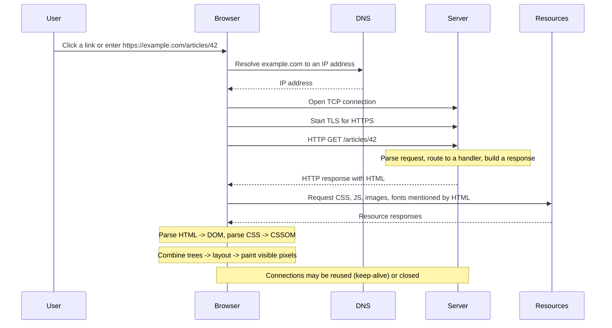

import Checkpoint from "../../../components/Checkpoint.astro";
import LevelIntro from "../../../components/LevelIntro.astro";
import PracticeCheck from "../../../components/PracticeCheck.astro";

export const unit = {
  track: "web",
  unitSlug: "http-request-response-basics",
};

L1 named the parts of a request and a response. L2 fits them into the full round trip — everything that happens between pressing Enter and pixels appearing — and into the one property, statelessness, that explains why load balancers and caching work the way they do.

<LevelIntro
  items={[
    "The full click-to-pixels round trip",
    "Why statelessness makes load balancing work",
    "What a server does, underneath any framework",
  ]}
/>

## What actually happens between "click" and "page appears"?



From a learner's point of view, there are two halves that often get blurred
together. The **network half** gets bytes to the browser: URL, DNS, TCP, TLS
when the URL starts with `https`, then an HTTP request and response. The
**browser half** turns those bytes into a screen: HTML becomes the DOM, CSS
becomes the CSSOM, the browser combines them, calculates layout, and paints
pixels. HTTP gets the ingredients across the network; rendering cooks them
into the visible page.

That first HTML response is usually only the starting sheet of instructions.
If it contains `<link rel="stylesheet" href="/styles.css">`, `<script
src="/app.js">`, ``, or a font reference, the browser
sends more HTTP requests for those resources. Each one is still the same
request/response contract from L1; the difference is that the browser is now
asking for supporting files needed to finish the page, not the initial HTML
document itself.

A request and a response are both just structured text. A request literally looks like this on the wire:

```
GET /articles/42 HTTP/1.1
Host: example.com
Accept: application/json
User-Agent: curl/8.4.0

```

And the response:

```
HTTP/1.1 200 OK
Content-Type: application/json
Content-Length: 27

{"id":42,"title":"Hello"}
```

The blank line is not decoration — it's the field separator between headers and body. Miss it and the parser can't tell where headers end (L1's Team A/Team B scenario is a variant of this same "the machinery trusts a signal that turned out to be misleading" problem, one level up: a status code instead of a blank line).

### The two lines are the same shape, opposite job

Line up the request's first line against the response's first line, field by field: `GET` / `/articles/42` / `HTTP/1.1` against `HTTP/1.1` / `200` / `OK`. Both are three space-separated fields. A request line states what's wanted (method + path + version); a status line states what happened (version + status code + reason phrase) — same structural shape, mirrored job. The practical consequence: client code should branch on the numeric status code, never on the reason phrase's exact text, because the protocol standardizes the number and explicitly leaves the phrase free to vary.

<PracticeCheck
  track={unit.track}
  unitSlug={unit.unitSlug}
  topicId="request-line-vs-status-line"
/>

### One connection, many requests

The mermaid diagram above notes that connections "may be reused (keep-alive) or closed." Under `Connection: close`, the socket closing after one response _is_ the boundary signal — simple, but it costs a fresh TCP handshake per request. Under keep-alive, that signal disappears: several requests can arrive back to back on the same connection, so a parser has to track exactly how many bytes belong to the current request (via `Content-Length` or chunked encoding) and treat anything after that as the start of the next one, rather than assuming one network read equals one request.

<PracticeCheck
  track={unit.track}
  unitSlug={unit.unitSlug}
  topicId="keep-alive-parsing"
/>

## Why does a load balancer get to send request #1 and request #2 to two completely different, uncoordinated servers?

Because a request carries everything the server needs to answer it (method, path, headers, body) and the server carries everything the client needs to interpret the answer (status, headers, body), **neither side has to remember the other exists** between requests. That single property — statelessness — is why:

- A load balancer can send request #1 to server A and request #2 to server B with no coordination between A and B.
- You can `curl` an endpoint in isolation and get a meaningful answer, without "logging in" to a session first, unless the _application_ layers state on top (cookies, `Authorization` headers, tokens).
- Caching works: a response to `GET /articles/42` can be cached and replayed for anyone, because the request alone determines the response (in principle — real APIs vary by auth, but that's the app opting back into statefulness).

<Checkpoint question="A load balancer sends your login POST to server A, and your very next request to server B. If there's no cookie or token involved, will server B know you just logged in?">

No — and that's statelessness working exactly as designed, not a bug. Server B has no memory of what server A just did; the only thing it knows about you is whatever arrived _in this request_. If the app wants server B to recognize you as logged in, it has to hand you something in the response (a session cookie, a JWT) that you send back on every later request — the state has to travel in the request itself, because the servers behind the load balancer share nothing.

</Checkpoint>

This is an architectural consequence, not just a trivia fact: the same "request alone determines the response" property that lets a load balancer split requests across uncoordinated servers is also the precondition that makes caching safe (a cached response stays valid for anyone sending the same request) and what makes splitting a monolith into independently-scalable services tractable in the first place.

<PracticeCheck
  track={unit.track}
  unitSlug={unit.unitSlug}
  topicId="architecture-implications"
/>

## What is a server actually doing, underneath any framework?

Pseudocode for what a server is conceptually doing for every connection — this is the shape underneath every framework you'll ever use, from a raw socket server to Express to a CDN edge function:

```python
loop forever:
    connection = accept_next_tcp_connection()

    raw_request = read_until_blank_line(connection)
    request_line, headers = parse(raw_request)
    method, path, version = split(request_line)

    if headers contains "Content-Length":
        body = read_exactly(connection, headers["Content-Length"])
    else:
        body = None

    handler = route(method, path)          # e.g. GET /articles/:id -> get_article
    response = handler(method, path, headers, body)

    write(connection, response.status_line)
    write(connection, response.headers)
    write(connection, "\r\n")
    write(connection, response.body)

    if headers["Connection"] == "keep-alive":
        continue on same connection
    else:
        close(connection)
```

Every real HTTP server — Node's `http` module, nginx, a Go `net/http` handler — is a more sophisticated, more concurrent version of exactly this loop. Nothing about `async`, routers, or middleware changes the underlying contract; they just make the "parse → route → handle → write" pipeline easier to compose.

Notice the `if headers contains "Content-Length"` branch: TCP itself is just a stream of bytes with no concept of "message boundaries," so the server has to be told explicitly how many bytes the body is, or read it in self-describing chunks (`Transfer-Encoding: chunked`) when the total size isn't known upfront. Either way, something has to say where the body ends — nothing in TCP does that for free.

<PracticeCheck
  track={unit.track}
  unitSlug={unit.unitSlug}
  topicId="content-length-purpose"
/>

## If a method's semantics are just a convention, what stops someone from breaking it?

Nothing at the network layer — which is exactly the risk worth internalizing. `GET`, `PUT`, and `DELETE` are supposed to be **idempotent** (calling them twice has the same effect as once); `POST` is not. Browsers, proxies, and retry logic lean on this promise to decide what's safe to auto-retry — but the promise only holds if the server's own handler actually honors it.

| Method   | Supposed to be idempotent? | Supposed to be safe (no side effects)? | What breaks if the handler doesn't honor this                                  |
| -------- | -------------------------- | -------------------------------------- | ------------------------------------------------------------------------------ |
| `GET`    | Yes                        | Yes                                    | A prefetching browser or crawler can trigger real damage                       |
| `PUT`    | Yes                        | No                                     | An automatic retry after a timeout can silently "undo" a newer write           |
| `DELETE` | Yes                        | No                                     | A retried delete should be a harmless no-op, not an error or a second deletion |
| `POST`   | No                         | No                                     | Retrying it can create a duplicate (double-charge, double-comment)             |

<PracticeCheck
  track={unit.track}
  unitSlug={unit.unitSlug}
  topicId="idempotency"
/>

## A status code is a claim, not a fact

A `200 OK` with a broken JSON body is still, technically, a `200`. Client code — or a monitoring check, per L1's scenario — that only reads the status code and never validates the body is trusting the server's word for it. The status line and the body are set independently by the same server code; nothing forces them to agree with each other.

<PracticeCheck
  track={unit.track}
  unitSlug={unit.unitSlug}
  topicId="status-code-is-a-claim"
/>
