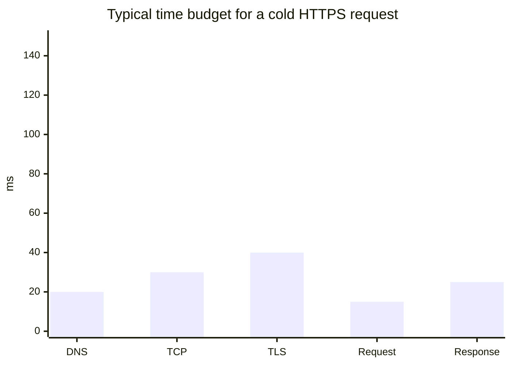
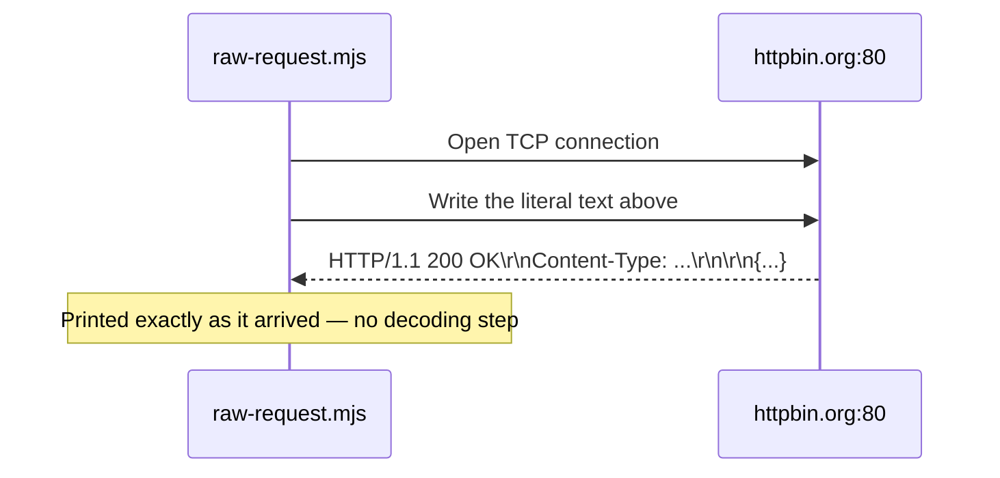
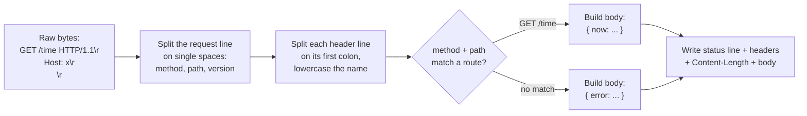
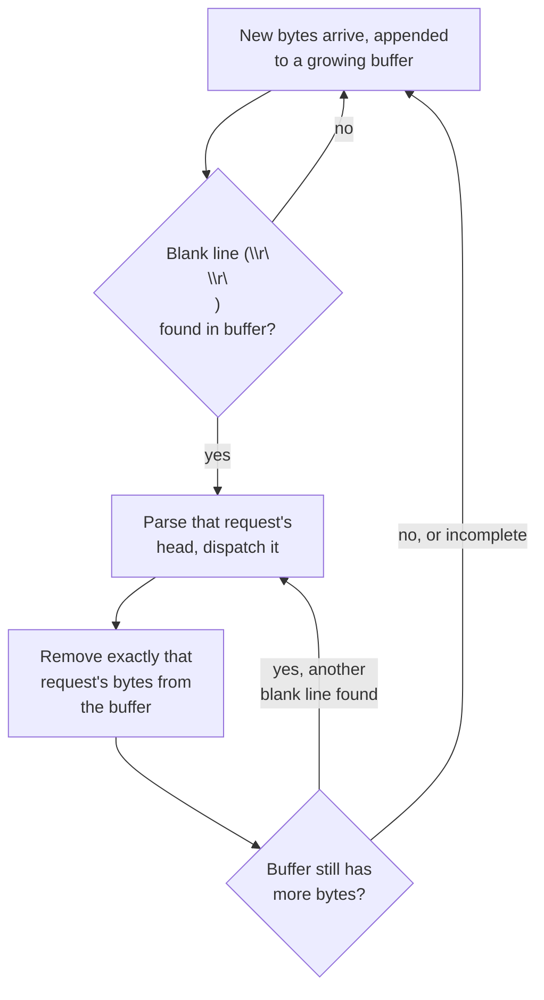

import LevelIntro from "../../../components/LevelIntro.astro";
import Checkpoint from "../../../components/Checkpoint.astro";
import PracticeCheck from "../../../components/PracticeCheck.astro";

export const unit = {
  track: "web",
  unitSlug: "http-request-response-basics",
};

L1 and L2 established the shape of an HTTP exchange and the mental model behind it. This level proves the "it's just text" claim with the smallest code that still runs, then walks through the failure modes a real server has to defend against — mostly via diagrams and worked reasoning, since the mechanism in each case is about _sequence and timing_, not an algorithm worth implementing from scratch.

<LevelIntro
  items={[
    "A raw request, no framework",
    "How a server's own loop actually parses one",
    "Four real parser failure modes",
  ]}
/>

## Where the time actually goes

Before writing a single byte of parser code, it's worth knowing what a "slow request" is even competing against. A cold HTTPS request (no cached DNS, no existing connection) spends its time roughly like this before your server logic even runs:



TLS is usually the single biggest fixed cost on a cold connection — more than DNS and the TCP handshake combined. This is exactly why HTTP/1.1 keep-alive (and connection pooling in general) matters so much in practice: paying the DNS+TCP+TLS setup cost once and reusing the connection for many requests amortizes that ~90ms of setup across all of them, instead of paying it again every time.

## Is "HTTP is just text over TCP" actually true, or just a simplification for beginners?

It's literally true — provable with five lines, no framework, no `fetch`, no `http` module. Just a TCP socket and the exact request string from L2, using Node's `net` module (works identically under `bun run`):

```js
import { createConnection } from "node:net";

const socket = createConnection({ host: "httpbin.org", port: 80 }, () => {
  socket.write(
    "GET /get HTTP/1.1\r\nHost: httpbin.org\r\nConnection: close\r\n\r\n",
  );
});
socket.on("data", (chunk) => console.log(chunk.toString()));
```



Run it and the output is the response's status line, headers, and body, printed exactly as they arrived on the wire — proof that a browser, `curl`, and this five-line script are all doing the same thing at the protocol level: opening a TCP connection and exchanging text that follows a specific grammar. Nothing in this unit depends on reading or writing more code than that; the rest of this level is about the sequencing and edge cases around that exchange, not about building a bigger version of it.

Every header line matters. `Host` isn't optional in HTTP/1.1 — a single server process often answers for many domains (virtual hosting), and `Host` is the only thing in the request that says which one. Drop it and compliant servers must respond `400 Bad Request`.

<Checkpoint question="If you deleted the Host: httpbin.org line from the raw-request.mjs script above and this were hitting a server doing virtual hosting, what would you expect back?">

A `400 Bad Request` — not the article/data you were asking for. `Host` is the only part of the request that tells a virtual-hosting server which of its many domains you meant; without it, a compliant server can't route the request at all, so it rejects it outright rather than guessing.

</Checkpoint>

## If frameworks hide all this parsing, what exactly are they hiding?

Frameworks hide the parsing, but the parsing is where the interesting edge cases live — hiding it doesn't make the edge cases go away, it just moves them somewhere you can't see. Follow a single concrete request, `GET /time`, through the L2 loop:



Three small jobs are doing all the real work here, and each is worth being able to reason about precisely, even without writing a parser from scratch: splitting a request line into its three fields (no library needed — the three fields are separated by single spaces, in a fixed order), turning raw header lines into a case-insensitive lookup (header names aren't guaranteed to arrive in the same casing twice), and making sure a response's `Content-Length` genuinely matches the bytes written after it, not the bytes some earlier, now-stale version of the body would have had.

<PracticeCheck
  track={unit.track}
  unitSlug={unit.unitSlug}
  topicId="parse-request-line"
/>

<PracticeCheck
  track={unit.track}
  unitSlug={unit.unitSlug}
  topicId="parse-headers"
/>

<PracticeCheck
  track={unit.track}
  unitSlug={unit.unitSlug}
  topicId="build-response"
/>

## Which of these four mistakes would still pass a quick smoke test on localhost?

All of them, which is exactly what makes them dangerous — a naive parser that works perfectly against `curl http://localhost` in a demo can still walk straight into every one of these under real network conditions or real attacker input:

**1. Trusting `Content-Length` without validating it against what's actually written.** If `buildResponse` computed `Content-Length` from the wrong string (say, the object before `JSON.stringify` instead of after), clients reading exactly that many bytes would either truncate the JSON or hang waiting for bytes that never arrive, because the receiver stops reading once it has read `Content-Length` bytes — it has no other way to know the message ended. This is why `Buffer.byteLength(body)` — not `body.length`, which counts UTF-16 code units, not bytes — is used above; a body with multi-byte UTF-8 characters would otherwise get a wrong count and every response with non-ASCII content would be silently truncated for the client.

<PracticeCheck
  track={unit.track}
  unitSlug={unit.unitSlug}
  topicId="byte-length"
/>

**2. Header injection via unsanitized values.** If a handler ever does something like:

```js
// DON'T DO THIS
headers += `Location: ${userSuppliedRedirectUrl}\r\n`;
```

and `userSuppliedRedirectUrl` contains a literal `\r\n`, an attacker can inject arbitrary extra headers — or an entire second response — into the stream. This is CRLF injection / HTTP response splitting. The fix is never string-concatenating untrusted input into a raw header block; use a library (or, as here, values that are never attacker-controlled) that rejects or strips `\r`/`\n` from header values before they're written.

<PracticeCheck
  track={unit.track}
  unitSlug={unit.unitSlug}
  topicId="sanitize-header-value"
/>

**3. Not handling partial reads.** TCP makes no promise that one `write()` on the client arrives as one `data` event on the server — a request can arrive split across multiple chunks, or multiple pipelined requests can arrive in a single chunk. A correct parser keeps accumulating bytes into a growing buffer and keeps re-checking for a complete head, rather than assuming the first chunk it receives is the whole request. A parser that assumes one chunk equals one full request will intermittently — and only under real network conditions, never in a fast localhost test — truncate requests.

<PracticeCheck
  track={unit.track}
  unitSlug={unit.unitSlug}
  topicId="find-header-boundary"
/>

**4. Not bounding how much you'll buffer.** A parser that keeps appending incoming bytes to that buffer forever, if a client sends headers but never sends the terminating `\r\n\r\n`, has no defense against a single slow or malicious client exhausting memory. A production server needs a maximum header size and a read timeout (this is the shape of a "slowloris" attack: open many connections, send headers one byte at a time, never finish).

| #   | Failure mode                            | Real symptom                                      | Fix                                                           |
| --- | --------------------------------------- | ------------------------------------------------- | ------------------------------------------------------------- |
| 1   | Wrong `Content-Length`                  | Truncated or hung response for non-ASCII bodies   | Compute length from the real UTF-8 bytes, after serialization |
| 2   | Unsanitized header values               | CRLF injection / response splitting               | Strip or reject `\r`/`\n` before writing any header value     |
| 3   | Assuming one `data` event = one request | Intermittent truncation under real network jitter | Buffer and re-check for a complete head on every chunk        |
| 4   | Unbounded header buffering              | Memory exhaustion (slowloris-style)               | Cap header size, enforce a read timeout                       |

<Checkpoint question="A server that only ever uses Connection: close has each socket carry exactly one request. Which of the four failure modes in the table does that coincidentally hide, that switching to keep-alive would immediately expose?">

Failure mode #3, not handling partial reads across multiple pipelined requests. With `Connection: close`, the buffer only ever needs to hold one request's worth of bytes before the socket ends, so a parser that's a little sloppy about re-synchronizing on request boundaries can still happen to work. Under keep-alive, several requests can arrive back-to-back on the same socket — now the parser has to correctly find where one request's bytes end and the next one's begin every single time, or it silently corrupts every request after the first.

</Checkpoint>

## Worked example: keep-alive changes the loop

A server using `Connection: close` has it easy — one request per connection, then the socket closes, so "where does this request end" is answered by the connection itself ending. HTTP/1.1 defaults to keep-alive instead: the server must go back to _waiting for another request_ on the same socket rather than closing, so it has to track where one request ends and the next begins inside one continuous byte stream, using nothing but the signals from L1 (the blank line) and L2 (`Content-Length`/chunked):



This is the detail that trips up most from-scratch HTTP parsers: keep-alive turns "one request per connection" into "an unbounded stream of requests per connection," and the parser has to re-synchronize on request boundaries itself — peeling off exactly one request's bytes at a time and checking what's left — instead of relying on the connection closing to mark the end. A single incoming chunk can legitimately contain one request, zero complete requests (a partial one, held until more bytes arrive), or several pipelined ones back to back.

The `/time` example earlier only handles a bodyless `GET`. **What would change if a route needed to accept a request body** (say, a `POST /articles` that creates a resource from a JSON payload)? At minimum: check for `Content-Length` once the head is parsed, keep buffering past the blank line until that many body bytes have arrived, and only then dispatch — the same "don't assume the bytes you have are the whole message" discipline this unit already applied to headers, extended to the body.

## Where HTTP stops and rendering begins

This unit's boundary is deliberately narrow: HTTP explains how a browser and a
server exchange messages. It covers the request line, headers, body, status
line, connection reuse, and the failure modes that appear when bytes are parsed
incorrectly. It does not, by itself, explain why a `<button>` is accessible,
why one CSS rule wins over another, why a click bubbles, why JavaScript gets
bundled, or why changing the DOM can still be slow.

The bridge is this: HTTP can deliver `index.html`, `styles.css`, `app.js`,
images, and fonts. After those responses arrive, the browser takes over:
semantic HTML shapes the DOM and accessibility tree, CSS cascade rules decide
computed styles, JavaScript listens to DOM events, bundled assets determine how
many files and bytes must be requested, and render performance depends on what
DOM/CSS changes force the browser to recalculate before it can paint.

For the next internal steps, connect this unit to
[TLS/HTTPS](/security/tls-https/) for the encrypted layer under HTTPS,
[HTML semantics](/web/need-html-semantics-just-divs/) for what the delivered
markup means, [CSS cascade](/web/css-cascade-specificity/) for how styles are
chosen, [DOM events](/web/dom-event-model/) for browser-side interaction,
[bundling](/web/bundling/) for how many resource requests modern apps produce,
and [render performance](/web/render-performance/) for the layout/repaint work
that turns parsed resources into visible pixels.
