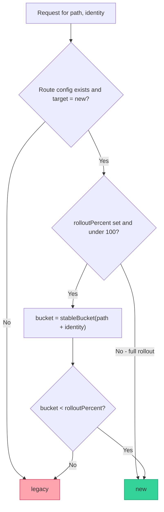
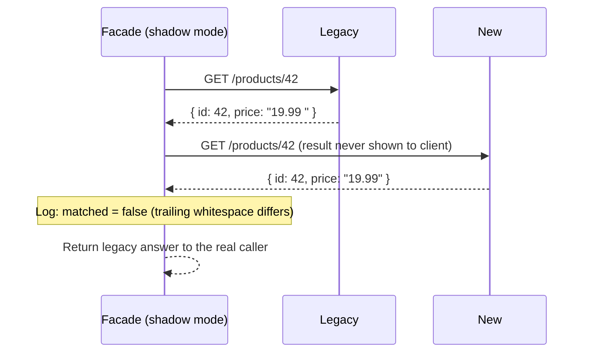

import Scenario from "../../../components/Scenario.astro";
import LevelIntro from "../../../components/LevelIntro.astro";
import Checkpoint from "../../../components/Checkpoint.astro";
import PracticeCheck from "../../../components/PracticeCheck.astro";

export const unit = {
  track: "web",
  unitSlug: "strangler-fig",
};

<Scenario label="The problem">
  <Fragment slot="facts">
    <div class="not-prose flex flex-col gap-2 text-sm text-slate-700 dark:text-slate-300">
      <div class="flex items-center gap-1.5"><span>🧵</span> <strong>Sticky routing</strong> — same user must not flip mid-session</div>
      <div class="flex items-center gap-1.5"><span>👥</span> <strong>Percentage rollout</strong> — 5% of catalog traffic on "new" this week</div>
      <div class="flex items-center gap-1.5"><span>🔁</span> <strong>Shadow diff</strong> — legacy answer returned, new answer only logged</div>
    </div>
  </Fragment>

A PR lands implementing "the facade" as a single `if (Math.random() < percentage)` check per request. It technically routes some traffic to the new system. In code review, someone asks what happens when the same logged-in user hits `GET /cart` twice in the same page load — once during checkout, once refreshing the page a second later. With pure `Math.random()`, that user can get the legacy cart on one request and the new (still-being-verified) cart on the next, inside a single session, and see their own cart look different depending on which coin flip fired.

**Is a random percentage check actually a correct strangler fig facade, or does it silently break the one property (a client shouldn't be able to tell, or be affected by, which system answered) the pattern depends on?**

</Scenario>

It's not correct as written — not because percentage-based rollout is
wrong, but because _unstable_ percentage-based rollout is. The fix isn't
routing on a fresh random number every request; it's routing on something
stable per identity (a user id, a session id) so the same actor always
lands on the same system for the duration of a rollout stage. This level
builds a real routing decision that gets that right, plus a shadow-diff
discipline that proves a migrated route agrees with the system it's
replacing.

<LevelIntro
  items={[
    "A real routing decision with stable, per-identity rollout",
    "Shadow-diff evidence: what a team actually watches",
    "Failure modes: split state, sticky sessions, and rollback drills",
  ]}
/>

## Building a stable rollout

The routing decision's job, precisely: given a route and a caller identity,
decide `legacy` or `new`, and do it the same way for the same identity every
time a given rollout percentage is in effect. The building block for that
is a deterministic hash of the identity into a stable bucket, not a fresh
random draw per call.

```ts
// A deterministic 0-99 bucket for a string, so the same identity always
// maps to the same bucket for a given rollout stage — no per-request coin flip.
function stableBucket(identity: string): number {
  let hash = 0;
  for (let i = 0; i < identity.length; i++) {
    hash = (hash * 31 + identity.charCodeAt(i)) | 0;
  }
  return Math.abs(hash) % 100;
}
```



Two design choices are worth defending in a review. First, the bucket is
keyed by `path + identity`, not just `identity` — a user can be in the
"new" bucket for `GET /products` while still in the "legacy" bucket for
`POST /orders`, because each route earns its own rollout independently and
one route's bucket assignment shouldn't leak into another's. Second, an
unset or `legacy`-flagged route falls through to `legacy` by default — a
brand-new route nobody has explicitly configured yet is automatically safe,
never accidentally served by unproven code just because nobody flipped a
switch for it.

<Checkpoint question="Why hash on path + identity with a deterministic function instead of storing 'this user is on the new system' as a boolean flag per user in a database?">

Both give stability, but the hash approach needs no storage, no migration
of its own, and no extra network call on the hot path — the routing
decision is a pure computation available instantly for any identity,
including one the facade has never seen before. A per-user flag in a
database would need to be provisioned for every user ahead of time (or
default somewhere, which just reintroduces the same problem one level
down), adds a read on every request, and becomes another piece of state
that can drift out of sync with the rollout percentage a team actually
intends. The hash trades a small amount of precision — you can't hand-pick
exactly which individual users are in the 5%, only that some stable-but-
effectively-random 5% are — for zero operational overhead, which is the
right trade for a mechanism meant to be flipped often and rolled back fast.

</Checkpoint>

<PracticeCheck
  track={unit.track}
  unitSlug={unit.unitSlug}
  topicId="stable-bucket"
/>

## Turning the decision into a function

```ts
function resolveTarget(
  bucket: number,
  rolloutPercent: number | undefined,
): "legacy" | "new" {
  if (rolloutPercent === undefined || rolloutPercent >= 100) return "new";
  if (rolloutPercent <= 0) return "legacy";
  return bucket < rolloutPercent ? "new" : "legacy";
}
```

Keeping `resolveTarget` a small, pure function — no I/O, no class state,
just numbers in and a label out — is itself a defense: the facade sits in
front of both systems, so a bug in the routing decision itself (not either
backend) can take down 100% of traffic on a route that was otherwise
healthy on both sides. The routing decision should be the most boring, most
unit-tested code in the entire migration, precisely because every route's
traffic passes through it.

<PracticeCheck
  track={unit.track}
  unitSlug={unit.unitSlug}
  topicId="resolve-target"
/>

## Proving equivalence before flipping the switch

L2 introduced shadowing conceptually. Here's what a team actually watches:
call both backends, return the legacy answer to the caller, and record
whether the new system's answer matched.



| Metric          | What it answers                                           |
| --------------- | --------------------------------------------------------- |
| Match rate      | Of everything shadowed, what fraction agreed with legacy? |
| Mismatches list | Which specific calls disagreed, and how?                  |

Match rate is the number a team watches on a dashboard before flipping a
route's rollout percentage above 0 — not "does it pass our test suite," but
"does it agree with production on production's own traffic shape," which
is a strictly harder and more honest bar. The mismatches list matters just
as much: every disagreement is a concrete, replayable bug report against
the new system, generated for free by traffic that would have happened
anyway.

## Worked example: shadowing `GET /products/:id`

| Field   | Legacy answer               | New answer          | Matched? |
| ------- | --------------------------- | ------------------- | -------- |
| `id`    | 42                          | 42                  | yes      |
| `price` | `"19.99 "` (trailing space) | `"19.99"` (trimmed) | **no**   |

This is a deliberately realistic mismatch, not a contrived one: the new
system is arguably _more_ correct (no stray whitespace), but "more correct"
still fails a strangler fig migration if any downstream caller does an
exact string comparison against the legacy format. The shadow log surfaces
that disagreement before it ships, giving the team a choice — fix the
legacy-compatible serialization in the new system, or confirm no caller
actually depends on the trailing space and accept the diff — instead of
finding out from a support ticket after the route is flipped to `new`.

<Checkpoint question="The match rate for GET /products/:id sits at 100% for two straight weeks. Is that alone enough to flip rolloutPercent to 100?">

Not by itself — a 100% match rate only proves the new system agrees with
the old one _on the traffic that actually occurred_ during those two weeks.
It says nothing about paths that traffic hasn't exercised yet: a
low-frequency query parameter, a product with unusual data (null price, a
non-ASCII name), or a load spike the shadow period never saw. A high match
rate over a long enough window with genuinely representative traffic is
strong evidence, but "flip to 100%" is still a judgment call weighing that
evidence against how catastrophic an undiscovered gap would be for this
particular route — which loops back to L2's point about migrating
low-blast-radius routes first, so the routes with the least forgiving
failure modes are the ones with the most accumulated evidence behind them.

</Checkpoint>

<PracticeCheck
  track={unit.track}
  unitSlug={unit.unitSlug}
  topicId="shadow-evidence"
/>

## Failure modes worth defending against in review

**Split state across systems.** If `POST /orders` writes to a new
database while `GET /orders/:id` still reads from the legacy one (because
they were migrated on different days), an order placed through the new
system can be invisible to a read immediately afterward. The fix is never
"migrate faster" — it's sequencing: a write path and every read path that
depends on its data move together, or the new write path also
dual-writes to the legacy store until every dependent read is migrated
too.

**Non-idempotent rollback and which routes can even be shadowed for free.**
Flipping a route back to `legacy` is safe for `GET` requests by
construction — nothing was ever created or changed, so shadowing them (and
rolling them back) has no real side effect to worry about.

| Method                           | Safe to shadow "for free"?                                   | Rollback is...                                                                       |
| -------------------------------- | ------------------------------------------------------------ | ------------------------------------------------------------------------------------ |
| `GET`, `HEAD`                    | Yes — no side effect                                         | Instant and complete                                                                 |
| `POST`, `PUT`, `DELETE`, `PATCH` | No — calling the new system for real would double the effect | Not automatically safe — a already-charged card or already-written row stays changed |

A `POST /orders` that already charged a card on the new system before a
flip is not undone by flipping the route back — routing the _next_ request
to legacy doesn't roll back what the _previous_ one already did. Any
mutating route needs a compensating action (a refund, a cancellation)
defined _before_ it's migrated, not improvised during an incident, and
usually needs a different verification strategy than shadowing (a sandbox
copy of the new system, or a small rollout percentage plus fast rollback)
since its write path can't be called "for free" just to compare answers.

<PracticeCheck
  track={unit.track}
  unitSlug={unit.unitSlug}
  topicId="safe-defaults"
/>
<PracticeCheck
  track={unit.track}
  unitSlug={unit.unitSlug}
  topicId="mutating-routes"
/>

## Extend the example yourself

The worked example above shadows a single read-only route with two
identities. Two natural extensions worth working through: what changes if
a route needs to shadow a _mutating_ route like `POST /orders`, where you
can't simply call the new system's write path "for free" without it having
a real side effect — would you shadow against a sandbox copy of the new
system, or skip shadowing for writes and rely on a smaller rollout
percentage plus fast rollback instead? And what changes if `stableBucket`'s
hash collides in a way that clusters an unusually large customer's traffic
entirely into one bucket — how would you detect that before it biases a
rollout's results?
